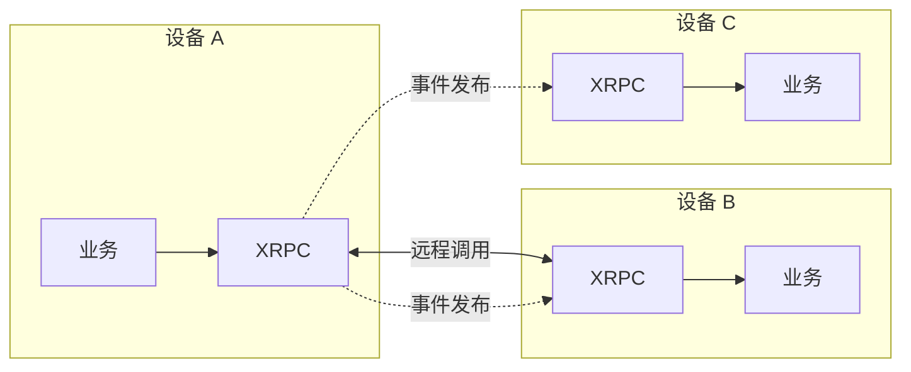
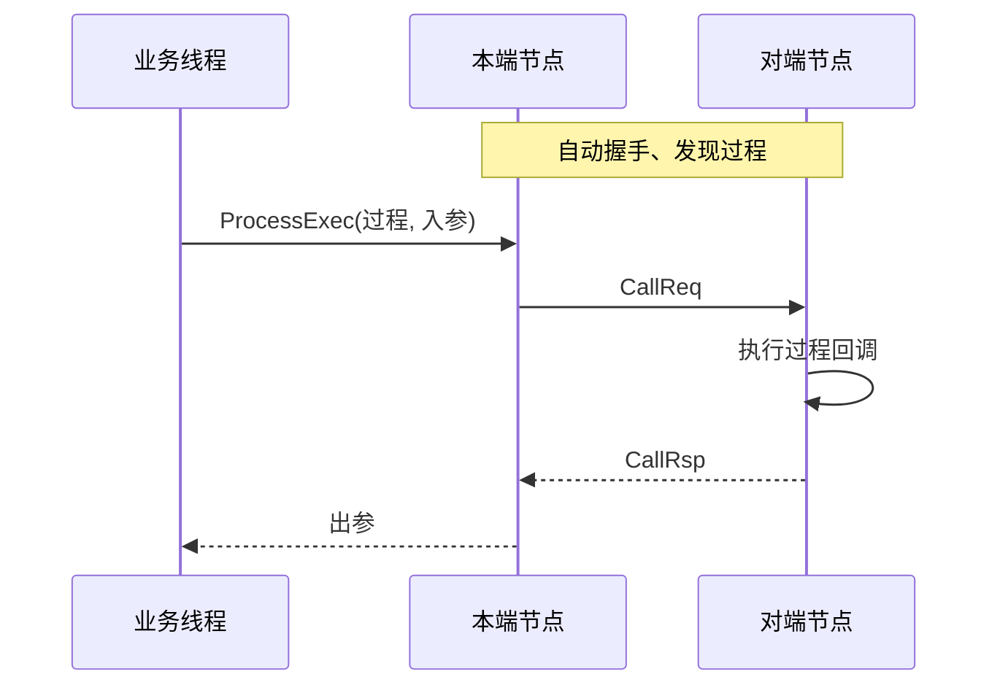

# XRPC

> 版本 0.9.0（预览）：PC 验证通过，尚未在真机上验证，接口和协议还可能改。更新记录见 [CHANGELOG](CHANGELOG.md)。

XRPC 是面向嵌入式的 C 语言通信组件。在任何能收发字节的链路和总线上，让设备之间**像调函数一样互相调用**，并能**发布和订阅事件**。

生成工具自带串口、TCP 和 Windows 命名管道的链路模板，USB 虚拟串口走串口模板。其他链路实现 `IXrpcLink` 即可接入，见 [适配说明](port/README.md)。



## 特点

| 特点 | 说明 |
| --- | --- |
| 零动态内存 | 纯 C，所有缓冲区由调用方提供 |
| 链路无关 | 实现 4 个回调就能接入新链路 |
| 点对点和总线 | 同一套接口，总线上自动寻址 |
| 服务中继 | 没有直连的节点也能互相调用，中间节点自动发现并转发 |
| 同步与异步调用 | 异步调用发出就返回，同一过程可以并发 |
| 事件发布订阅 | 可要求应答、超时补发、失败回调，支持观察者 |
| 自动恢复 | 自动握手、发现、断线重连后重新发现 |
| 健壮的帧处理 | 流式拼帧、CRC16、错误后重新对齐 |

## 跨节点调用

调用方只管说"我要调用 X"，不需要知道 X 在哪个节点、隔了几跳。中间节点开启服务中继后，自动发现提供者并转发，调用方和提供者都不用改。


## 工作方式



## 目录

| 路径 | 说明 |
| --- | --- |
| `common/` | 核心库，公开头文件在 `common/include/xrpc/` |
| `tools/` | 代码生成和诊断工具：适配代码、接口代码、协议解码、PC 调试节点 |
| `port/` | 平台适配说明 |
| `docs/` | 使用说明、设计文档、路线图 |

测试工程和 demo 不在公开仓库。

## 快速开始

要先装好 Python 3、CMake、Ninja 和 GCC。用自带的两节点例子生成 PC 仿真并编译：

```bash
python tools/xrpc_net_gen.py check tools/examples/net_demo.yaml
```

```bash
python tools/xrpc_net_gen.py sim tools/examples/net_demo.yaml --out out/net_demo
```

```bash
cmake -S out/net_demo -B out/net_demo/build -G Ninja
```

```bash
cmake --build out/net_demo/build
```

在生成的 `api/*_impl.c` 和 `xrpc_sim_app.c` 里写上业务就能运行，完整步骤见[上手指南](docs/XRPC上手指南.md)第 3 关。集成到项目：用[代码生成工具](tools/README.md)生成适配代码和接口代码，详见[使用说明](docs/XRPC使用说明.md)。

## 文档

| 文档 | 给谁看 |
| --- | --- |
| [上手指南](docs/XRPC上手指南.md) | 第一次接触，从编译走到部署 |
| [使用说明](docs/XRPC使用说明.md) | 要把 XRPC 集成到项目的开发者 |
| [协议规范](docs/XRPC协议规范.md) | 要用别的语言实现 XRPC，或分析线上数据 |
| [设计文档](docs/XRPC设计文档.md) | 要修改 XRPC 的开发者 |
| [路线图](docs/ROADMAP.md) | 了解进度和决策 |
| [工具说明](tools/README.md) | 用生成工具快速部署、定义接口，用诊断工具联调 |
| [贡献指南](CONTRIBUTING.md) | 提交改动、发布版本 |

## 约束

- 同步调用会等待应答，**必须**和 `RunOnce` 在不同线程
- 调用线程与 `RunOnce` 线程不同时，节点锁必须注入
- 过程回调、事件回调、完成回调都在轮询线程执行，不能阻塞
- RPC 不做重传去重，超时不能撤销对端的执行
- 不提供加密与鉴权

## 许可证

暂未指定许可证，保留所有权利。
