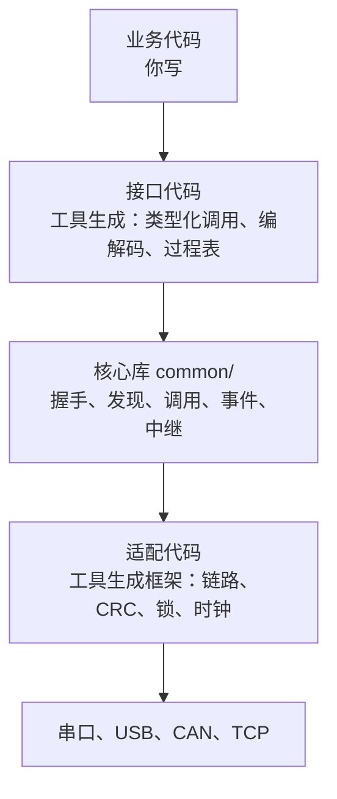
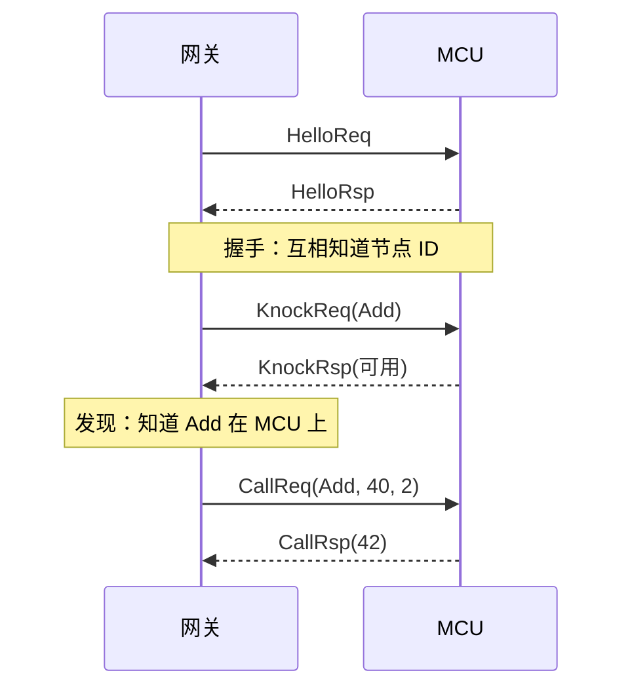
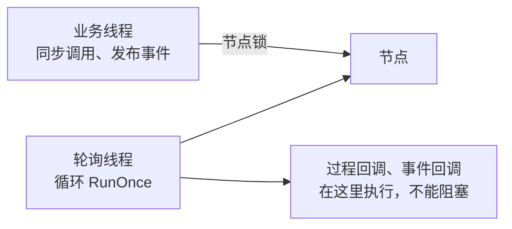
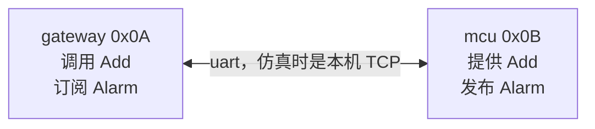
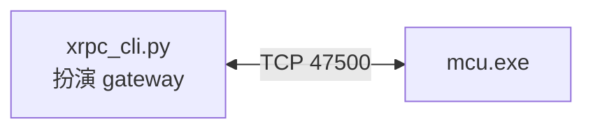
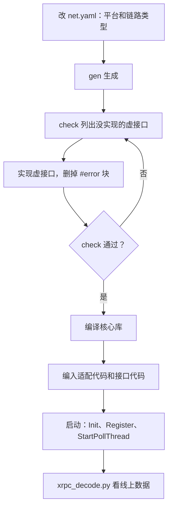
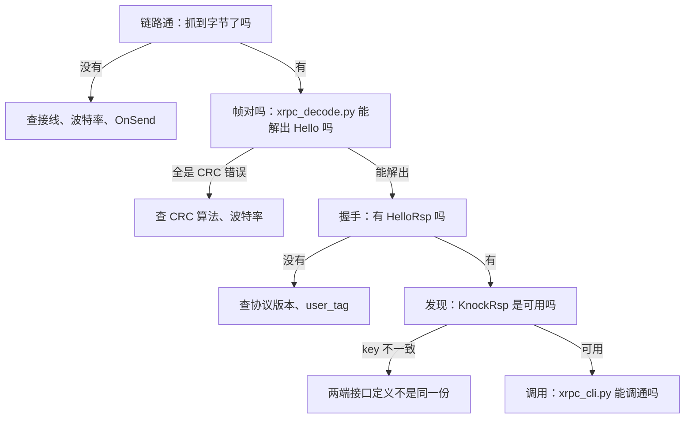

# XRPC 上手指南

从零开始走一遍：认识组件、编译核心库、写第一个例子、用工具调试、部署到设备。第 2 到第 5 关约一小时。

每关都有“应该看到”。所有命令都在仓库根目录下运行过，产物放在 `out/guide`，不进 git。


要先装好 Python 3、CMake、Ninja 和 GCC。检查一下：

```bash
python --version
```

```bash
cmake --version
```

```bash
ninja --version
```

```bash
gcc --version
```

## 第 1 关：认识组件

XRPC 让设备之间像调函数一样互相调用，并能发布和订阅事件。它不管字节怎么传，链路由你提供。

### 三件事

| 能力 | 什么时候用 | 例子 |
| --- | --- | --- |
| 同步或异步调用 | 要结果 | 网关问 MCU 当前电压 |
| 事件 | 主动上报，可以一对多 | MCU 上报报警 |
| 中继 | 两个节点没有直连 | 手机隔着网关调用 MCU |

### 分层



你只写业务代码，以及模板没覆盖的适配代码。

### 一次调用发生了什么



握手和发现是自动的，业务只管调用。所以刚启动时调用可能返回 `-12`（提供者未知），第 3 关会看到。

### 线程规则

这是最容易出错的地方，先记住：



| 规则 | 违反时的现象 |
| --- | --- |
| 同步调用不能在轮询线程里发起 | 调用总是超时 |
| 回调不能阻塞 | 整个节点收发停住 |
| 多线程时必须注入节点锁 | 偶发错乱 |

## 第 2 关：编译核心库

先确认环境没问题：用例子配置生成一份适配代码，再把核心库编译出来。

```bash
python tools/xrpc_port_gen.py generate tools/examples/port_custom.yaml --out out/guide/port
```

```bash
cmake -S . -B out/guide/lib -G Ninja -DXRPC_PORT_DIR=out/guide/port/port_include
```

```bash
cmake --build out/guide/lib
```

**应该看到** `Linking C static library libxrpc.a`。核心库只依赖适配目录里的 `xrpc_port.h`，生成的适配代码里还有没实现的虚接口，第 5 关再处理。

## 第 3 关：写第一个例子

做两个节点：网关调用 MCU 的 `Add`，MCU 每 2 秒向网关上报 `Alarm`。先在 PC 上用 TCP 仿真，不需要硬件。



### 3.1 写网络描述

新建 `out/guide/net.yaml`：

```yaml
module: guide
crc16: ccitt_false

nodes:
  - {name: mcu, id: 0x0B}
  - {name: gateway, id: 0x0A}

links:
  - name: uart
    connect:
      mcu: {name: to_gateway}
      gateway: {name: to_mcu}

processes:
  - name: Add
    id: 0x00001001
    provider: mcu
    callers: [gateway]
    input:
      - {id: 1, name: a, type: i32}
      - {id: 2, name: b, type: i32}
    output:
      - {id: 1, name: sum, type: i32}

notifies:
  - name: Alarm
    id: 0x00002001
    publisher: mcu
    subscribers: [gateway]
    need_ack: true
    timeout_ms: 300
    retry: 2
    params:
      - {id: 1, name: code, type: u32}
```

只写节点、链路、过程和事件。中继、转发表、缓冲大小都由工具算出来。

### 3.2 检查并生成

```bash
python tools/xrpc_net_gen.py check out/guide/net.yaml
```

**应该看到** `检查通过：2 个节点，1 条链路，1 个过程，1 个事件`。

```bash
python tools/xrpc_net_gen.py sim out/guide/net.yaml --out out/guide/sim --base-port 47500
```

每个节点得到一个目录：

| 路径 | 内容 | 重新生成时 |
| --- | --- | --- |
| `<节点>/port/` | 适配代码 | 覆盖 |
| `<节点>/api/guide_xrpc.h/.c` | 接口代码 | 覆盖 |
| `<节点>/api/guide_xrpc_impl.c` | **你写**：过程和事件回调 | 保留 |
| `<节点>/xrpc_sim_app.c` | **你写**：业务入口 | 保留 |
| `report.md` | 拓扑、路径、容量 | 覆盖 |

### 3.3 写 MCU 的业务

把 `out/guide/sim/mcu/api/guide_xrpc_impl.c` 里的 `GuideProvideAdd` 改成：

```c
Int32 GuideProvideAdd(const TGuideAddIn *input, TGuideAddOut *output)
{
    output->sum = input->a + input->b;

    return kXrpcErrOk;
}
```

把 `out/guide/sim/mcu/xrpc_sim_app.c` 整个换成：

```c
#include "xrpc_port_node.h"
#include "xrpc/xrpc.h"
#include "guide_xrpc.h"

#include <stdio.h>

static void L_OnDone(TXrpcNode *node, const TXrpcNotifyResult *result, void *user_data)
{
    (void)node;
    (void)user_data;
    printf("Alarm 序号 %u：%s\n", (unsigned)result->seq,
           (result->code == kXrpcNotifyOk) ? "已应答" : "未应答");
    fflush(stdout);
}

void XrpcSimPrepare(void)
{
}

int XrpcSimRun(void)
{
    TGuideAlarmParams params;
    UInt32 code = 0U;

    for (;;)
    {
        XrpcSleepMs(2000U);
        params.code = ++code;
        (void)GuidePublishAlarm(XrpcPortNode(), &params, NULL, L_OnDone, NULL);
    }

    return 0;
}
```

### 3.4 写网关的业务

把 `out/guide/sim/gateway/api/guide_xrpc_impl.c` 的回调改成下面这样，并在文件开头加 `#include <stdio.h>`：

```c
void GuideOnAlarm(UInt32 publisher, UInt32 seq, const TGuideAlarmParams *params)
{
    printf("收到 Alarm：发布方 0x%02X，序号 %u，code=%u\n",
           (unsigned)publisher, (unsigned)seq, (unsigned)params->code);
    fflush(stdout);
}
```

把 `out/guide/sim/gateway/xrpc_sim_app.c` 整个换成：

```c
#include "xrpc_port_node.h"
#include "xrpc/xrpc.h"
#include "guide_xrpc.h"

#include <stdio.h>

void XrpcSimPrepare(void)
{
}

int XrpcSimRun(void)
{
    TGuideAddIn input = {40, 2};
    TGuideAddOut output;
    Int32 result = 0;

    for (;;)
    {
        result = GuideProcessAdd(XrpcPortNode(), &input, &output, 1000U, 0U);
        if (result >= 0)
        {
            printf("Add(%d, %d) = %d\n", input.a, input.b, output.sum);
        }
        else
        {
            printf("Add 失败：%d\n", result);
        }
        fflush(stdout);
        input.a++;
        XrpcSleepMs(1000U);
    }

    return 0;
}
```

### 3.5 编译运行

```bash
cmake -S out/guide/sim -B out/guide/sim/build -G Ninja
```

```bash
cmake --build out/guide/sim/build
```

开两个终端，启动顺序不限：

```bash
out/guide/sim/build/mcu.exe
```

```bash
out/guide/sim/build/gateway.exe
```

**应该看到**网关一侧（`[xrpc W]` 开头的是组件日志）：

```text
Add 失败：-12
Add(41, 2) = 43
收到 Alarm：发布方 0x0B，序号 524909219，code=1
Add(42, 2) = 44
```

MCU 一侧：

```text
Alarm 序号 524909219：已应答
```

| 看到的现象 | 为什么 |
| --- | --- |
| 第一次 `Add 失败：-12` | 正常。提供者还没发现，下一次就成功了 |
| 事件序号很大 | 正常。初值取启动时的 tick，防止重启后被当成重复事件 |
| 关掉网关后 MCU 打印“未应答” | 正常。这正是“需要应答”的事件在起作用 |

按 Ctrl+C 停掉**网关**，保留 MCU，进入下一关。

## 第 4 关：用工具调试

### 4.1 不写 C 就调用设备



TCP 模板一次只接受一个连接，所以要先停掉网关。

```bash
python tools/xrpc_cli.py --api out/guide/net.yaml --tcp 127.0.0.1:47500 --node-id gateway call Add a=40 b=2
```

**应该看到**：

```text
已连接 mcu(0x0B)
成功 sum=42
```

接收事件并应答，运行 5 秒：

```bash
python tools/xrpc_cli.py --api out/guide/net.yaml --tcp 127.0.0.1:47500 --node-id gateway listen --seconds 5
```

**应该看到**：

```text
mcu(0x0B) -> NotifyEvent Alarm origin=mcu(0x0B) seq=524934767 need_ack (code=2) seq=10 ttl=255
```

两次运行之间隔一两秒，让 MCU 重新进入监听。

### 4.2 看线上到底发了什么

把解码代理串在中间。开一个终端运行：

```bash
python tools/xrpc_decode.py --api out/guide/net.yaml --tcp-proxy 47600:127.0.0.1:47500
```

另一个终端让调试节点连代理：

```bash
python tools/xrpc_cli.py --api out/guide/net.yaml --tcp 127.0.0.1:47600 --node-id gateway call Add a=1 b=2
```

**应该看到**代理打印完整的一次交互，和第 1 关的时序图一一对应：

```text
#1 [>] gateway(0x0A) -> HelloReq seq=1 ttl=255
#2 [<] mcu(0x0B) -> HelloReq seq=13 ttl=255
#3 [>] gateway(0x0A) -> HelloRsp seq=2 ttl=255
#4 [<] mcu(0x0B) -> HelloRsp seq=14 ttl=255
#5 [>] gateway(0x0A) -> KnockReq Add seq=3 ttl=255
#6 [<] mcu(0x0B) -> KnockRsp req_seq=3 Add 可用 seq=15 ttl=255
#7 [>] gateway(0x0A) -> CallReq Add(a=1, b=2) seq=4 ttl=255
#8 [<] mcu(0x0B) -> CallRsp req_seq=4 Add ok sum=3 seq=16 ttl=255
```

真机联调时，把串口监听软件存下的数据交给它：

```bash
python tools/xrpc_decode.py capture.bin --api out/guide/net.yaml
```

### 4.3 用图形界面

```bash
python tools/xrpc_tool_gui.py
```

打开第 4 页“全网生成”，点“打开”选 `out/guide/net.yaml`，点“检查”。下面的表会列出节点、中继和帧缓冲，界面的生成结果和命令行完全相同。

### 4.4 改一次接口

在 `net.yaml` 的 `Add` 下面加一个过程，再运行一次 3.2 的 `sim` 命令：

```yaml
  - name: Sub
    id: 0x00001002
    provider: mcu
    callers: [gateway]
    input:
      - {id: 1, name: a, type: i32}
      - {id: 2, name: b, type: i32}
    output:
      - {id: 1, name: diff, type: i32}
```

打开 `mcu/api/guide_xrpc_impl.c`，你写的 `Add` 还在，末尾多了 `GuideProvideSub` 的骨架。这就是日常改接口的方式。

## 第 5 关：部署到设备

### 5.1 从仿真到真机只改网络描述

| 改动 | 仿真 | 真机 |
| --- | --- | --- |
| 生成命令 | `sim` | `gen` |
| 链路 | 全部换成本机 TCP | 按 `type` 生成 |
| 业务代码 | 同一份 | 同一份 |



把网关配成 Linux、串口链路：

```yaml
nodes:
  - {name: mcu, id: 0x0B}
  - {name: gateway, id: 0x0A, platform: posix}

links:
  - name: uart
    connect:
      mcu: {name: to_gateway}
      gateway: {name: to_mcu, type: serial, device: /dev/ttyUSB0, baud: 460800}
```

```bash
python tools/xrpc_net_gen.py gen out/guide/net.yaml --out out/guide/gen
```

### 5.2 看还差什么

```bash
python tools/xrpc_port_gen.py check out/guide/gen/gateway/port
```

**应该看到** `全部虚接口都已实现。` 网关用了平台和串口模板，不用写适配代码。

```bash
python tools/xrpc_port_gen.py check out/guide/gen/mcu/port
```

**应该看到** 7 项待实现：链路的 4 个回调，加睡眠、时钟和锁。这些文件都有 `#error`，没实现时编译不过，不会等到运行才发现。详细步骤和约定在生成的 `PORTING.md`。

| 虚接口 | 必须遵守 |
| --- | --- |
| `L_OnSend` | 整帧写入，写不完算失败 |
| `L_OnRecv` | 不能阻塞，无数据返回 0，负数触发重连 |
| `L_OnState` | 只有 `Connected` 才收发 |
| `XrpcGetSysTick` | 毫秒计数，允许 32 位回绕 |
| 锁 | 节点锁和发送锁是不同对象，不能是递归锁 |
| CRC | 两端算法完全相同，`crc16: ccitt_false` 已自带 |

### 5.3 编译

核心库单独编译，工具不生成这部分：

```bash
cmake -S . -B out/guide/lib -G Ninja -DXRPC_PORT_DIR=out/guide/gen/gateway/port/port_include
```

```bash
cmake --build out/guide/lib
```

**应该看到** `out/guide/lib/libxrpc.a`。把适配代码（`port/*.c`）、接口代码（`api/*.c`）和业务代码编进你的工程，再链接这个库。用 CMake 时直接 `include(xrpc_port.cmake)`。

### 5.4 启动

有线程的平台：

```c
XrpcPortInit();
GuideXrpcRegister(XrpcPortNode(), seq_seed);    /* seq_seed 取与启动相关的值 */
XrpcPortStartPollThread();

/* 之后业务线程可以调用和发布 */
```

裸机或单线程，在主循环里轮询，只能用异步调用：

```c
XrpcPortInit();
GuideXrpcRegister(XrpcPortNode(), seq_seed);

for (;;)
{
    (void)XrpcPortPoll();
    /* 业务 */
}
```

### 5.5 上电联调的顺序



### 5.6 现在的验证范围

| 范围 | 状态 |
| --- | --- |
| Windows + GCC | 全部测试通过 |
| Linux、大端 | 工具和测试已写好，还没运行过 |
| 串口模板 | 没有接过真实串口 |
| 真机、ARMCC | 没有验证 |

第一次上真机时，请把这张表当成风险清单，先做小范围联调。

## 排错速查

| 现象 | 原因 | 处理 |
| --- | --- | --- |
| 调用返回 `-12` | 提供者还没发现 | 刚启动时重试；一直这样就看 Knock |
| 调用返回 `-5` | 超时 | 对端没收到，或回调太慢、轮询线程被占用 |
| 调用返回 `-8` | 没有这个过程，或 key 不一致 | 两端要用同一份定义 |
| 同步调用总超时 | 在轮询线程里发起了调用 | 换到业务线程 |
| 调试节点报“握手超时” | CRC、`user_tag` 不一致，或连接被占用 | 查 `--crc`；停掉其他客户端 |
| 代理或仿真报端口被占用 | 上次的进程还在 | 结束进程，或换 `--base-port` |
| 工具报 `CMake Error ... xrpc_port.h` | 没指定适配目录 | 加 `-DXRPC_PORT_DIR=<目录>` |

错误码完整列表见[使用说明](XRPC使用说明.md)第 9 章。

## 接下来看什么

| 想做什么 | 看哪里 |
| --- | --- |
| 总线、中继的配置 | [使用说明](XRPC使用说明.md)第 7 章 |
| 全部工具选项 | [工具说明](../tools/README.md) |
| 适配新链路 | [适配说明](../port/README.md) |
| 分析线上字节，或用别的语言实现 | [协议规范](XRPC协议规范.md) |
| 改核心库 | [设计文档](XRPC设计文档.md) |
