# XRPC 使用说明

面向要把 XRPC 集成到自己项目里的开发者。设计细节见 [XRPC设计文档.md](XRPC设计文档.md)。

## 1. 三分钟了解

XRPC 让设备之间能**像调函数一样互相调用**，并能**发布和订阅事件**。它不关心底层是串口、USB、CAN 还是 TCP。


| 能力 | 用哪个接口 | 说明 |
| --- | --- | --- |
| 同步调用 | `TXrpcNodeProcessExec` | 等结果返回，要有独立的轮询线程 |
| 异步调用 | `TXrpcNodeCallAsync` | 发出就返回，结果走回调；不要结果时回调写成空函数 |
| 发布事件 | `XrpcNotifyPublish` | 发出就返回，可要求应答、超时补发 |
| 订阅事件 | `TXrpcNodeSetNotifySubs` | 订阅表编译期写死 |
| 跨节点调用 | `TXrpcNodeSetRelay` | 中间节点替你找到提供者并转发 |

### 选哪种调用

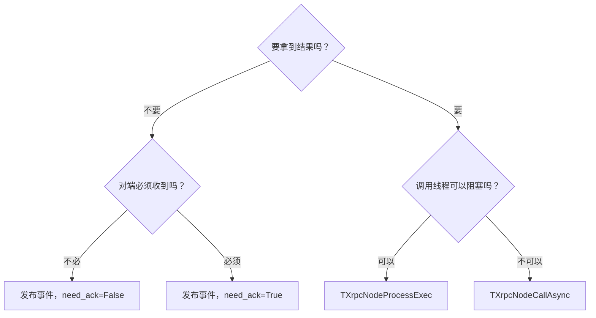

## 2. 部署形态

### 2.1 点对点

一条链路只有一个对端，帧不带目的地址。

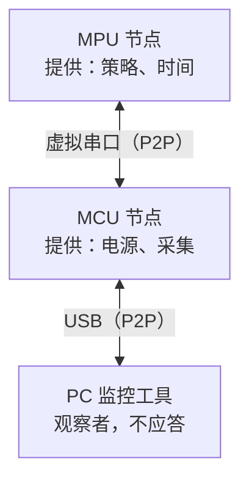

### 2.2 多点总线

多个节点共享一条链路，单播消息自动包进寻址信封。**拓扑不能有环路**。

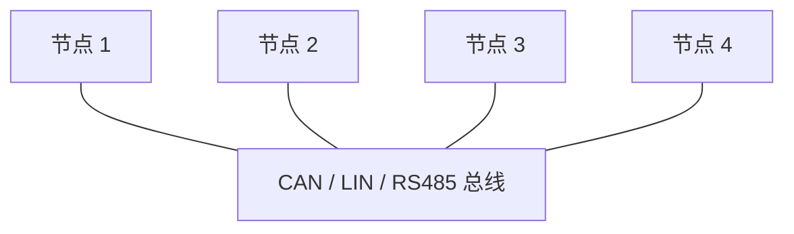

### 2.3 一个节点可以同时接多条链路

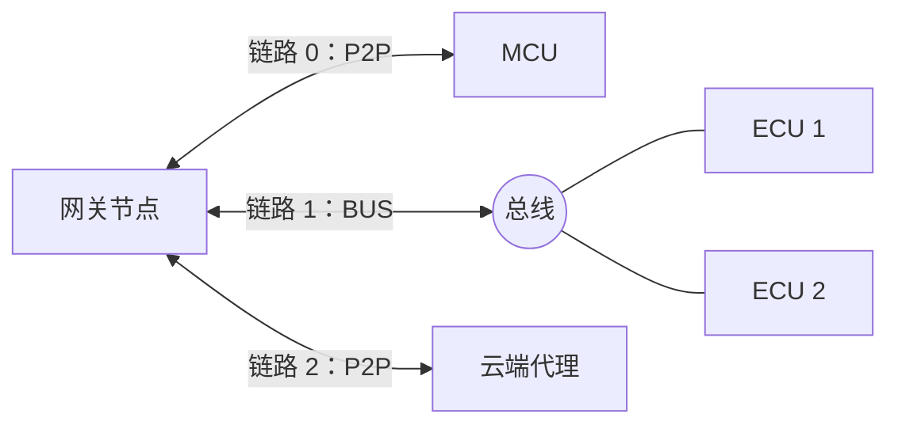

### 2.4 跨节点调用

A 和 C 没有直连时，中间节点 B 开启服务中继。A 的代码和直连时一样，它不知道 C 的存在。见 7.2。

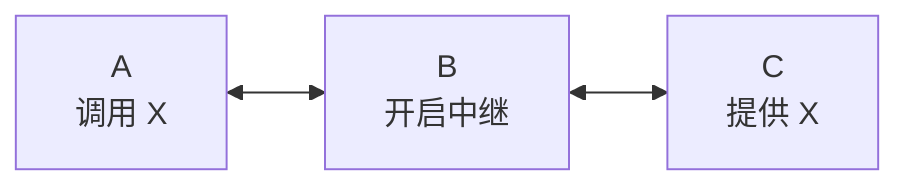

### 2.5 同一设备部署多套系统

每套系统用自己的 `user_tag`。标识不同的节点就算连在同一条总线上，也互相看不见。

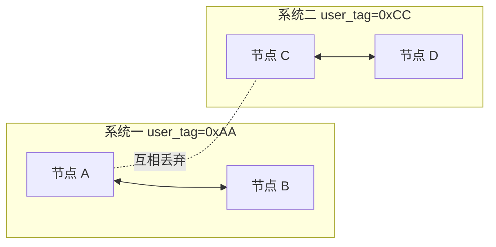

```c
TXrpcNodeCreate(&s_node, 0x00000002U, XRPC_PROTOCOL_VERSION);
TXrpcNodeSetUserTag(&s_node, 0xAAU);   /* 同一系统的节点写同一个值，默认 0 */
```

一个进程里可以创建多个节点，每个节点用自己的 peer cache、过程运行数据和链路。两个节点共用同一条字节流时需要一层分发，目前还没有提供。

## 3. 集成步骤

> 这一节的适配代码和第 5、6 节的接口代码都可以生成：`tools/xrpc_port_gen.py` 生成适配代码并引导实现虚接口，`tools/xrpc_api_gen.py` 从接口定义生成调用封装和实现框架，见 [工具说明](../tools/README.md)。下面讲手写时要做什么，也是读懂生成物的参考。


### 3.1 需要你提供的东西

库内**不分配内存**，下面这些都由你静态提供：

| 内容 | 大小建议 | 用途 |
| --- | --- | --- |
| `TXrpcPeerNode` 数组 | 每条链路一个 | peer 状态 |
| 拼帧缓存 | 不小于最大帧，2500 字节业务建议 2600 | 每条链路一块 |
| 发送缓存 | 同上 | 每条链路一块 |
| 接收临时缓冲 | 256～4096 | 所有链路共用，决定单次读取量 |
| `TXrpcCallSlot` 数组 | 最多同时在途的调用数 | 用异步调用时才需要 |
| 发布槽位 | 不小于该通知的最大载荷 | 每个通知一块 |
| 远端节点表 | 总线上的节点数 | 总线链路才需要 |

### 3.2 实现链路

四个回调，语义要严格：

| 回调 | 返回 | 要求 |
| --- | --- | --- |
| `OnConnectSwitch_` | 命令是否下发成功 | 下发即返回，结果由 `OnState_` 体现 |
| `OnState_` | 当前状态 | 只有 `Connected` 才会收发 |
| `OnSend_` | 写入字节数 | **必须整帧写入**。返回 0 或少于整帧都算失败 |
| `OnRecv_` | 读到的字节数 | **不能阻塞**。无数据返回 0，出错返回负数（会触发断开） |

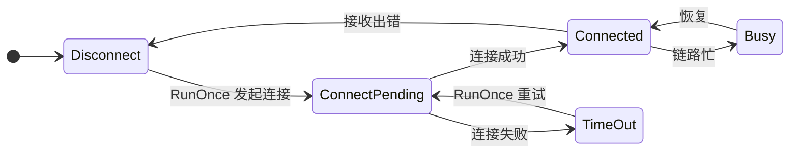

`Busy` 不算断开。其他从 `Connected` 离开的情况，节点都会清掉这条链路的握手和发现状态，在途调用立即返回。

### 3.3 实现 CRC16

```c
static UInt16 L_Crc16Calc(IXrpcCrc16 *sender, const UInt8 *data, UInt32 size)
{
    (void)sender;

    return MyCrc16(data, size);     /* 必须与现网设备字节级一致 */
}

static IXrpcCrc16 s_crc16 = {L_Crc16Calc};
```

实现必须可重入，轮询线程和调用线程都会用到。不注入时发不出任何帧，收到的帧全部丢弃。

### 3.4 定义过程

过程由 ID 标识，`process_key` 用来确认两端接口定义一致（由生成工具算出）。**有 `exec_cb` 的是提供方，没有的是调用方。**

```c
static Int32 L_ExecAdd(const TXrpcMsgParamList *input, TXrpcMsgParamList *output, void *user)
{
    Int32 a = 0;
    Int32 b = 0;
    Int32 result = XrpcProcessParamGetInt32(input, 1U, &a);

    (void)user;
    if (result == kXrpcErrOk)
    {
        result = XrpcProcessParamGetInt32(input, 2U, &b);
    }
    if (result == kXrpcErrOk)
    {
        result = XrpcProcessParamAddInt32(output, 1U, a + b);
    }

    return result;
}

static const TXrpcProcessStaticDesc s_add_desc =
{
    0x00001001U, 0x5A5A0001U, "Add", L_ExecAdd, NULL, NULL
};
static TXrpcProcessRuntimeData s_add_runtime;
static TXrpcProcessObject s_add_object = {&s_add_desc, &s_add_runtime};
static TXrpcProcessObject *s_process_table[] = {&s_add_object};
```

### 3.5 装配节点

```c
static TXrpcNode s_node;
static TXrpcPeerCache s_cache;
static TXrpcPeerNode s_peers[1];
static UInt8 s_fdn_buff[2600];
static UInt8 s_send_buff[2600];
static UInt8 s_recv_buff[1024];

void AppXrpcInit(IXrpcLink *link, const TXrpcLockOps *node_lock, const TXrpcLockOps *send_lock)
{
    TXrpcProcessTable table;

    TXrpcNodeCreate(&s_node, 0x00000002U, XRPC_PROTOCOL_VERSION);
    TXrpcNodeSetCrc16(&s_node, &s_crc16);
    TXrpcNodeSetLockMethod(&s_node, node_lock);     /* 多线程时必填 */

    TXrpcPeerCacheCreate(&s_cache, s_peers, 1U);
    TXrpcNodeSetPeerCache(&s_node, &s_cache);
    TXrpcPeerCacheAddLink(&s_cache, link, 0U,       /* 0：对端 ID 靠握手学习 */
                          s_fdn_buff, sizeof(s_fdn_buff),
                          s_send_buff, sizeof(s_send_buff),
                          send_lock);

    table.process_table = s_process_table;
    table.count = 1U;
    TXrpcNodeSetProcessTable(&s_node, &table);
}
```

> **先设锁，再加链路。** 节点锁和发送锁必须是不同的对象，也不能和日志库的锁相同，否则会自死锁。

### 3.6 启动轮询

库不创建线程。要有一个固定线程周期性调用：

```c
void AppXrpcPollTask(void)
{
    while (running)
    {
        TXrpcNodeRunOnce(&s_node, s_recv_buff, sizeof(s_recv_buff));
        SleepMs(1);
    }
}
```

## 4. 线程模型

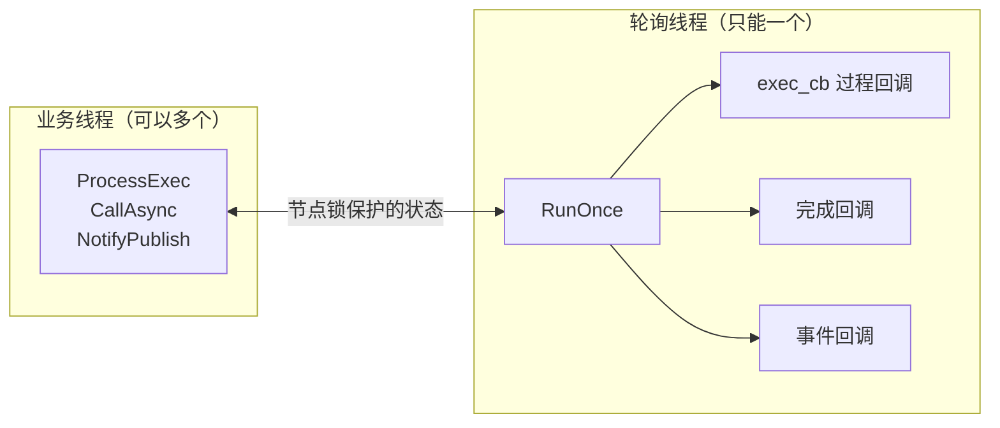

| 规则 | 原因 |
| --- | --- |
| 同步调用**不能**在轮询线程里发起 | 轮询线程被占着，收不到应答，只能超时 |
| 回调里**不能**阻塞或做耗时操作 | 回调期间收不了包，别的调用也被推迟 |
| 回调里可以调 `TXrpcNodeCallAsync`、`XrpcNotifyPublish` | 它们不等待 |
| 调用线程与轮询线程不同时，**节点锁必填** | 状态只靠这把锁保护 |

## 5. 远程调用

### 5.1 上电后发生什么

不需要业务干预。对端晚启动也没关系：额度用完后每 5 秒重试一次。

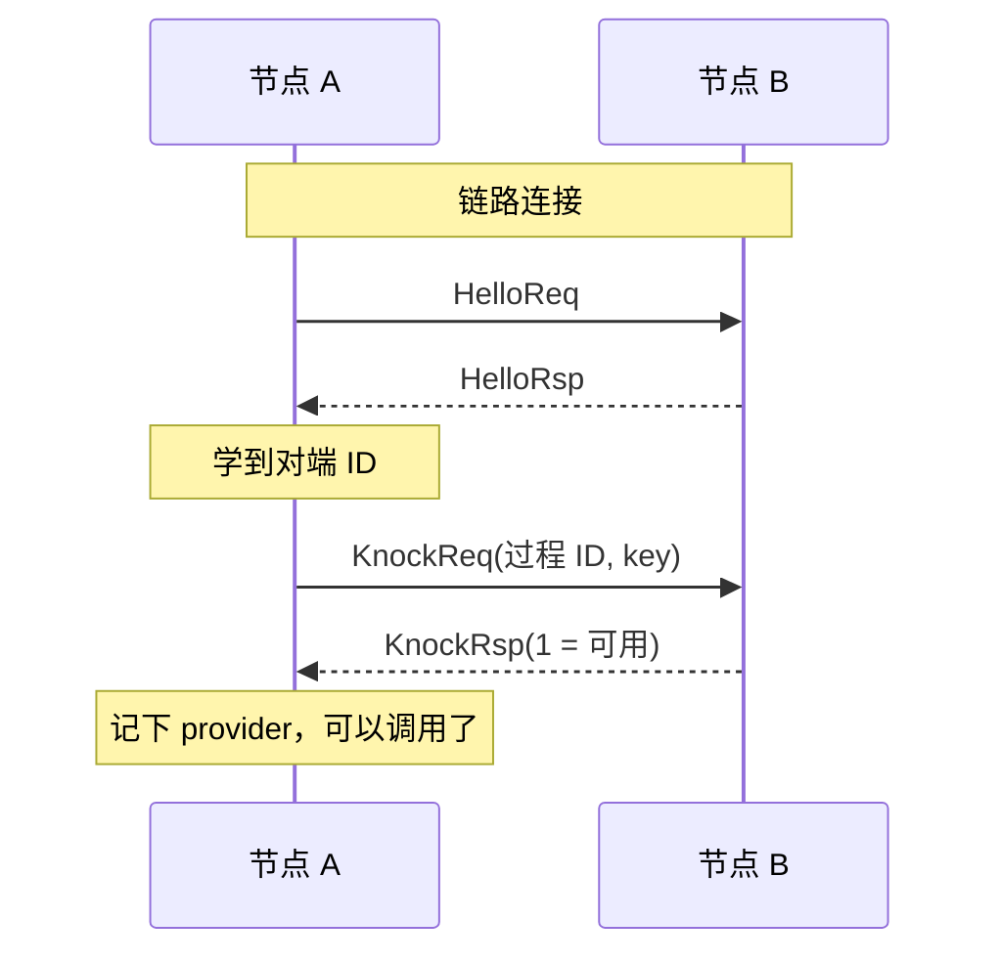

### 5.2 同步调用

```c
TXrpcMsgParamList input;
TXrpcMsgParamList output;
char in_buff[32];
char out_buff[32];
Int32 sum = 0;
Int32 result = 0;

TXrpcMsgParamListCreate(&input, 0U, in_buff, sizeof(in_buff));
TXrpcMsgParamListCreate(&output, 0U, out_buff, sizeof(out_buff));
XrpcProcessParamAddInt32(&input, 1U, 40);
XrpcProcessParamAddInt32(&input, 2U, 2);

result = TXrpcNodeProcessExec(&s_node, 0x00001001U, &input, &output, 1000U);
if (result >= 0)
{
    XrpcProcessParamGetInt32(&output, 1U, &sum);
}
```

返回值：`>= 0` 是对端回调的返回值；`< 0` 是错误码，见第 9 节。

### 5.3 异步调用

先启用调用槽，槽的个数决定最多同时在途几个调用：

```c
static TXrpcCallSlot s_slots[4];

TXrpcNodeSetCallSlots(&s_node, s_slots, 4U);
```

```c
static void L_OnAddDone(TXrpcNode *node, UInt32 process_id, Int32 result,
                        TXrpcMsgParamList *output, void *user)
{
    /* 在轮询线程，不能阻塞。结果 < 0 时 output 是空列表 */
}

/* output 必须保持有效直到回调返回，input 发出后就可以释放 */
result = TXrpcNodeCallAsync(&s_node, 0x00001001U, &input, &output, 1000U, L_OnAddDone, NULL);
```

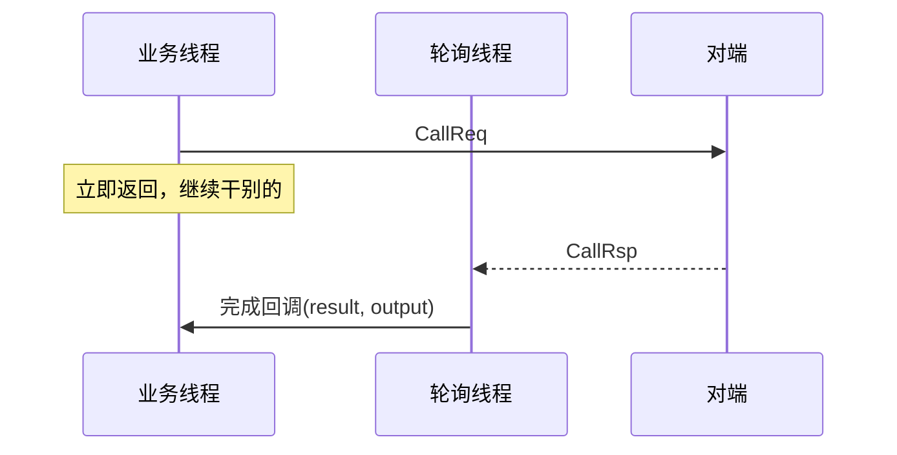

返回 `kXrpcErrOk` 表示已发出，**结果一定通过回调通知**（成功、超时、断链都会回调）。返回负数表示没发出去，不会回调。

启用调用槽后：

- 同步调用也走调用槽，同一过程可以多个线程同时调用。
- 不启用时，同一过程同一时刻只能有一个调用，后到者收到 `kXrpcErrProcessStatus`。

### 5.4 自动重试

调用时设置重试次数，组件在超时后自动重发。组件**不判断函数是否幂等**，不是幂等的函数把次数配成 0。

```c
TXrpcCallOpt opt;

opt.timeout_ms = 200U;      /* 每次等待的时长 */
opt.retry = 2U;             /* 超时后再发 2 次，最长总耗时 600ms */

/* 同步 */
result = TXrpcNodeProcessExecOpt(&s_node, PROC_ID, &input, &output, &opt);

/* 异步：input 要保持有效，直到完成回调 */
result = TXrpcNodeCallAsyncOpt(&s_node, PROC_ID, &input, &output, &opt, L_OnDone, NULL);
```

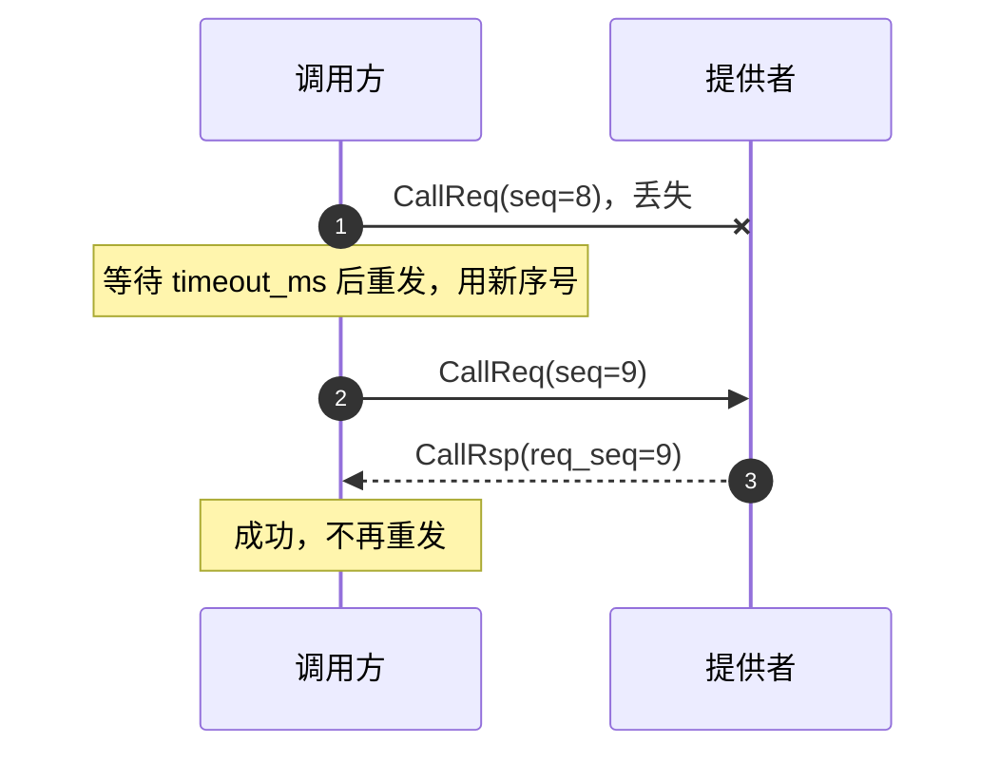

要点：

- 默认不重试。`TXrpcNodeProcessExec`、`TXrpcNodeCallAsync` 等于 `retry = 0`。
- **超时不代表对端没执行。** 丢的是应答时对端已经执行过，重试会让它再执行一次。
- 每次重发用新的帧头 `seq`，前一次迟到的应答直接丢弃。所以 `timeout_ms` 要大于往返时延，否则每次应答都算迟到，重试用尽仍然失败。
- `timeout_ms` 也要大于对端的处理时间。重试不能取消对端已收到的请求，超时太短时重发的请求会在对端堆积，加重负担。
- 重试需要调用槽。没配 `TXrpcNodeSetCallSlots` 却设置了 `retry` 时返回 `kXrpcErrNotSupported`。过程在本节点时 `retry` 不起作用。
- 只有发起方重试，中继不重试。经中继时每次重试占一个转发槽，旧槽要等应答到达或中继超时才释放，所以转发槽要留足余量。
- 重试期间链路断开，调用立即以 `kXrpcErrPeerStatusInvalid` 结束。
- 中继的 `call_timeout_ms` 是节点配置，调用方的超时不会传给中继。它要不小于全网最长的调用，否则长调用会被中继提前回超时。

### 5.5 调用失败怎么处理

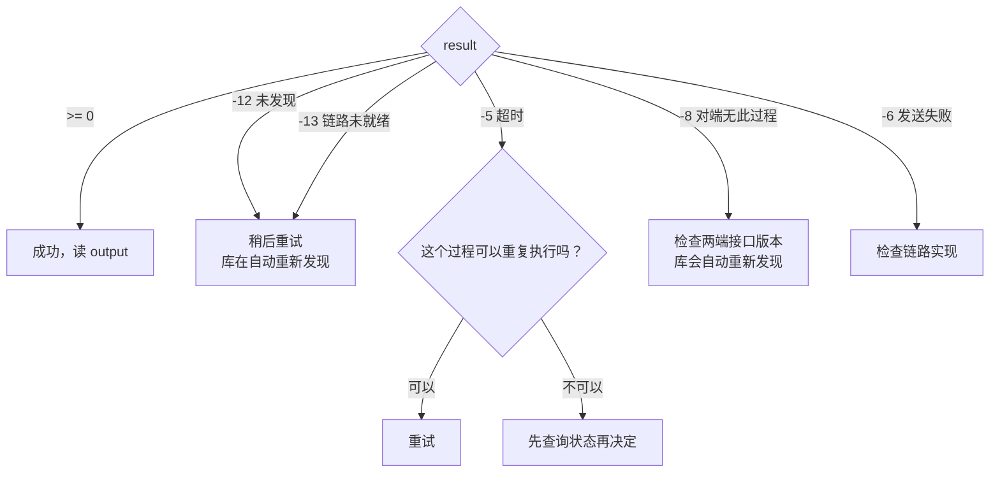

> **超时不能撤销对端的执行。** 关机、重启这类过程，重试前要先确认是否允许重复执行。

## 6. 事件发布与订阅

### 6.1 角色

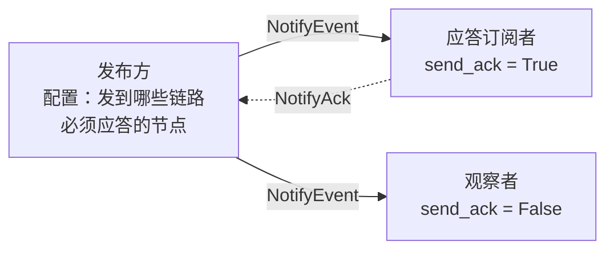

"发到哪些链路"和"必须应答的节点"是两张独立的表。观察者只要在发布的链路上就能收到，它不在应答列表里，不影响发布结果。

**只有一套机制，几个词别混了：**

| 词 | 意思 |
| --- | --- |
| 通知 | 一种消息的定义，相当于过程的定义 |
| 事件 | 通知的一次发生，相当于一次调用 |
| 发布 | 发出一个事件。接口是 `XrpcNotifyPublish` |
| 订阅 | 声明要接收某个通知。**写在配置表里，线上没有订阅消息** |

**三种回调：**

| 回调 | 在哪一方 | 什么时候 |
| --- | --- | --- |
| 事件回调 | 订阅方 | 数据来了 |
| 完成回调 | 发布方 | 这一包结束了，成功失败都回调 |
| 状态回调 | 任意节点 | 丢包、来源不对、key 不符也从这里上报，见第 10 章 |

### 6.2 发布方

```c
static UInt8 s_slot[2600];                      /* 快照缓冲 */
static const UInt16 k_links[] = {0U};           /* 发布到链路 0 */
static const UInt32 k_acks[] = {0x0000000AU};   /* 节点 0x0A 必须应答 */
static UInt32 s_ack_work[XRPC_NOTIFY_ACK_WORK_WORDS(1U)];   /* 应答工作区，大小随节点数 */
static const TXrpcNotifyPubDesc s_pub_desc =
{
    0x00002001U, 0x5A5A1001U,                   /* notify_id, notify_key */
    1U, k_links,
    1U, k_acks, s_ack_work,
    s_slot, sizeof(s_slot)
};
static TXrpcNotifyPubRuntime s_pub_runtime;
static TXrpcNotifyPubObject s_pub_object = {&s_pub_desc, &s_pub_runtime};
static TXrpcNotifyPubObject *s_pubs[] = {&s_pub_object};

/* 序号种子取与启动相关的值，防止重启后序号和上次撞上 */
TXrpcNodeSetNotifyPubs(&s_node, s_pubs, 1U, XrpcGetSysTick());
```

链路数和应答节点数都由你提供的数组决定，组件不设上限。不需要应答时 `ack_node_count` 写 0，`k_acks`、`s_ack_work` 写 `NULL`。

```c
static void L_OnPublished(TXrpcNode *node, const TXrpcNotifyResult *result, void *user)
{
    if (result->code != kXrpcNotifyOk)
    {
        /* 记审计日志：result->missing 列出没应答的节点，只在回调内有效 */
    }
}

TXrpcNotifyOpt opt;

opt.need_ack = True;
opt.timeout_ms = 500U;      /* 每次等多久 */
opt.retry = 2U;             /* 超时后补发几次 */
XrpcNotifyPublish(&s_node, 0x00002001U, &params, &opt, L_OnPublished, NULL);
```

`XrpcNotifyPublish` 只负责受理：数据拷进槽位就返回，`params` 随后可以改。最坏完成时间 = `timeout_ms × (retry + 1)`。

| `result->code` | 含义 | 建议 |
| --- | --- | --- |
| `kXrpcNotifyOk` | 发出（无需应答）或应答收齐 | |
| `kXrpcNotifyAckTimeout` | 补发用尽，仍有节点没应答 | 看 `missing`，记审计 |
| `kXrpcNotifyRejected` | 收齐了，但有节点拒绝 | 通常是 key 不一致 |
| `kXrpcNotifySendFailed` | 链路发送失败 | 检查链路 |
| `kXrpcNotifyLinkDown` | 所有链路都没连接 | |
| `kXrpcNotifyReplaced` | 槽位忙时被新数据替换 | `replaced_count` 是被替换的包数 |
| `kXrpcNotifyTooLarge` | 超过链路或对端帧长上限 | 调大缓冲或拆包 |

### 6.3 需要应答的发布

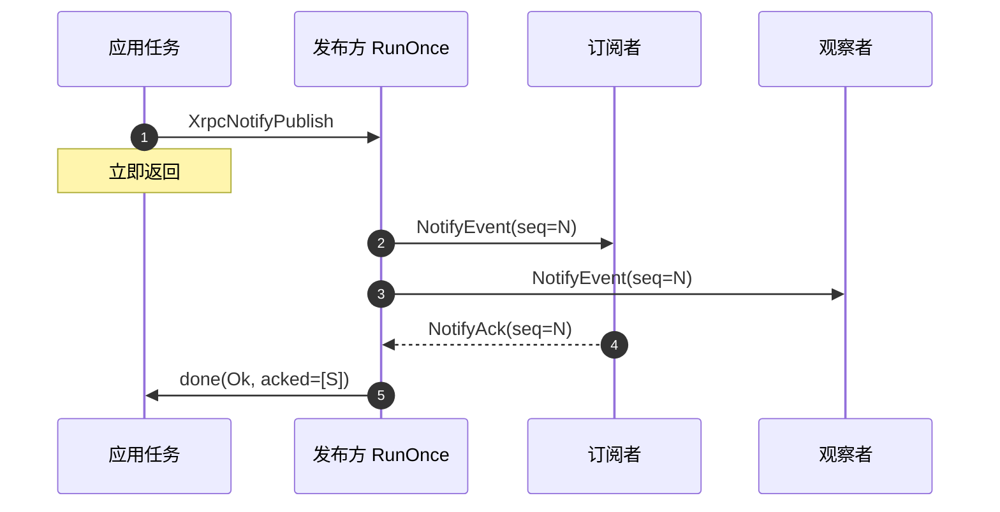

补发用同一序号，订阅方**只补 Ack，不重复回调**。

### 6.4 订阅方

```c
static void L_OnVehicle(TXrpcNode *node, UInt32 notify_id, UInt32 publisher, UInt32 seq,
                        const TXrpcMsgParamList *params, void *user)
{
    /* params 指向接收缓存，只在回调内有效。要用就拷走，交给业务任务处理 */
}

static const TXrpcNotifySubDesc s_sub_desc =
{
    0x00002001U, 0x5A5A1001U,
    0x0000000BU,        /* 期望的发布方；0 表示任意 */
    True,               /* 回应答；观察者填 False */
    L_OnVehicle, NULL
};
static TXrpcNotifySubRuntime s_sub_runtime;
static TXrpcNotifySubObject s_sub_object = {&s_sub_desc, &s_sub_runtime};
static TXrpcNotifySubObject *s_subs[] = {&s_sub_object};

TXrpcNodeSetNotifySubs(&s_node, s_subs, 1U);
```

序号缺口、key 不匹配、来源不对、参数解析失败都通过状态回调上报，见第 10 章。

## 7. 总线与服务中继

### 7.1 总线链路

```c
static TXrpcRemoteNode s_remotes[8];
static const TXrpcProcessBinding s_bindings[] =
{
    {0x00001001U, 0U, 0x0000000CU},     /* 过程 0x1001 走链路 0，由节点 0x0C 提供 */
};

TXrpcLinkConfig config = {0};

config.topology = kXrpcLinkTopologyBus;
config.remotes = s_remotes;
config.remote_capacity = 8U;
TXrpcPeerCacheSetLinkConfig(&s_cache, 0U, &config);
TXrpcNodeSetProcessBindings(&s_node, s_bindings, 1U);
```

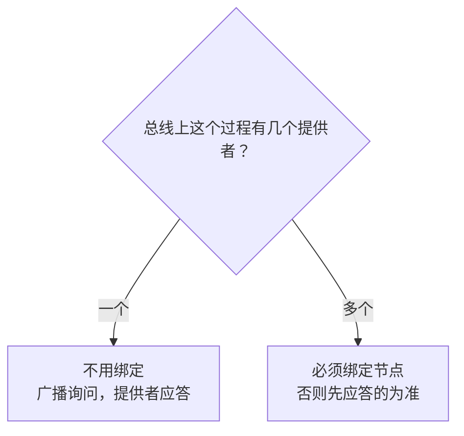

业务代码不用改，调用和发布的接口完全一样。

**帧长上限**：两端缓冲可以不同。打开 `advertise_max_recv` 后，Hello 会带上本端接收上限，发送前自动检查，超限返回 `kXrpcErrFrameTooLarge`，而不是对端静默丢帧。这个字段默认关闭。

### 7.2 服务中继

节点没有的过程，由它到其他链路上找提供者，并把调用转发过去。**只有中间节点要配置**，调用方和提供方是普通节点，可以是老设备。

```c
static TXrpcRelayRoute s_routes[8];     /* 最多中继几个过程 */
static TXrpcRelayCall s_relay_calls[8]; /* 最多同时转发几个调用 */

TXrpcRelayConfig relay = {0};

relay.routes = s_routes;
relay.route_count = 8U;
relay.calls = s_relay_calls;
relay.call_count = 8U;
TXrpcNodeSetRelay(&s_node, &relay);
```

用代码生成工具时，在节点里写 `relay: {routes: 8, calls: 8}`。

多跳的情况，**只有路径中间的节点要开启中继**：

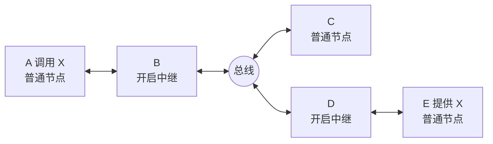

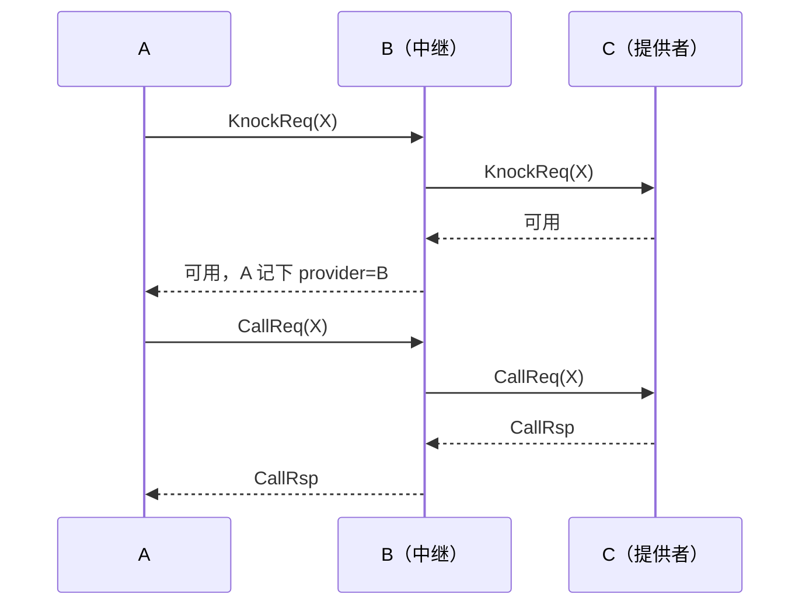

| 注意 | 说明 |
| --- | --- |
| 调用方的超时 | 要大于各跳等待之和，中继等提供者的时长是 `call_timeout_ms`（默认 5 秒） |
| 首次发现 | 启动时对端链路可能还没握手，会多等约 1 秒；每多一跳最坏多等一轮 |
| 本地优先 | 中继节点自己有的过程本地执行 |
| 多跳 | A-B-C-D 中 B、C 都开启中继即可 |
| 拓扑 | 按星形相互连接成树来部署，可以混合点对点和总线。接错线成环时帧不会无限绕圈 |
| Hello | 只在相邻节点之间，不转发，A 不需要知道 C |
| 事件通知 | 中继按转发表转发，见 7.3 |

### 7.3 事件跨中继

发布方和订阅方的用法不变：发布方的 `ack_node_id` 写最终订阅者，订阅方的 `publisher_node_id` 写最初的发布方，都不用写中继。只有中间节点要配转发表。


```c
static const UInt16 k_links[] = {0U, 1U};
static TXrpcNotifyForwardRuntime s_forward_runtime;
static const TXrpcNotifyForward k_forwards[] =
{
    {0x00002001U, 2U, k_links, &s_forward_runtime},     /* 这个通知转发到链路 0、1 */
};
static TXrpcNotifyAckRecord s_ack_records[8];

relay.forwards = k_forwards;
relay.forward_count = 1U;
relay.ack_records = s_ack_records;
relay.ack_record_count = 8U;
relay.notify_timeout_ms = 0U;       /* 记录保留时长，0 表示 1 秒 */
TXrpcNodeSetRelay(&s_node, &relay);
```

收到事件的那条链路自动排除，所以转发表可以把所有链路都写上。

| 配置项 | 怎么定 |
| --- | --- |
| `ack_record_count` | 同时待应答的事件数。不要求应答的事件不占记录 |
| `notify_timeout_ms` | 大于 Ack 往返时间。发布方补发时记录会刷新 |

要点：

- 记录表满时淘汰最老的，优先淘汰已收到过 Ack 的。淘汰了没收到过 Ack 的记录时上报 `kXrpcStatusNotifyRecordFull`，这个事件的 Ack 可能回不去，发布方超时后补发。
- 只有发布方补发，中继不重发。
- 中继自己也可以订阅或发布。
- 接错线成环时，事件不会形成风暴：同一事件从别的链路绕回来时不再转发。

## 8. 参数读写

| 类型 | 写 | 读 |
| --- | --- | --- |
| 整数 | `XrpcProcessParamAdd{U}Int8/16/32/64` | `XrpcProcessParamGet{U}Int8/16/32/64` |
| 字节串 | `XrpcProcessParamAddBytes` | `XrpcProcessParamGetBytes` |
| 字符串 | `XrpcProcessParamAddString` | `XrpcProcessParamGetString` |

- 输入、输出的参数 ID 各自独立编号。
- 字节串和字符串读出来的是**指向接收缓存的指针**，回调返回后失效。
- 字符串线上**不带** `\0`，用返回的长度。
- 单个列表最多 255 项。

## 9. 错误码

| 值 | 名称 | 含义 | 处理 |
| --- | --- | --- | --- |
| -1 | `kXrpcErrInvalidParam` | 参数无效，或过程不在表里 | 查代码 |
| -2 | `kXrpcErrBufferOverflow` | 缓冲不足或解析失败 | 调大缓冲 |
| -3 | `kXrpcErrListFull` | 参数超过 255 项 | |
| -4 | `kXrpcErrItemNotFound` | 参数或通知不存在 | |
| -5 | `kXrpcErrTimeout` | 超时 | 见 5.5 |
| -6 | `kXrpcErrLinkSendFailed` | 链路发送失败（含短写） | 查链路 |
| -7 | `kXrpcErrTxBufferOverflow` | 发送缓冲不足 | 调大缓冲 |
| -8 | `kXrpcErrProcessNotFound` | 对端无此过程或 key 不符 | 查接口版本 |
| -9 | `kXrpcErrProcessStatus` | 过程正被占用 | 串行调用或启用调用槽 |
| -10 | `kXrpcErrPeerNodeUnknow` | 提供者不在 peer 表 | |
| -11 | `kXrpcErrRxBufferOverflow` | 出参放不下，`output` 已清空 | 调大 `output` |
| -12 | `kXrpcErrProviderUnknow` | 还没发现提供者 | 稍后重试 |
| -13 | `kXrpcErrPeerStatusInvalid` | 链路未就绪或调用中断开 | 稍后重试 |
| -14 | `kXrpcErrNotSupported` | 未启用调用槽或本地过程 | |
| -15 | `kXrpcErrFrameTooLarge` | 超过链路或对端帧长上限 | 调大对端缓冲 |
| -16 | `kXrpcErrNoFreeSlot` | 调用槽或中继的转发槽用完 | 增加槽位 |
| -17 | `kXrpcErrTtlExpired` | 跳数耗尽，中继不再转发 | 检查是否接错线形成环路 |

## 10. 运行时状态上报

缓冲和表项都由适配层静态配置，配小了不能静默出错。`TXrpcNodeSetStatusCb` 让组件把这类异常报给应用，用来调整配置和发现接线问题。

```c
static void L_OnStatus(TXrpcNode *node, const TXrpcStatusInfo *info, void *user_data)
{
    /* 在 RunOnce 线程执行，不要阻塞 */
    log_warn("xrpc status %d link=%u node=0x%08x count=%u need=%u actual=%u",
             info->code, info->link_index, info->node_id,
             info->count, info->need, info->actual);
}

TXrpcNodeSetStatusCb(&s_node, L_OnStatus, 1000U, NULL);   /* 同一状态至少隔 1 秒报一次 */
```

```mermaid
flowchart LR
    A["任意线程发现异常"] --> B["记入节点状态表<br/>累加次数，保留最近详情"]
    B --> C["RunOnce 扫描"]
    C --> D["状态回调"]
```

| 状态 | 含义 | `need` / `actual` | 怎么处理 |
| --- | --- | --- | --- |
| `kXrpcStatusRxFrameTooLarge` | 收到的帧放不下 | 帧长 / 接收缓存 | 加大拼帧缓存。CRC 校验之前就会判断，噪声也可能偶尔触发 |
| `kXrpcStatusTxBufferOverflow` | 发送缓冲不足 | 帧长 / 缓冲大小 | 加大发送缓冲 |
| `kXrpcStatusTxFrameTooLarge` | 超过链路或对端上限 | 帧长 / 上限 | 减小载荷或提高上限 |
| `kXrpcStatusRouteTableFull` | 中继路由表满 | 需要 / 表项数 | 增加路由表项。询问方收到 -16 |
| `kXrpcStatusRelayCallFull` | 中继转发槽满 | 需要 / 槽数 | 增加转发槽。调用方收到 -16 |
| `kXrpcStatusRemoteTableFull` | 总线远端表满 | 需要 / 表项数 | 增加 `remote_capacity` |
| `kXrpcStatusVersionMismatch` | 版本不一致 | 本节点 / 帧里 | 统一版本 |
| `kXrpcStatusUserTagMismatch` | `user_tag` 不一致 | 本节点 / 帧里 | 两套系统共用链路时属正常，否则检查配置 |
| `kXrpcStatusNodeIdConflict` | 总线上有节点与本节点 ID 相同 | 无 | 改节点 ID。会回显自己发送内容的总线，由链路适配过滤回显 |
| `kXrpcStatusTtlExpired` | 跳数耗尽 | 无 / 收到的 ttl | 检查是否接错线形成环路 |
| `kXrpcStatusNotifySeqGap` | 事件序号缺口 | 期望 / 实际序号 | 差值就是丢失的包数 |
| `kXrpcStatusNotifyKeyMismatch` | 事件 key 不匹配 | 无 / 序号 | 两端接口定义不一致 |
| `kXrpcStatusNotifyWrongPublisher` | 来源不是期望的发布方 | 无 / 序号 | 检查订阅表 |
| `kXrpcStatusNotifyBadParams` | 事件参数解析失败 | 无 / 序号 | 检查发布方 |
| `kXrpcStatusNotifyRecordFull` | 中继淘汰了没收到过 Ack 的记录 | 需要 / 表项数 | 增加 `ack_record_count` |

要点：

- 回调固定在 `RunOnce` 线程、节点锁之外执行。
- 第一次出现立即上报。之后同一状态受间隔限制，间隔内的次数累加到 `count`，详情保留最近一次。
- 不设回调时用 `TXrpcNodeGetStatusCount` 主动查询。
- 回调只报给本节点。要不要发到网络上，由应用决定。

## 11. 排错

```mermaid
flowchart TD
    S["调用总是失败"] --> A{"返回值？"}
    A -->|"-12"| B{"握手完成了吗？<br/>peer_node_id 非 0"}
    B -->|否| C["查链路：OnState_ 是否 Connected<br/>RunOnce 有没有在跑"]
    B -->|是| D{"对端有 exec_cb 吗？"}
    D -->|没有| E["对端没实现这个过程"]
    D -->|有| F["两端 process_key 不一致"]
    A -->|"-5"| G{"对端收到请求了吗？"}
    G -->|没有| H["查协议版本、CRC 算法、链路"]
    G -->|收到| I["回调太慢，或轮询线程被占用"]
    A -->|"发送都失败"| J["CRC 接口没注入？<br/>OnSend_ 是否整帧写入"]
```

| 现象 | 常见原因 |
| --- | --- |
| 两端都发帧，但互相收不到 | 协议版本不一致，或 CRC 算法不一致（帧被静默丢弃） |
| 同步调用总是超时 | 在轮询线程里发起了调用 |
| 偶发死锁 | 节点锁和发送锁用了同一个对象 |
| 大包收不到 | 对端拼帧缓存比帧小；打开 `advertise_max_recv` 可以提前发现 |

## 12. 看一个完整例子

[上手指南](XRPC上手指南.md)第 3、4 关用两节点例子 `tools/examples/net_demo.yaml` 走完了调用、事件和调试。

多节点网络不用手写这些配置：写一份网络描述，用 `tools/xrpc_net_gen.py` 生成全部节点，见 [工具说明](../tools/README.md)。
