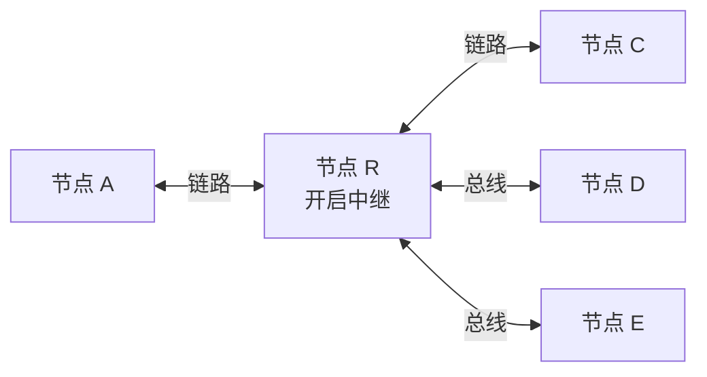
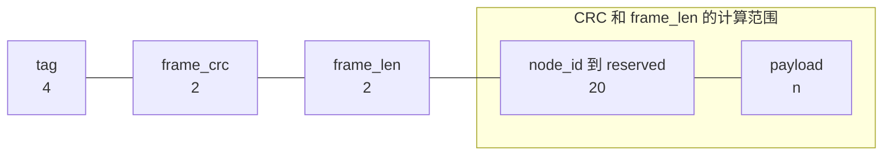
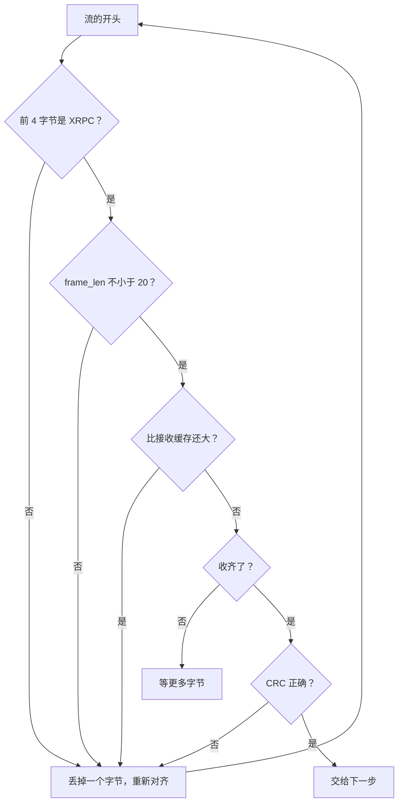
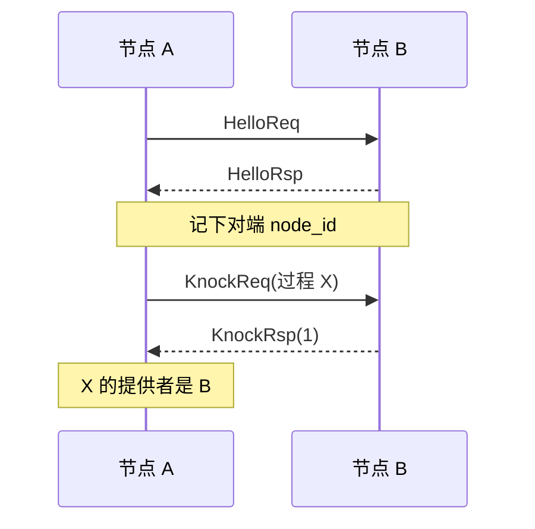
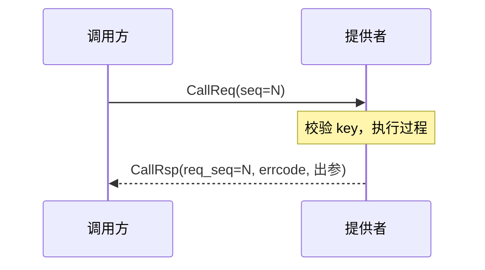
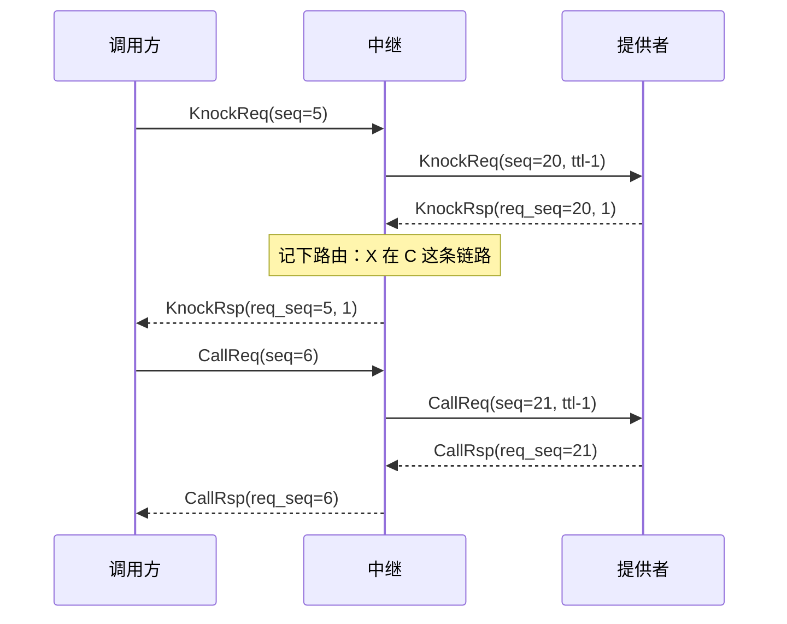
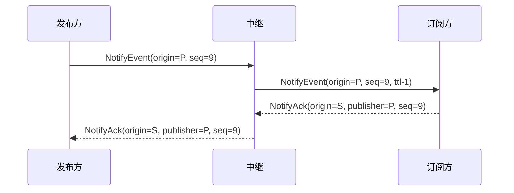

# XRPC 协议规范

协议版本 `0x0200`。这份文档只描述线上行为，不涉及 C 代码，按它可以用任何语言实现一个节点。

第 9 章的测试向量由 `tools/tests/test_wire.py` 和 `tests/test_golden.c` 的黄金字节逐字节核对。

## 1. 概念



| 词 | 含义 |
| --- | --- |
| 节点 | 协议的端点，有一个 32 位节点 ID。`0` 表示未知，`0xFFFFFFFF` 表示广播，都不能分配给节点 |
| 链路 | 能收发字节的通道。点对点链路只有两个节点，总线链路有多个节点 |
| 过程 | 一个节点提供、别的节点调用的函数，由过程 ID 和过程 key 标识 |
| 事件 | 发布方发出、订阅方接收的通知，由通知 ID 和通知 key 标识 |
| 中继 | 替别的节点发现过程、转发调用和事件的节点 |

key 用来确认两端的接口定义一致。协议只比较它是否相等，不规定算法。

链路只需要按顺序传字节。协议不依赖链路的帧边界，可靠性由调用超时、事件补发和 CRC 处理。

## 2. 帧格式

多字节字段全部大端。帧头固定 28 字节。

```text
偏移  长度  字段
0     4     tag         固定为 ASCII "XRPC"
4     2     frame_crc   帧校验
6     2     frame_len   从 node_id 到帧尾的字节数，等于 20 + 载荷长度
8     4     node_id     发送方节点 ID，每一跳都是这一跳的发送方
12    2     version     协议版本，0x0200
14    2     type        消息类型
16    4     user_tag    应用标识，不同的值互相隔离
20    4     seq         这个节点发送的帧的流水号
24    1     ttl         剩余跳数
25    1     flags       发送写 0，接收忽略
26    2     reserved    发送写 0，接收忽略
28    n     payload     载荷，n = frame_len - 20
```



### 2.1 校验

`frame_crc` 对偏移 8 到帧尾计算。算法由部署决定，同一网络内必须相同。新项目推荐 CRC-16/CCITT-FALSE：多项式 `0x1021`，初值 `0xFFFF`，不反射，不异或输出，`"123456789"` 的校验值是 `0x29B1`。

### 2.2 接收

接收方把链路字节流切成帧：



通过校验后依次检查：

| 检查 | 不符时 |
| --- | --- |
| `version` 等于本节点版本 | 丢弃 |
| `user_tag` 等于本节点的值 | 丢弃，不学习，不应答 |
| 总线链路上 `node_id` 不等于本节点 | 丢弃，这说明节点 ID 冲突 |
| `type` 已知 | 丢弃，不执行，不转发 |

### 2.3 seq

每个节点一个计数器，所有链路共用，每发一帧加 1，从 1 开始。链路发送失败后重发同一帧，`seq` 不变。

KnockReq、CallReq 的载荷不带序号，帧头的 `seq` 就是请求序号。KnockRsp、CallRsp 用 `req_seq` 指回请求。中继转发时换成自己的 `seq`，收到应答后换回去。

### 2.4 ttl

| 情况 | `ttl` |
| --- | --- |
| 节点新发的帧 | 255 |
| 中继转发 KnockReq、CallReq、NotifyEvent | 收到的值减 1 |
| 收到的值不大于 1，又需要转发 | 不转发。Knock、Call 回 `-17`，事件丢弃 |
| 应答和 NotifyAck | 中继发出时用 255 |
| 过程在本节点 | 不检查 |

## 3. 消息类型

| 类型 | 值 | 说明 |
| --- | --- | --- |
| HelloReq | `0x0102` | 握手请求 |
| HelloRsp | `0xF102` | 握手应答 |
| KnockReq | `0x0101` | 询问过程是否存在 |
| KnockRsp | `0xF101` | 询问结果 |
| CallReq | `0x0111` | 调用请求 |
| CallRsp | `0xF111` | 调用结果 |
| NotifyEvent | `0x0120` | 事件 |
| NotifyAck | `0xF120` | 事件应答 |
| Addressed | `0x0130` | 寻址信封 |

`0x0110` 曾用于单向调用，已经移除并保留，不要复用。收到时按未知类型处理。

载荷里的多字节字段同样是大端。

### 3.1 Hello

载荷可以为空，也可以带 4 字节 `max_recv_frame`：本节点能接收的最大整帧字节数。没带时对端不限制。

### 3.2 Knock

```text
KnockReq  process_id(4) process_key(4)
KnockRsp  req_seq(4) process_id(4) errcode(4)
```

| `errcode` | 含义 |
| --- | --- |
| `1` | 存在，key 一致，可以调用 |
| `0` | 存在，但 key 不一致 |
| 负数 | 不存在或不可达，`-8` 表示没有这个过程 |

### 3.3 Call

```text
CallReq  process_id(4) process_key(4) param_cnt(1) param_list
CallRsp  req_seq(4) process_id(4) errcode(4) param_cnt(1) param_list
```

`errcode` 不小于 0 表示执行成功，负数是错误码，见第 8 章。失败时 `param_cnt` 为 0。

### 3.4 Notify

```text
NotifyEvent  notify_id(4) notify_key(4) origin_node(4) seq(4) flags(1) param_cnt(1) param_list
NotifyAck    notify_id(4) origin_node(4) publisher(4) seq(4) result(4)
```

| 字段 | 含义 |
| --- | --- |
| NotifyEvent 的 `origin_node` | 最初发布事件的节点，经过中继不变 |
| `seq` | 按（通知，发布方）递增，补发时不变 |
| `flags` | bit0 为 1 表示需要应答 |
| NotifyAck 的 `origin_node` | 发出应答的节点，经过中继不变 |
| `publisher` | 事件的发布方，中继靠它找到来路 |
| `result` | 0 成功，负数表示订阅方拒绝 |

### 3.5 Addressed

```text
dst_node(4) inner_type(2) inner_payload
```

`inner_payload` 是内层消息的原样载荷。`dst_node` 为 `0xFFFFFFFF` 表示广播。不是发给自己的信封直接丢弃，不算错误。

## 4. 参数列表

`param_cnt` 个参数项顺序排列，同一列表内 `param_id` 不重复。

```text
param_id(1) param_type(1) param_len(2) value(param_len)
```

| 类型码 | 类型 | `param_len` |
| --- | --- | --- |
| `0x00` | U8 | 1 |
| `0x01` | I8 | 1 |
| `0x02` | U16 | 2 |
| `0x03` | I16 | 2 |
| `0x04` | U32 | 4 |
| `0x05` | I32 | 4 |
| `0x06` | U64 | 8 |
| `0x07` | I64 | 8 |
| `0x10` | Bytes | 任意 |
| `0x11` | String | 任意，不含结尾的 0 |

整数大端，有符号数用补码。最多 255 项。

## 5. 握手与发现

### 5.1 点对点链路



- 链路连上、对端未知时，每秒发一次 HelloReq，等 HelloRsp 最多 3 秒。
- 收到 Hello 时用帧头 `node_id` 更新对端。对端换成别的节点时，经它学到的提供者和路由全部作废。
- 对端已知后，节点对本地没有实现的过程发 KnockReq。先快速询问 3 次，间隔 1 秒；之后每 5 秒询问一次，直到找到提供者。

### 5.2 总线链路

总线没有一对一握手。节点每 3 秒广播一次 Hello，收到任何帧时都把发送方记入远端节点表。

单播消息（Hello、Knock、Call、Ack 等）放进 Addressed 信封。NotifyEvent 不用信封。询问过程时 `dst_node` 用广播，没有这个过程的节点不应答，否则否定应答可能盖过真正的提供者。

## 6. 调用



- 调用方用 `req_seq` 和 `process_id` 匹配应答。迟到的应答直接丢弃。
- 超时后调用方可以用新的 `seq` 重发，次数由调用方决定。协议不去重，重试只应用于幂等的过程。
- 提供者回 `-8` 时，调用方作废提供者，重新发现。

## 7. 中继与事件

### 7.1 服务中继

中继对调用方表现为提供者，对提供者表现为调用方，两边看到的都是普通帧。不新增消息类型。



| 情况 | 中继的行为 |
| --- | --- |
| 过程在本节点 | 本地执行，不转发 |
| 路由未知 | 问其他链路，全部否定或超时回 `-8` |
| 转发资源用完 | 立刻回 `-16` |
| 提供者超时 | 回 `-5` |
| 下一段发送失败 | 回 `-6` |
| 等待应答时下一段链路断开 | 回 `-13`，路由作废 |
| 提供者回 `-8` | 把 `-8` 传回调用方，路由作废 |

Hello 只在相邻节点之间有效，不转发。

### 7.2 事件



- 需要应答的事件，发布方等应答超时后用相同的 `seq` 补发。
- 订阅方按（通知，发布方）记住最后的 `seq`。重复的事件只回 Ack，不交给应用。
- 订阅关系和转发表都是配置好的，不泛洪。同一事件从另一条链路再到达时不转发，只有发布方补发时才再转发一次。
- 中继记下事件来自哪条链路，Ack 按记录原路返回。

## 8. 错误码

| 值 | 含义 | 上线吗 |
| --- | --- | --- |
| `-1` | 参数无效 | CallRsp |
| `-2` | 缓冲不足或数据解析失败 | CallRsp |
| `-5` | 超时 | 中继回 CallRsp |
| `-6` | 链路发送失败 | 中继回 CallRsp |
| `-8` | 没有这个过程，或 key 不匹配 | KnockRsp、CallRsp、NotifyAck |
| `-13` | 对端状态无效，等待应答时链路断开 | 中继回 CallRsp |
| `-16` | 中继转发资源用完 | CallRsp |
| `-17` | 跳数耗尽 | KnockRsp、CallRsp |

提供者自己的过程可以返回其他负数，由应用约定。

## 9. 测试向量

这些帧的 `node_id=2`，`user_tag=0x11223344`，`seq=1`。为了让向量不依赖 CRC 算法，`frame_crc` 都写成固定值 `0x5AA5`，校验时要跳过这个字段。示例参数是 `id=1 U16 0x1234` 和 `id=2 String "OK"`。

HelloReq：

#### k_hello_req

```text
58 52 50 43 5A A5 00 14 00 00 00 02 02 00 01 02
11 22 33 44 00 00 00 01 FF 00 00 00
```

HelloRsp：

#### k_hello_rsp

```text
58 52 50 43 5A A5 00 14 00 00 00 02 02 00 F1 02
11 22 33 44 00 00 00 01 FF 00 00 00
```

HelloReq，通告接收上限 1500：

#### k_hello_req_cap

```text
58 52 50 43 5A A5 00 18 00 00 00 02 02 00 01 02
11 22 33 44 00 00 00 01 FF 00 00 00 00 00 05 DC
```

KnockReq：

#### k_knock_req

```text
58 52 50 43 5A A5 00 1C 00 00 00 02 02 00 01 01
11 22 33 44 00 00 00 01 FF 00 00 00 00 00 20 08
A1 B2 C3 D4
```

KnockRsp，可用：

#### k_knock_rsp_ok

```text
58 52 50 43 5A A5 00 20 00 00 00 02 02 00 F1 01
11 22 33 44 00 00 00 01 FF 00 00 00 00 00 00 05
00 00 20 08 00 00 00 01
```

KnockRsp，key 不一致：

#### k_knock_rsp_key_mismatch

```text
58 52 50 43 5A A5 00 20 00 00 00 02 02 00 F1 01
11 22 33 44 00 00 00 01 FF 00 00 00 00 00 00 05
00 00 20 08 00 00 00 00
```

KnockRsp，不存在：

#### k_knock_rsp_not_found

```text
58 52 50 43 5A A5 00 20 00 00 00 02 02 00 F1 01
11 22 33 44 00 00 00 01 FF 00 00 00 00 00 00 05
00 00 99 99 FF FF FF F8
```

CallReq，无参数：

#### k_call_req_no_param

```text
58 52 50 43 5A A5 00 1D 00 00 00 02 02 00 01 11
11 22 33 44 00 00 00 01 FF 00 00 00 00 00 20 08
A1 B2 C3 D4 00
```

CallReq，带参数：

#### k_call_req_params

```text
58 52 50 43 5A A5 00 29 00 00 00 02 02 00 01 11
11 22 33 44 00 00 00 01 FF 00 00 00 00 00 20 08
A1 B2 C3 D4 02 01 02 00 02 12 34 02 11 00 02 4F
4B
```

CallRsp，成功：

#### k_call_rsp_ok

```text
58 52 50 43 5A A5 00 2D 00 00 00 02 02 00 F1 11
11 22 33 44 00 00 00 01 FF 00 00 00 00 00 00 05
00 00 20 08 00 00 00 00 02 01 02 00 02 12 34 02
11 00 02 4F 4B
```

CallRsp，不存在：

#### k_call_rsp_not_found

```text
58 52 50 43 5A A5 00 21 00 00 00 02 02 00 F1 11
11 22 33 44 00 00 00 01 FF 00 00 00 00 00 00 05
00 00 99 99 FF FF FF F8 00
```

NotifyEvent，需要应答：

#### k_notify_event

```text
58 52 50 43 5A A5 00 32 00 00 00 02 02 00 01 20
11 22 33 44 00 00 00 01 FF 00 00 00 00 00 30 01
A1 B2 C3 D4 00 00 00 02 00 00 00 05 01 02 01 02
00 02 12 34 02 11 00 02 4F 4B
```

NotifyAck，订阅方拒绝：

#### k_notify_ack

```text
58 52 50 43 5A A5 00 28 00 00 00 02 02 00 F1 20
11 22 33 44 00 00 00 01 FF 00 00 00 00 00 30 01
00 00 00 02 00 00 00 01 00 00 00 05 FF FF FF F8
```

Addressed，内层 CallReq，发给节点 1：

#### k_addressed_call_req

```text
58 52 50 43 5A A5 00 2F 00 00 00 02 02 00 01 30
11 22 33 44 00 00 00 01 FF 00 00 00 00 00 00 01
01 11 00 00 20 08 A1 B2 C3 D4 02 01 02 00 02 12
34 02 11 00 02 4F 4B
```

保留的 0x0110，接收方必须忽略：

#### k_retired_oneway

```text
58 52 50 43 5A A5 00 29 00 00 00 02 02 00 01 10
11 22 33 44 00 00 00 01 FF 00 00 00 00 00 20 08
A1 B2 C3 D4 02 01 02 00 02 12 34 02 11 00 02 4F
4B
```
