# XRPC 设计文档

> 范围：`common/`（核心库）。部署代码由 `tools/` 生成或由部署方实现。
> 怎么用见 [XRPC使用说明.md](XRPC使用说明.md)；本文讲设计、约束与改动入口。
> 依据：源码、PC 测试（`tests/`）和三进程 demo（`demo/win_pc_test`）。尚未在 ARMCC 或真机上运行。

---

## 1. 定位与设计目标

XRPC 是面向嵌入式的跨设备远程过程调用组件，运行在"虚拟流数据总线"（如 XCU-MPU 虚拟串口）之上。

| 目标 | 实现方式 |
| --- | --- |
| 业务代码像调本地函数一样调对端能力 | 过程（process）以固定 `process_id` 标识，本地有 `exec_cb` 则直接执行，否则走远端 |
| 不依赖具体链路 | `IXrpcLink` 四回调抽象 |
| 零动态内存 | 所有缓冲区、peer 数组、过程运行数据都由调用方提供，库内不 malloc |
| 可在 RTOS / 裸机移植 | 平台相关只有休眠、tick、CRC16、锁：CRC16 与锁通过注入提供，休眠与 tick 是两个系统函数 |
| 不依赖拓扑 | 点对点与多点总线用同一套接口，总线上单播消息走寻址信封 |
| 不阻塞业务 | 异步调用与事件发布都只负责受理，结果走回调 |
| **跨节点调用** | 没有直连的节点也能互相调用：中间节点自动发现提供者并转发，见 1.1 |
| 接口定义两端一致可校验 | `process_key`（CRC32）在 Knock 与每次 Call 中校验 |
| 抗链路噪声 | 帧头标识 + 长度 + CRC16，流式拼帧，错误逐字节重同步 |

非目标（当前不具备）：RPC 请求的重传与去重、加密与鉴权、大消息分片、事件通知的多跳转发。事件通知的可靠投递靠应答加补发。

### 1.1 核心特性：跨节点调用

XRPC 按微服务的服务发现来设计：**调用方只管说"我要调用过程 X"，不需要知道 X 在哪个节点、隔了几跳。**

#### 物理网络

一个网络里可以混合点对点链路和总线。下面的例子里 A 只连着 B，E 只连着 D，A 和 E 之间隔了 3 跳。

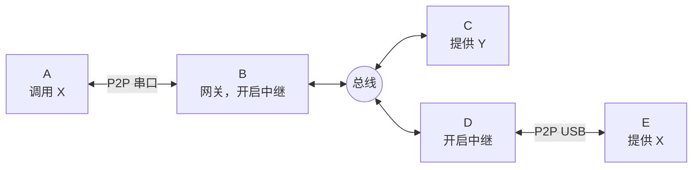

#### 每个节点看到的网络

每个节点**只认识相邻节点**，这是理解跨节点调用的关键。中继节点对两侧都冒充对方：对调用方来说它是提供者，对提供者来说它是调用方。

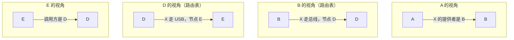

| 节点 | 角色 | 配置 | 知道什么 |
| --- | --- | --- | --- |
| A | 调用方 | 普通节点 | 只知道 X 的提供者是 B，不知道 D、E |
| B | 中继 | `TXrpcNodeSetRelay` | X 走总线，下一跳是 D |
| D | 中继 | `TXrpcNodeSetRelay` | X 走 USB，下一跳是 E |
| E | 提供者 | 普通节点，实现 `exec_cb` | 只知道调用来自 D |
| C | 无关节点 | 普通节点 | 收到询问，没有 X，不应答 |

调用方和提供者**不用开启任何东西**，只有中间节点要配置。线上全是普通帧，所以任何 v2 节点都可以直接当 A 或 E。

#### 发现：逐跳询问，路由逐跳建立

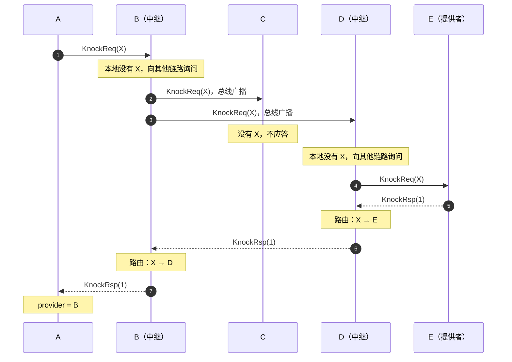

询问在中间节点超时时，A 先收到否定应答，下一轮再问时已经建好的路由会立即回答。所以每多一跳，首次发现最坏多等一轮（A 的 Knock 节拍是 1 秒）。

#### 调用：逐跳换序号，结果原路返回

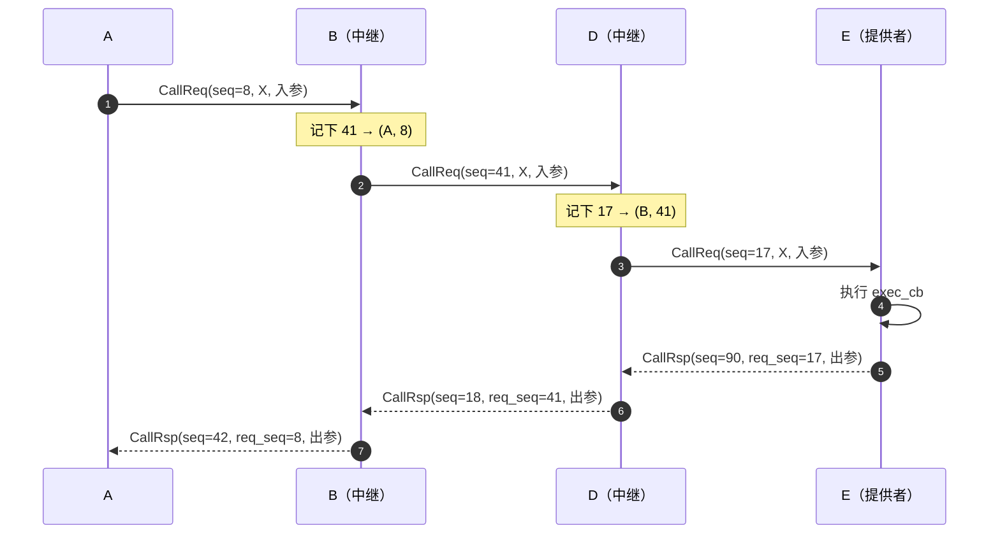

`seq` 在帧头，每一跳都是发送方自己的流水号；`req_seq` 在应答载荷里，指回这一跳请求的 `seq`。中继只换这两个序号，入参、出参、`process_id`、`process_key` 原样转发。

#### 失败时谁负责

| 故障 | 发现的节点 | 处理 | A 收到 |
| --- | --- | --- | --- |
| E 没有这个过程了 | E 回 -8 | D、B 依次作废路由 | -8，之后自动重新发现 |
| D 到 E 的链路断了 | D | 作废路由，回错误 | -13 |
| E 太慢 | D 等待超时 | 回错误 | -5（A 的超时更短时由 A 自己超时） |
| B 的转发槽用完 | B | 回错误 | -16 |

中继的数据结构、路由状态机和完整的处理规则见 11.4.6。

---

## 2. 总体架构

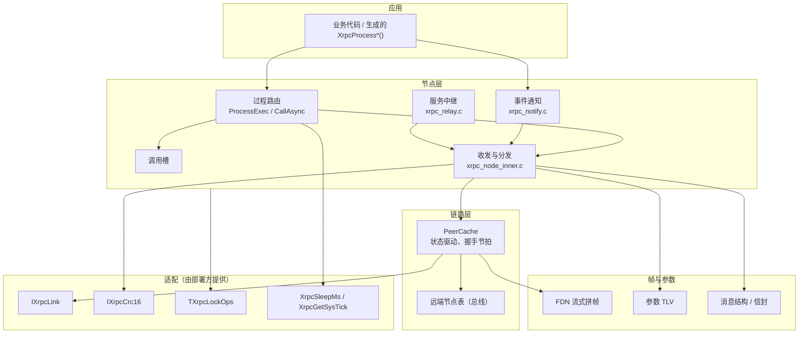

依赖方向自上而下，下层不知道上层。例外：`xrpc_peer.c` 反向依赖节点层（通过 `owner` 指针拿锁，并调用 `TXrpcNodeHandleRxFrame`、`TXrpcNodeSendHelloReq`、`TXrpcNodeProcessKnockDeal`、`TXrpcNodePeerLinkDown`）。

### 2.0 数据流

发送方向：所有消息都在 peer 的 `send_buff` 里就地组帧，经同一个发送骨架发出。

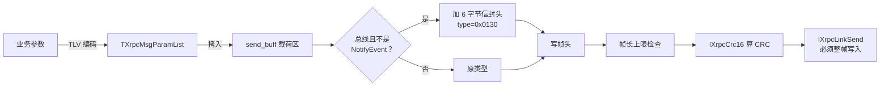

接收方向：字节流先拼成帧，校验通过后按类型分发，信封的内层和普通帧走同一条路。

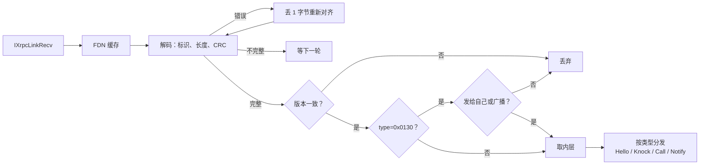

### 2.1 文件职责

| 文件 | 职责 |
| --- | --- |
| `include/xrpc/xrpc_common.h` | 错误码、帧常量、消息类型枚举、锁 vtable |
| `include/xrpc/xrpc_link.h`、`xrpc_link.c` | `IXrpcLink` 接口与分发包装 |
| `include/xrpc/xrpc_peer.h`、`xrpc_peer.c` | peer 数组管理、链路属性、`RunOnce` 轮询、帧解码/通知回调 |
| `xrpc_peer_inner.h` | `SetOwner`、`PeerRunOnce`（刻意放在 include 路径之外，仅库内可见） |
| `include/xrpc/xrpc_node.h`、`xrpc_node.c` | 节点对象、装配、过程查找、过程绑定、`TXrpcNodeProcessExec`、调用槽与 `TXrpcNodeCallAsync` |
| `include/xrpc/xrpc_notify.h`、`xrpc_notify.c`、`xrpc_notify_inner.h` | 事件通知：发布槽、补发、去重、订阅分发 |
| `include/xrpc/xrpc_relay.h`、`xrpc_relay.c`、`xrpc_relay_inner.h` | 服务中继：跨节点发现与调用转发 |
| `include/xrpc/xrpc_msg_ext.h` | 新增消息的线上结构（信封、通知、Hello 能力），手写，不是 dpt 生成物 |
| `xrpc_node_inner.h/.c` | 帧发送骨架、各类消息发送、接收分发（`TXrpcNodeHandleRxFrame`）、Knock 轮询 |
| `include/xrpc/xrpc_process.h`、`xrpc_process.c` | 过程描述、运行数据、状态枚举、类型化参数 Get/Add、`XrpcProcessNotifyCallRsp` |
| `include/xrpc/xrpc_msg_param_list.h`、`.c` | 参数列表编解码（TLV） |
| `include/xrpc/xrpc_msg.h` | 帧头、Knock、Call 的线上结构，多字节字段是字节数组 |
| `include/xrpc/xrpc_delivery.h`、`xrpc_delivery.c` | 投递状态机：判断继续等、重发或到期 |
| `include/xrpc/xrpc_status.h`、`xrpc_status.c` | 运行时状态表与状态回调 |
| `include/xrpc/xrpc_wire.h`、`xrpc_wire.c` | 线上字段的大端读写，全部线上字段都经过这里 |
| `dpt_encoder.h`、`dpt_decoder.h` | 字节流读写小工具，函数全为 `static`，每个包含方各有一份拷贝 |
| `include/xrpc/fdn.h`、`fdn.c` | 流式缓存拼帧（Full Data Notify） |
| `include/xrpc/xrpc.h` | 声明 `XrpcSleepMs`、`XrpcGetSysTick`，由部署方实现，见 `port/README.md` |
| `include/xrpc/xrpc_crc16.h`、`xrpc_crc16.c` | `IXrpcCrc16` 虚接口与分发。算法由部署方实现，经 `TXrpcNodeSetCrc16` 注入，必须与现网设备一致 |
| `include/xrpc/xrpc_types.h` | 基础类型定义 |

---

## 3. 核心数据结构

### 3.1 所有权关系

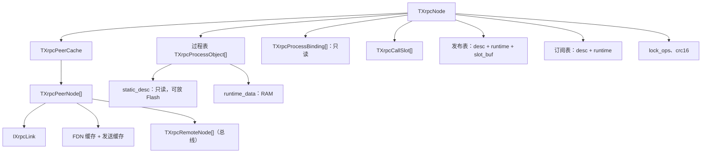

以上数组和缓冲**全部由调用方提供**，库内不分配内存。

- `TXrpcPeerCache.owner` 指回 `TXrpcNode`，由 `TXrpcNodeSetPeerCache` 设置。一个 cache 只有一个 owner。
- 过程对象分静态（只读，可放 Flash）和运行时（RAM）两部分。不启用调用槽时，运行时数据是"每过程一份"，同一过程同一时刻只能有一个在途调用。启用调用槽后，在途状态放在槽里。

### 3.2 过程运行时数据 `TXrpcProcessRuntimeData`

| 字段 | 含义 |
| --- | --- |
| `provider_node_id` | 已发现的提供者节点 ID，0 表示未知 |
| `process_seq` | 最近一次 Knock 或 Call 请求帧的帧头 `seq`，用来匹配应答 |
| `call_step` | 状态机当前态 |
| `knock_left_cnt` | 自动 Knock 剩余额度，初始 3 |
| `last_knock_tick` | 上次 Knock 时刻 |
| `curr_output` | 当前调用方的输出参数列表指针（用于回填） |
| `curr_errcode` | 当前调用的结果 |
| `exec_time_ms` | **未使用** |

### 3.3 过程状态机（图见 5.3 节）

补充规则：

- 本地实现了 `exec_cb` 的过程不进入此状态机，`ProcessExec` 直接调用回调。
- Knock 发送失败（链路、锁、缓冲）会把状态置回 `Idle` 并写入 `curr_errcode`。此时 `provider_node_id` 仍为 0，所以 `Idle` 不等于"可调用"，`ProcessExec` 还会再检查 provider。
- `curr_errcode` 在 `SendKnockReq` 时被预置为 `kXrpcErrTimeout`，在 `ProcessExec` 的"补充 Knock 额度"分支里被写成 `kXrpcErrProviderUnknow`，并没有被调用方读取，主要用于日志与诊断。
- 迟到的 CallRsp：调用方超时后状态已被复位为 `Idle`，`XrpcProcessNotifyCallRsp` 要求 `WaitRsp` 且 `process_seq` 一致才接收，因此迟到应答被丢弃，不会污染下一次调用。

---

## 4. 协议设计

> 本章描述当前实现。事件中继、状态上报等已定稿的后续改动见 设计评审，代码改到哪一步，这里更新到哪一步。

### 4.1 帧格式

协议 v2。**线上所有多字节字段都是网络字节序（大端）**，包括帧头、控制字段和参数值，与宿主字节序无关。

```
偏移  长度  字段
0     4     tag = "XRPC"
4     2     frame_crc    CRC16，覆盖 [node_id .. 帧尾]
6     2     frame_len    从 node_id 起的长度 = 20 + payload_len
8     4     node_id      发送方节点 ID
12    2     version      协议版本，当前 0x0200，高字节决定帧格式
14    2     type         消息类型
16    4     user_tag     应用标识，不同的值互相隔离
20    4     seq          本节点发送的数据包流水号
24    1     ttl          剩余跳数，新帧 255，每过一个中继减 1
25    1     flags        发送写 0，未知位接收忽略
26    2     reserved     发送写 0，接收忽略
28    N     payload
```

整帧长度 = `8 + frame_len`；`XRPC_MSG_HEAD_SIZE`=28，`XRPC_MSG_CRC_START_OFFSET`=8，`XRPC_MSG_FRAME_LEN_MIN`=20。前 8 字节（`tag`、`frame_crc`、`frame_len`）永远不变，解帧层不关心版本。

线上结构体的多字节字段都是字节数组，只能经 `xrpc_wire.h` 读写，漏掉转换时编译不过。

#### 帧头 seq：请求和应答怎么配对

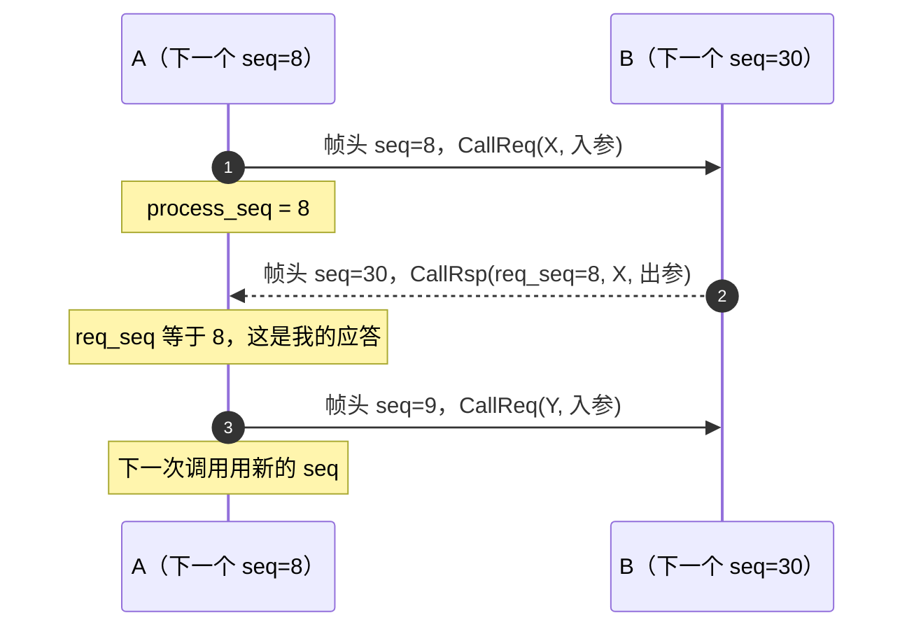

| 规则 | 说明 |
| --- | --- |
| 每个节点一个计数器 | 所有链路共用，所以应答只凭 `req_seq` 就能找到请求 |
| 每发一帧加 1 | 包括 Hello、Notify 和应答 |
| 链路发送失败的重发序号不变 | 那是同一帧 |
| 请求不再带自己的序号 | KnockReq、CallReq 的 `process_seq` 字段取消，直接用帧头 `seq` |
| 应答带 `req_seq` | KnockRsp、CallRsp 的第一个字段，指回请求的帧头 `seq` |
| 用于配对，不用于排序 | 发送请求前要先取号记录，可能被别的线程插队，所以线上不保证严格递增 |
| 中继扇出例外 | 一次询问发到多条链路时各帧序号相同，应答才能归到同一条路由 |
| 通知序号是另一回事 | NotifyEvent 载荷里的 `seq` 按（通知，发布方）递增，补发不变，用于去重 |

#### user_tag：同一设备上的多套系统

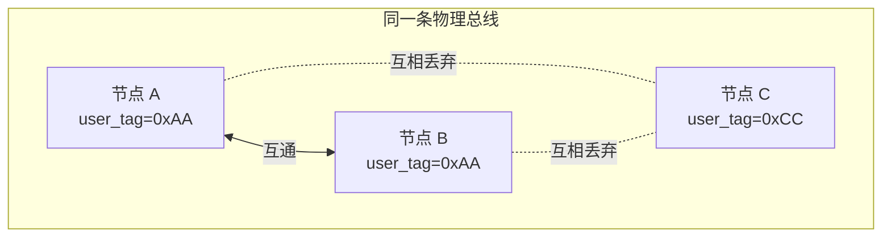

收帧时先比较 `user_tag`，不一致的帧不学习、不应答、不进业务，只累加计数（`TXrpcNodeGetUserTagDrops`）。计数持续增长说明配置错了。

- 默认 0，两端都不配时互通。
- 核心库没有全局状态，一个进程里可以有任意多个 `TXrpcNode`，这就是多实例。
- 每个实例独占链路时直接可用。两个实例共用同一条字节流时，要在链路下面做一层分发：读一次、拼一次帧，按 `user_tag` 交给对应实例。这一层还没有做。

#### ttl：接错线成环时自保

网络模型是星形相互连接成的树，正常情况下没有环。现场接错线成环时，过期路由可能让请求绕圈，白白占用沿途的转发槽。`ttl` 用来拦截这种帧，默认值 255 大于正常网络的跳数，不是拓扑限制。

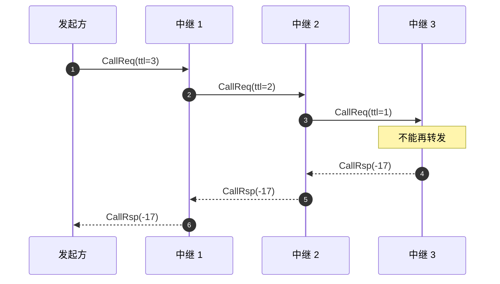

| 情况 | 处理 |
| --- | --- |
| 中继转发 KnockReq、CallReq | 新帧的 `ttl` 取收到的值减 1 |
| 收到的 `ttl` 不大于 1，又需要转发 | 不转发，回 `kXrpcErrTtlExpired` |
| 中继发回应答 | 用默认值。应答按记录的来源原路返回，不查路由 |
| 过程在本节点 | 不看 `ttl`，正常执行 |
| 总线帧 | `ttl` 在信封外的帧头里，规则相同 |

#### 版本演进

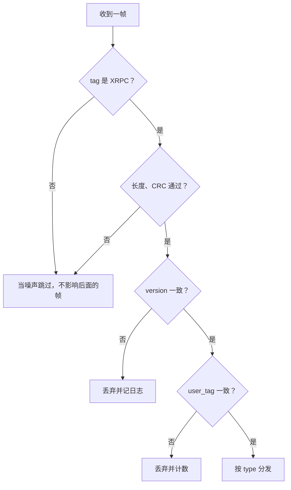

帧格式变化时提升 `version` 的高字节；只新增消息类型不用提升，对端收到不认识的类型记日志后丢弃。`TXrpcNodeCreate` 拒绝主版本不是 2 的版本号。没有已发布的设备，不做版本兼容，`version` 不一致的帧直接丢弃。

### 4.2 消息类型与 payload

| 类型 | 值 | payload（均为 pack(1)） |
| --- | --- | --- |
| HelloReq | 0x0102 | 空 |
| HelloRsp | 0xF102 | 空 |
| KnockReq | 0x0101 | `process_id(4) process_key(4)` |
| KnockRsp | 0xF101 | `req_seq(4) process_id(4) errcode(4)`；1=可用，0=key 不匹配，负数=不存在 |
| CallReq | 0x0111 | `process_id(4) process_key(4) param_cnt(1) param_list...` |
| CallRsp | 0xF111 | `req_seq(4) process_id(4) errcode(4) param_cnt(1) param_list...` |
| NotifyEvent | 0x0120 | `notify_id(4) notify_key(4) origin_node(4) seq(4) flags(1) param_cnt(1) param_list...`；flags bit0 = need_ack |
| NotifyAck | 0xF120 | `notify_id(4) origin_node(4) publisher(4) seq(4) result(4)`；0 成功，<0 订阅方拒绝 |
| Addressed | 0x0130 | `dst_node(4) inner_type(2) inner_payload...`；`dst_node` 全 1 表示广播 |

规律：响应类型 = 请求类型 | 0xF000（Hello 例外：Hello 的 Req/Rsp 值各自独立）。

HelloReq/HelloRsp 默认无载荷；链路打开 `advertise_max_recv` 后带 `max_recv_frame(4)`。

### 4.3 参数列表（TLV）

```
param_id(1) | param_type(1) | param_len(2, BE) | value(param_len)
```

- 类型码：`0..7` 为 U8/I8/U16/I16/U32/I32/U64/I64，`0x10` Bytes，`0x11` String。
- 定长整数值按大端写入，用移位实现，与宿主字节序无关。
- `param_cnt` 只有 1 字节，最多 255 项。接收侧 `TXrpcMsgParamListCreate(cnt>0)` 会扫描缓冲区确定真实长度，越界则返回 `kXrpcErrBufferOverflow`。
- `GetItemById` 是线性扫描；`Get` 返回的 Bytes/String 指针直接指向接收缓冲区，生命周期仅限回调内。
- `XrpcProcessParamGetBytes` 允许读 String 类型，`GetString` 不允许读 Bytes，类型检查是单向的。

### 4.4 消息序列

握手、发现、调用及异常路径的完整时序图见 **第 5 章**（5.2 节），各消息 payload 的逐字段图例见 5.4 节。

---

## 5. 图解：交互时序与数据结构

> 本章面向第一次接触 XRPC 的读者，建议按顺序阅读。时序图使用 Mermaid 语法（GitHub、GitLab、VS Code、Typora 等可直接渲染）；数据结构图使用等宽文本，任何编辑器都能看。

### 5.1 一图看懂：谁在和谁说话

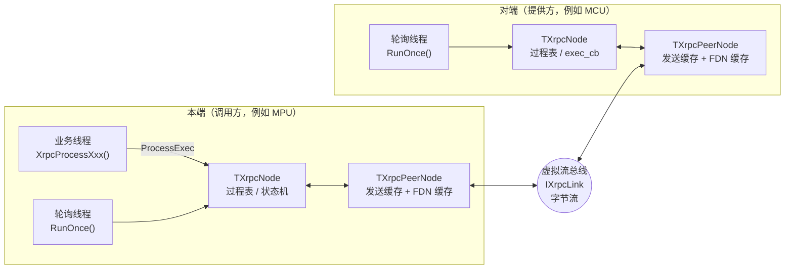

要点：

- 业务线程只负责"发请求、等结果"，**从不读链路**。
- 所有收包都由轮询线程完成：它把字节流拼成帧，再根据帧类型更新状态机或执行对端的 `exec_cb`。
- 两端结构对称，谁有 `exec_cb` 谁就是该过程的提供方。

### 5.2 时序图

图中参与者约定：

| 名称 | 含义 |
| --- | --- |
| 业务线程 | 调用 `XrpcProcess<Name>` / `TXrpcNodeProcessExec` 的线程 |
| 本端轮询 | 本端驱动 `TXrpcNodeRunOnce` 的线程 |
| 链路 | `IXrpcLink`，下面是串口或虚拟总线 |
| 对端轮询 | 对端驱动 `RunOnce` 的线程，provider 回调也在这里执行 |

#### 5.2.1 全景：从上电到第一次成功调用

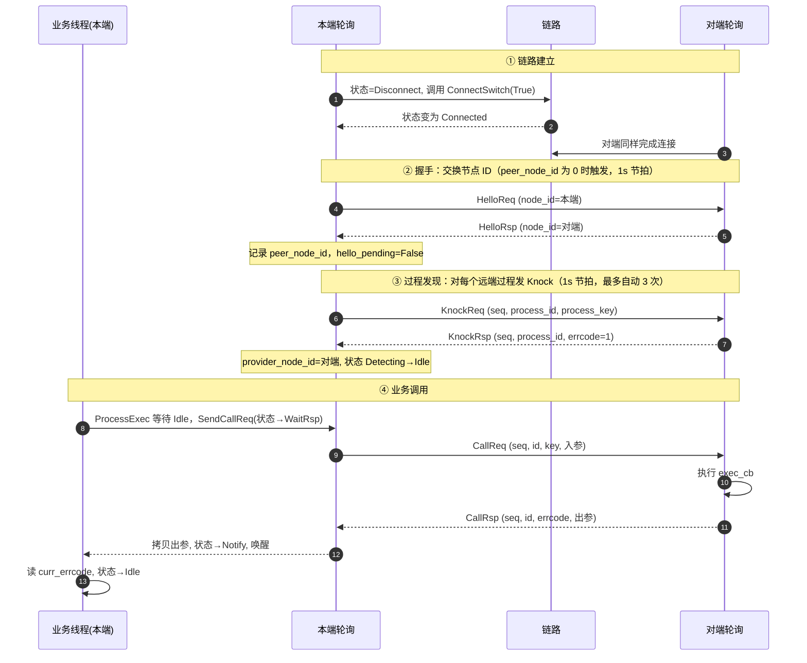

#### 5.2.2 握手 Hello

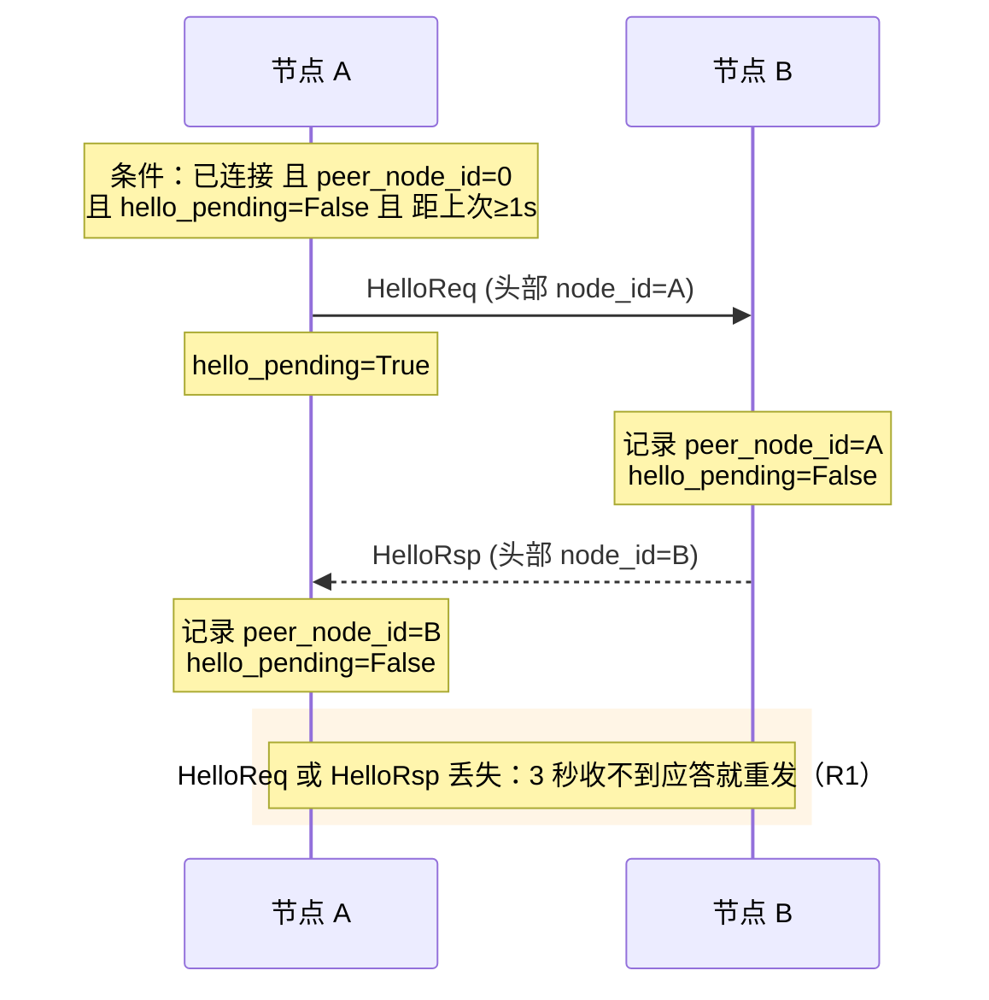

两个细节：

- Hello 不携带 payload，节点 ID 全靠帧头里的 `node_id` 字段。
- 如果在 `TXrpcPeerCacheAddLink` 注册时就给了非零 `peer_node_id`，这一步会被跳过。

#### 5.2.3 过程发现 Knock（三种结果）

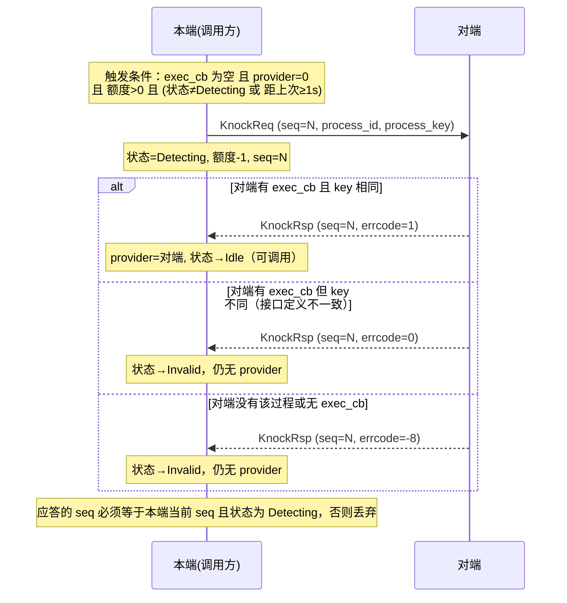

#### 5.2.4 同步调用 Call：正常路径（含线程分工）

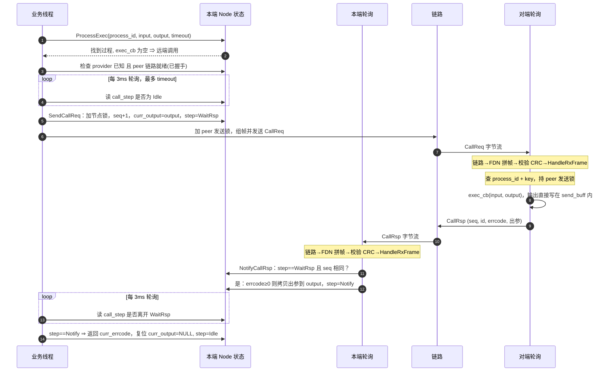

关键点：

- **两个线程通过 `call_step` 交接**：业务线程把它置为 `WaitRsp`，轮询线程在收到应答后置为 `Notify`。
- 出参是**在轮询线程里直接拷贝到调用方提供的 `output` 缓冲**，所以调用返回前，`output` 必须保持有效。
- 对端的 `exec_cb` 在**对端轮询线程**里执行，执行期间持有对端 peer 的发送锁。

#### 5.2.5 同步调用：异常路径

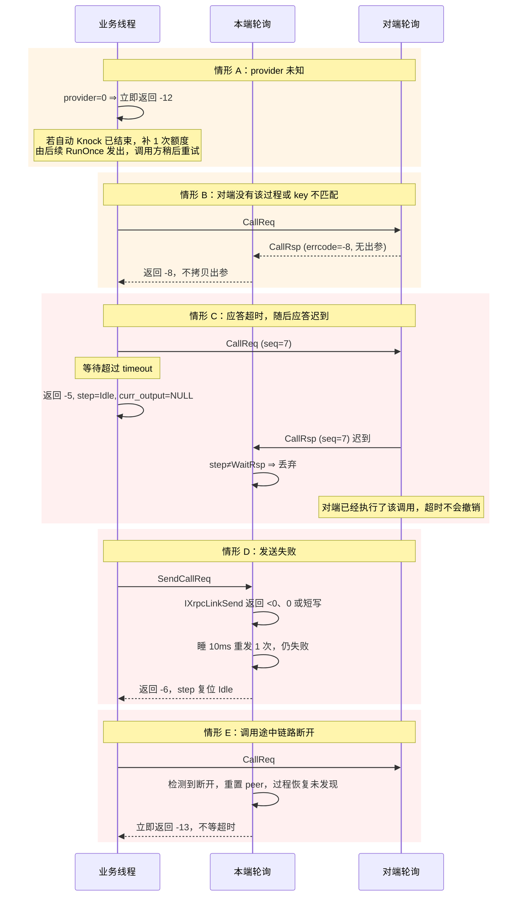

#### 5.2.6 接收路径内部（一帧数据如何变成一次回调）

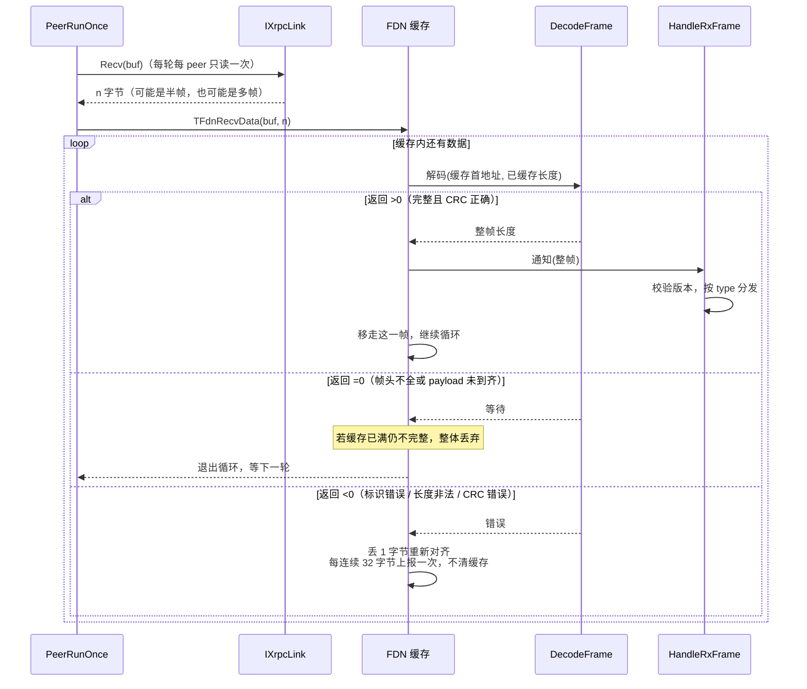

### 5.3 过程状态机图

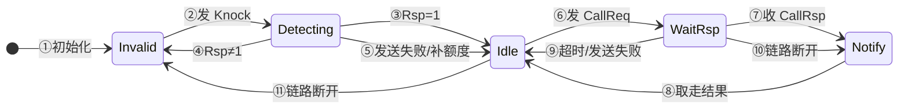

| 编号 | 触发 | 动作 |
| --- | --- | --- |
| ① | `SetProcessTable`（仅 `exec_cb` 为空的过程） | `provider=0`，额度=3 |
| ② | `SendKnockReq` | 额度-1，`seq+1`，记录发送时刻 |
| ③ | KnockRsp，`errcode=1`，`seq` 匹配 | 记录 `provider_node_id` |
| ④ | KnockRsp，`errcode` 为 0 或负数 | 仍无 provider，后续还可以再 Knock |
| ⑤ | Knock 发送失败，或 `ProcessExec` 在额度耗尽后补发额度 | 回到 `Idle`，`provider` 仍为 0 |
| ⑥ | `SendCallReq` | `seq+1`，记录 `curr_output`，`curr_errcode=0` |
| ⑦ | CallRsp，`seq` 匹配 | 写入 `curr_errcode`，`errcode≥0` 时拷贝出参 |
| ⑧ | 业务线程读到结果 | 复位 `curr_output=NULL` |
| ⑨ | 业务线程等待超时，或 CallReq 发送失败 | 复位 `curr_output=NULL`；迟到的应答之后会被丢弃 |
| ⑩ | 链路断开时有在途调用 | `curr_errcode=-13`，唤醒调用方 |
| ⑪ | 链路断开，或 CallRsp 返回 -8 | `provider=0`，额度恢复为 3，由自动 Knock 重新发现 |

阅读方法：横向是"发现阶段"（Invalid→Detecting→Idle），之后的稳态循环是 `Idle → WaitRsp → Notify → Idle`。`Idle` 只说明"当前没有在途调用"，调用前还必须有 `provider_node_id`。

### 5.4 数据结构图例

字段名在图中用英文，与源码一致；中文说明见各图下面的表格。所有"偏移"均为字节，多字节字段都是大端。

#### 5.4.1 总体帧结构

```
 偏移:  0        4        6        8                12       14       16              20              24  25  26    28
        ├────────┼────────┼────────┼────────────────┼────────┼────────┼───────────────┼───────────────┼───┼───┼─────┼──────────────┤
        │  tag   │ frame_ │ frame_ │    node_id     │version │  type  │   user_tag    │      seq      │ttl│flg│resv │   payload    │
        │ "XRPC" │  crc   │  len   │                │        │        │               │               │   │   │     │  (N 字节)    │
        └────────┴────────┴────────┴────────────────┴────────┴────────┴───────────────┴───────────────┴───┴───┴─────┴──────────────┘
 长度:    4 B      2 B      2 B          4 B           2 B      2 B         4 B             4 B        1B  1B  2 B       N B

                                     ◄──────────────── frame_len = 20 + N ─────────────────────────────────────────────────────►
                                     ◄──────────────── CRC16 的计算范围 ───────────────────────────────────────────────────────►
        ◄──────────────────────────────────── 整帧 = 8 + frame_len ───────────────────────────────────────────────────────────►
```

| 字段 | 偏移 | 长度 | 说明 |
| --- | --- | --- | --- |
| `tag` | 0 | 4 | 固定 `XRPC`，用于重新定位帧起点 |
| `frame_crc` | 4 | 2 | CRC16，计算范围从 `node_id`（偏移 8）到帧尾，长度 `frame_len` |
| `frame_len` | 6 | 2 | 从 `node_id` 起的长度，`= 20 + payload 长度` |
| `node_id` | 8 | 4 | 发送方节点 ID |
| `version` | 12 | 2 | 协议版本，接收端不一致直接丢帧 |
| `type` | 14 | 2 | 消息类型，见 4.2 |
| `user_tag` | 16 | 4 | 应用标识，接收端不一致直接丢帧并计数 |
| `seq` | 20 | 4 | 本节点发送的数据包流水号，见 4.1 |
| `ttl` | 24 | 1 | 剩余跳数，见 4.1 |
| `flags` | 25 | 1 | 发送写 0，未知位接收忽略 |
| `reserved` | 26 | 2 | 发送写 0，接收忽略 |
| `payload` | 28 | N | 随 `type` 变化 |

两个容易混淆的数字：`frame_len` 不包含前 8 字节（`tag` 和 `frame_crc`、`frame_len` 自己）；因此**整帧字节数 = `frame_len + 8`**，空 payload 的 Hello 帧是 28 字节（`frame_len = 20`）。

#### 5.4.2 各消息的 payload 布局

**HelloReq / HelloRsp**：无 payload，整帧 28 字节。

**KnockReq**（8 字节，请求序号是帧头 `seq`）

```
 payload  0           4           8
          ├───────────┼───────────┤
          │process_id │process_key│
          └───────────┴───────────┘
```

**KnockRsp**（12 字节）

```
 payload  0           4           8           12
          ├───────────┼───────────┼───────────┤
          │  req_seq  │process_id │  errcode  │     errcode: 1 可用 / 0 key 不符 / <0 不存在
          └───────────┴───────────┴───────────┘
```

**CallReq**（9 字节固定部分 + 参数列表，请求序号是帧头 `seq`）

```
 payload  0           4           8   9
          ├───────────┼───────────┼───┼────────────────────────┐
          │process_id │process_key│cnt│  param_list (TLV × cnt)│
          └───────────┴───────────┴───┴────────────────────────┘
                                     └ param_cnt（1 字节）
```

**CallRsp**（13 字节固定部分 + 参数列表）

```
 payload  0           4           8           12  13
          ├───────────┼───────────┼───────────┼───┼────────────────────────┐
          │  req_seq  │process_id │  errcode  │cnt│  param_list (TLV × cnt)│
          └───────────┴───────────┴───────────┴───┴────────────────────────┘
```

| 字段 | 说明 |
| --- | --- |
| `req_seq` | 对应请求的帧头 `seq`，本端据此判断应答是否有效 |
| `process_id` | 过程 ID，例如 `0x00002008` |
| `process_key` | 由过程定义（ID、各参数的 ID/类型/长度）计算出的 CRC32，用于确认两端接口一致，不是密钥 |
| `errcode` | Knock：见上；Call：`≥0` 成功（正数由过程自定义），`<0` 为错误码 |
| `param_cnt` | 参数个数，接收端会重新扫描缓冲区校正 |

#### 5.4.3 参数列表（TLV）

单个参数项：

```
          0         1          2           4                 4+len
          ├─────────┼──────────┼───────────┼──────────────────┤
          │param_id │param_type│ param_len │   param_value    │
          │  (1B)   │   (1B)   │ (2B, BE)  │   (param_len B)  │
          └─────────┴──────────┴───────────┴──────────────────┘
          │<──── 固定 4 字节头 ───────────>│
```

类型码与值的长度：

| `param_type` | 类型 | `param_len` | 值的编码 |
| --- | --- | --- | --- |
| `0x00` / `0x01` | UInt8 / Int8 | 1 | 1 字节 |
| `0x02` / `0x03` | UInt16 / Int16 | 2 | 大端 |
| `0x04` / `0x05` | UInt32 / Int32 | 4 | 大端 |
| `0x06` / `0x07` | UInt64 / Int64 | 8 | 大端 |
| `0x10` | Bytes | 任意（≤ 缓冲上限） | 原样字节 |
| `0x11` | String | 任意 | 原样字节，**不保证以 `\0` 结尾** |

**编码示例**：两个参数 `id=1, UInt16=0x1234` 与 `id=2, String="OK"`

```
 param_cnt = 2
 offset:  0  1  2  3  4  5 | 6  7  8  9  10 11
 bytes : 01 02 00 02 12 34 | 02 11 00 02 4F 4B
         │  │  └──┘  └──┘    │  │  └──┘  └──┘
         │  │  len=2  value  │  │  len=2  "OK"
         │  type=U16(0x02)   │  type=String(0x11)
         id=1                id=2
 encode_buffer_used = 12
```

多个参数项首尾相连，没有分隔符，也不填充。参数 ID 在"输入"和"输出"里**各自独立编号**。

读写时的规则：

- `Add` 时先检查剩余空间，不足返回 `-2`；项数超过 255 返回 `-3`。
- `Get` 按 ID 线性查找，类型或长度不符返回 `-1`，ID 不存在返回 `-4`。
- Bytes/String 的 `Get` 返回的是**指向原缓冲的指针**，不拷贝，调用返回后就不应再使用。

#### 5.4.4 完整帧示例：一次 CallReq

假设：本端 `node_id=2`、`version=0x0200`、`user_tag=0x11223344`，这是节点发出的第一帧，调用 `process_id=0x00002008`，带两个参数（即 5.4.3 的示例，共 12 字节），`process_key` 用 `KK KK KK KK` 表示，CRC 用 `CC CC` 表示。

```
 偏移    字节                     含义
 ─────   ──────────────────────   ─────────────────────────────────
  0..3   58 52 50 43              tag = "XRPC"
  4..5   CC CC                    frame_crc（覆盖偏移 8..48，共 41 字节）
  6..7   00 29                    frame_len = 20 + 21 = 41
  8..11  00 00 00 02              node_id = 2
 12..13  02 00                    version = 0x0200
 14..15  01 11                    type = 0x0111 (CallReq)
 16..19  11 22 33 44              user_tag
 20..23  00 00 00 01              seq = 1
 24      FF                       ttl = 255
 25      00                       flags
 26..27  00 00                    reserved
 ───── payload（21 字节）─────────────────────────────────────────
 28..31  00 00 20 08              process_id = 0x00002008
 32..35  KK KK KK KK              process_key
 36      02                       param_cnt = 2
 37..42  01 02 00 02 12 34        参数 1：id=1, U16, 0x1234
 43..48  02 11 00 02 4F 4B        参数 2：id=2, String, "OK"
```

核算：payload = 9（固定部分）+ 12（参数列表）= 21 字节；`frame_len` = 20 + 21 = 41（0x29）；整帧 = 8 + 41 = 49 字节（偏移 0..48）。真实 CRC 由部署方注入的 `IXrpcCrc16` 实现计算，此处用 `CC CC` 代替。

#### 5.4.5 发送缓冲 `send_buff` 的内存布局

每个 peer 只有**一块**发送缓冲，所有发送都在里面就地组帧，因此必须持有该 peer 的发送锁。

```
 send_buff  0                16                   29                         send_buff_size
            ├────────────────┼────────────────────┼──────────────────────────────┤
 发送 CallReq│   帧头 16 B    │ seq/id/key/cnt 13 B │ 入参 TLV（拷贝自 input）      │
            ├────────────────┼────────────────────┼──────────────────────────────┤
 对端处理    │   帧头 16 B    │ seq/id/errcode/cnt  │ 出参 TLV ← exec_cb 直接写这里 │
 CallReq 时  │ (稍后填充)      │ 13 B (稍后填充)     │                              │
            └────────────────┴────────────────────┴──────────────────────────────┘
```

对端收到 CallReq 后，`output_param` 被直接建立在 `send_buff[29..]`，`exec_cb` 把出参写进去，之后补齐帧头和 CallRsp 固定部分即可发送，不需要再拷贝一遍。代价是：

- 业务可用的出参空间 = `send_buff_size − 29`。
- 整个"执行 + 发送"期间持有该 peer 的发送锁，别的消息（包括 Hello、Knock）发不出去。
- 这个设计导致 `memcpy` 的源和目的相同（已知问题 K1）。

#### 5.4.6 对象关系图

```mermaid
classDiagram
    class TXrpcNode {
        UInt32 node_id
        UInt16 version
        TXrpcPeerCache* peer_cache
        TXrpcProcessTable process_table
        TXrpcLockOps* lock_ops
    }
    class TXrpcPeerCache {
        TXrpcPeerNode* peer_array
        UInt32 max_peer_count
        UInt32 peer_count
        void* owner
    }
    class TXrpcPeerNode {
        IXrpcLink* link
        UInt32 peer_node_id
        Bool hello_pending
        UInt32 hello_tick
        UInt32 knock_tick
        TFdnData fdn_recv
        UInt8* send_buff_ptr
        UInt32 send_buff_size
        TXrpcLockOps* send_lock_ops
    }
    class IXrpcLink {
        OnConnectSwitch_()
        OnSend_()
        OnRecv_()
        OnState_()
    }
    class TXrpcProcessTable {
        TXrpcProcessObject** process_table
        UInt32 count
    }
    class TXrpcProcessObject {
        static_desc
        runtime_data
    }
    class TXrpcProcessStaticDesc {
        UInt32 process_id
        UInt32 process_key
        char* process_name
        exec_cb
        void* user_data
    }
    class TXrpcProcessRuntimeData {
        UInt32 provider_node_id
        UInt32 process_seq
        call_step
        UInt32 knock_left_cnt
        UInt32 last_knock_tick
        TXrpcMsgParamList* curr_output
        Int32 curr_errcode
    }
    class TXrpcMsgParamList {
        char* encode_buffer_addr
        UInt16 encode_buffer_size
        UInt16 encode_buffer_used
        UInt8 param_cnt
    }
    TXrpcNode "1" --> "1" TXrpcPeerCache : peer_cache
    TXrpcPeerCache "1" --> "*" TXrpcPeerNode : peer_array
    TXrpcPeerCache ..> TXrpcNode : owner(反向引用)
    TXrpcPeerNode "1" --> "1" IXrpcLink : link
    TXrpcNode "1" --> "1" TXrpcProcessTable
    TXrpcProcessTable "1" --> "*" TXrpcProcessObject
    TXrpcProcessObject --> TXrpcProcessStaticDesc : 只读
    TXrpcProcessObject --> TXrpcProcessRuntimeData : 可变
    TXrpcProcessRuntimeData ..> TXrpcMsgParamList : curr_output(指向调用方)
```

读图提示：实线是"持有/指向"，虚线是"弱引用"。`TXrpcMsgParamList` 本身不拥有缓冲区，只描述一块外部内存的使用情况（容量、已用、项数）。

#### 5.4.7 一次调用中各缓冲区的归属

```
 业务线程栈/静态区                     库内（调用方提供的内存）
 ┌──────────────────────┐         ┌──────────────────────────────┐
 │ input  ParamList     │──拷贝──►│ peer.send_buff（发送组帧）     │──► Link.Send
 │   └ 输入 TLV 缓冲     │         └──────────────────────────────┘
 │ output ParamList     │◄──拷贝──┐
 │   └ 输出 TLV 缓冲     │         │   ┌──────────────────────────┐
 └──────────────────────┘         └───│ FDN 缓存（接收拼帧）       │◄── Link.Recv
          ▲                           │   └ CallRsp 出参视图(不拷贝)│     （经轮询临时缓冲）
          │ curr_output 指针          └──────────────────────────┘
          └── 过程 runtime_data
```

调用方提供的 `output` 缓冲在 `ProcessExec` 返回之前必须有效，因为轮询线程会通过 `runtime_data.curr_output` 直接写它。

---

## 6. 关键模块设计

### 6.1 节点层调用路由 `TXrpcNodeProcessExec`

```mermaid
flowchart TD
    A["ProcessExec"] --> B{"过程在表里？"}
    B -->|否| E1["返回 -1"]
    B -->|是| C{"本地有 exec_cb？"}
    C -->|有| L["直接执行，timeout 无效"]
    C -->|没有| D{"provider 已知？"}
    D -->|否| E2["额度用完时补 1 次<br/>返回 -12"]
    D -->|是| F{"peer 找到且就绪？"}
    F -->|否| E3["返回 -10 / -13"]
    F -->|是| G{"启用调用槽？"}
    G -->|是| H["申请槽、发送、等槽完成<br/>同一过程可并发"]
    G -->|否| I["等 Idle，SendCallReq，等应答<br/>同一过程一个在途"]
    H --> Z["取结果并复位（同一临界区）"]
    I --> Z
```

两段等待共用一个截止时间，总时长不超过 `timeout`。没有占用过程的调用（`SendCallReq` 返回 -9）不复位状态，否则会清掉先到者的在途调用（C5）。

### 6.2 节点层接收分发 `TXrpcNodeHandleRxFrame`

先校验 `version` 和 `user_tag`，不一致直接丢弃。然后按类型分发：Hello 记录对端；KnockReq 回 KnockRsp；KnockRsp 更新过程状态；CallReq 执行回调并回 CallRsp；CallRsp 回填输出并通知。

**CallReq 处理细节**（`L_XrpcNodeHandleCallReq`）：

- 输出参数列表直接建在 peer 的 `send_buff` 内，偏移 = 28 + 13（CallRsp 固定部分），即回包 `param_list` 的位置。执行回调后直接填充 CallRsp 头并发送，省去一次拷贝。
- 整个"执行回调 + 发送应答"持有该 peer 的发送锁。
- 找不到过程、key 不匹配、本地无 `exec_cb`：回 `kXrpcErrProcessNotFound`（-8）。
- 入参/出参列表创建失败：回 `kXrpcErrInvalidParam`。
- 回调返回值（含正数）原样放入 `errcode`；`errcode<0` 时接收端不拷贝输出。

### 6.3 对端层轮询 `TXrpcPeerCachePeerRunOnce`

```mermaid
flowchart TD
    S["每个 peer"] --> A{"链路状态"}
    A -->|"Connected"| B["标记 link_up"]
    A -->|"Busy"| N["本轮跳过，不算断开"]
    A -->|"其他，且之前 link_up"| R["TXrpcNodePeerLinkDown"]
    A -->|"Disconnect / TimeOut"| C["发起连接"]
    R --> C
    B --> D["Hello 节拍"]
    D --> E["读一次链路"]
    E -->|"有数据"| F["进 FDN，分发"]
    E -->|"负数"| G["断开并重置，本轮结束"]
    F --> H["Knock 节拍（已握手才发）"]
    H --> S
```

| 拓扑 | Hello 行为 |
| --- | --- |
| P2P | 未握手时发 HelloReq，3 秒收不到应答重发 |
| 总线 | 每 3 秒广播一次宣告，按帧头发送方学习远端节点 |

`TXrpcNodeRunOnce` 在所有 peer 轮询之后，再驱动调用槽（超时、完成回调）、事件发布和中继超时。

慢速 Knock 在链路之间轮转。自动额度用完后每 5 秒才有一次额度，而轮询总是从第 0 条链路开始，不轮转的话额度永远被第 0 条用掉，晚上线的提供者再也问不到。过程的 `knock_cursor` 记下一次从哪条链路开始，跳过没连上、没握手和绑定不接受的链路。

### 6.4 FDN 拼帧

- 把新数据追加到缓存 → 循环调用解码器：
  - `>0`：完整帧，回调通知，memmove 消费，清错误计数
  - `=0`：不完整，等待；若缓存已满则丢弃全部缓存
  - `<0`：丢 1 字节重同步；连续错误每达 32 字节上报一次，不清缓存（噪声后面可能就是有效帧）
- 解码器 `L_XrpcPeerDecodeFrame` 校验：标识 `XRPC`、`frame_len>=20`、不超过拼帧缓存、长度到齐、CRC16。不启用 FDN 时走同一个解码器。
- 帧长上限由 FDN 缓存大小决定，声明长度更大的帧立即按错误处理，不等缓存填满。
- 通知回调内会同步执行 provider，期间 FDN 缓存仍被占用。

### 6.5 发送路径

`L_XrpcNodeSendMsgFrameNoLock`：在 `peer->send_buff` 内就地组帧 → 算 CRC → `IXrpcLinkSend` 一次发出，数据流见 2.0 节。所有消息共用这个发送缓冲，所以发送必须持有 peer 发送锁。返回 0 或短写都算失败。`L_XrpcNodeSendWithRetry` 只在链路发送失败时睡 10ms 重发一次（只重发这一帧，与业务层的重试无关）。

---

## 7. 线程、锁与内存模型

### 7.1 角色

| 角色 | 线程 | 做什么 |
| --- | --- | --- |
| 轮询线程 | 一个固定线程 | 周期调用 `RunOnce`：收包、握手、发现、执行 provider、回填应答 |
| 调用线程 | 任意业务线程 | 调 `ProcessExec`：发 CallReq 并休眠等待 |

库不创建线程。**同步远端调用绝不能和 `RunOnce` 在同一线程**，否则收不到应答，必然超时。

### 7.2 三类锁，必须是不同对象

```mermaid
flowchart LR
    S["peer 发送锁"] -->|"允许：持发送锁取节点锁"| N["节点锁"]
    N -.->|"禁止"| S
    L["日志后端锁"]
    N -.-|"不能共用"| L
    S -.-|"不能共用"| L
```

| 锁 | 注入点 | 保护对象 |
| --- | --- | --- |
| 节点锁 | `TXrpcNodeSetLockMethod` | 过程运行时数据、peer 的握手/节流字段、调用槽、发布槽、远端节点表 |
| peer 发送锁 | `TXrpcPeerCacheAddLink` 的 `send_lock_ops` | 该 peer 的 `send_buff`（含 `exec_cb` 执行期间） |
| 日志后端锁 | 日志库内部 | 无关，但**不能与前两者共用** |

节点锁与发送锁的回调可以为 NULL（视为空操作），但**调用线程与 `RunOnce` 线程不同时，节点锁必须注入**，否则过程状态没有任何保护。锁不得递归。

加锁顺序：持发送锁时可以取节点锁（发送失败后复位过程状态），反过来不允许。不要持节点锁做发送或调用回调。

### 7.3 状态访问

过程运行时数据和 peer 的握手、节流字段，读写都在节点锁内完成，核心库不使用原子操作，也不含芯片相关代码。调用线程等待时循环执行"加锁读 `call_step`、解锁、睡眠"。

`ProcessExec` 取结果和复位状态在同一临界区内完成。出参拷贝由轮询线程在节点锁内进行，所以 `ProcessExec` 解锁返回后，迟到的应答只会看到 `Idle`，不会再写调用方的 `output`。加锁失败时，等待方按"忙"处理，继续等到超时。

### 7.4 内存

全部由调用方提供，包括：peer 数组、每 peer 的 FDN 缓存与发送缓存、轮询用的接收缓冲、过程运行时数据。单帧可用的业务参数空间 ≈ `send_buff_size − 16 − 13（CallRsp）`，CallReq 则为 `− 16 − 13`；输出参数受 `send_buff` 中剩余空间限制。

---

## 8. 错误处理约定

返回值：`0` 成功；`>0` 由过程自行定义的业务结果（`ProcessExec` 原样透传）；`<0` 为框架错误码。完整错误码见 `xrpc_common.h`。

超时只表示本端放弃等待，不能撤销对端的执行。对关机、重启、输出控制这类非幂等过程，上层重试前要先确认是否允许重复执行。


---

### 8.1 运行时状态上报

缓冲和表项由适配层静态配置，不足时不能静默。`xrpc_status.c` 在节点里放一张固定大小的状态表，每种状态一项，记录累计次数和最近一次的详情。

```mermaid
flowchart LR
    A["任意线程发现异常"] --> B["节点锁内写状态表"]
    B --> C["RunOnce 扫描状态表"]
    C --> D{"次数有变化，且是第一次<br/>或已过上报间隔？"}
    D -- "是" --> E["锁外调用状态回调"]
    D -- "否" --> C
```

这样回调固定在 `RunOnce` 线程，不需要动态内存，噪声只累加计数。状态码和 `need`、`actual` 的含义见 `xrpc_status.h`。中继路由表满时回 `kXrpcErrNoFreeSlot`，不再回 -8，因为过程可能存在。

总线上收到帧头 `node_id` 等于自己的帧时，按节点 ID 冲突上报并丢弃，不当成对端的帧。

## 9. 已知问题与风险

已修复的条目保留，方便追溯；✅ 表示已修复并有回归用例，状态汇总见 9.6。

### 9.1 状态与恢复

| # | 问题 | 位置 | 影响 |
| --- | --- | --- | --- |
| R1 ✅ | `hello_pending` 置位后没有超时清除。HelloReq 丢失时不会重发，只能依赖对端主动发 HelloReq | `PeerRunOnce` | 两端都丢包时 `peer_node_id` 长期为 0，所有远端调用返回 -13 |
| R2 ✅ | 链路断开/重连不重置 peer 状态：`peer_node_id`、`hello_pending`、FDN 缓存、过程的 `provider_node_id` 与 `call_step` 都保持原样 | `PeerRunOnce` 的状态分支 | 对端重启后，若接口定义变化，本端仍持有旧 provider，要等到 CallReq 被对端返回 -8 才发现；断开时的在途调用只能等超时 |
| R3 ✅ | Knock 自动额度为 3 次，耗尽后只有调用方再次 `ProcessExec` 才补发 1 次 | `ProcessExec` | 对端晚于本端启动超过 3 秒（每秒 1 次）时，需要业务层有重试逻辑 |
| R4 | ~~32 位原子宏被用在 1 字节的 `Bool hello_pending` 上~~ **已解决（N1）**：原子宏已移除 | `xrpc_peer.c`、`xrpc_node*.c` | 无 |
| R5 ✅ | Knock 不等握手完成就发出，`RunOnce` 没有检查 `peer_node_id`。`peer_node_id` 仍为 0 时收到 KnockRsp，会把 provider 记成 0、状态置 Idle | `PeerRunOnce`、`L_XrpcNodeHandleKnockRsp` | HelloRsp 丢失时对端明明在线，3 次自动 Knock 额度也会被白白耗尽，与 R1、R3 叠加后需要业务层重试才能恢复 |

### 9.2 并发语义

| # | 问题 | 影响 |
| --- | --- | --- |
| C1 | 同一过程被两个线程并发调用时，两者可能同时通过"等 Idle"，后到者在 `SendCallReq` 里因状态非 Idle 返回 `kXrpcErrProcessStatus`，而不是排队等待 | 业务线程要按过程串行调用；启用调用槽后没有这个限制 |
| C2 | provider 在轮询线程内执行并持有 peer 发送锁；执行期间无法收包、也无法发 Hello/Knock，调用方的应答也被推迟 | provider 必须快；**绝不能在 provider 里发起同一 peer 的同步调用**（会因轮询线程被占用而超时） |
| C3 ✅ | 超时是两段独立计时（等 Idle + 等应答），总时长最多约 2×timeout；本地 `exec_cb` 完全不受 timeout 约束 | 业务层对"最长阻塞时间"的估算要乘 2 |
| C4 | provider ID 在节点锁内读取，但读取与后续使用之间有窗口 | 目前依赖 provider 一旦发现就不再变，没有"失效"路径，所以问题不明显；一旦加入 provider 失效/重新发现（见 R2 改进）就需要处理 |
| C5 | ~~同一过程并发调用时，后到者收到 `kXrpcErrProcessStatus` 后仍无条件复位状态，清掉先到者的在途调用~~ **已修复**：只有占用了过程的调用才复位。判断依据是 `SendCallReq` 的返回值，不是最终结果，因为对端业务也可能返回 -9 | 修复前先到者会被判超时，或返回成功但 `output` 未写入 |

### 9.3 协议与数据

| # | 问题 | 影响 |
| --- | --- | --- |
| P1 ✅ | ~~帧头与控制字段是宿主字节序~~ **协议 v2 已解决**：线上全部大端，按移位读写 | 尚未在大端宿主上实测 |
| P2 ✅ | `IXrpcLinkSend` 返回 `0` 被当作成功（只判 `<0`），返回值也不与整帧长度比较 | 链路忙时 0 字节发送会被当成已发送，后续只能靠应答超时发现 |
| P3 | 没有请求重传和去重，接收端也不记录已执行的 seq | 发送重试（10ms 一次）只在"发送失败返回负数"时触发，但若首次其实已经部分写入，重试可能导致对端收到重复帧；对端会重复执行 |
| P4 | `TXrpcMsgParamListCreate` 校验失败时仍会保留部分结果并返回 `kXrpcErrBufferOverflow`，调用方必须检查返回值 | 已在 `L_XrpcCreateRxParamList` 路径检查 |
| P5 | CallRsp 的 `param_cnt` 来自对端，应答里 `errcode>=0` 但参数不足时由业务读取时才暴露 | 生成的封装需要处理 `kXrpcErrItemNotFound` |
| P6 ✅ | 不启用 FDN 时，`RunOnce` 把单次接收的数据直接当完整帧分发，不校验 tag、CRC，也不核对 `frame_len` 与实际收到的长度（`xrpc_peer.c` 单帧模式分支） | 损坏的帧会被执行；`frame_len` 被改大时，参数解析会读到接收缓冲之外 |
| P7 ✅ | `frame_len` 没有与缓存容量比较。噪声恰好形如帧头且声明长度大于 FDN 缓存时，只能等到缓存填满才整体丢弃（`fdn.c` 缓存满分支） | 这段时间内到达的有效帧被一起丢掉，调用方只看到超时 |
| P8 ✅ | 连续 32 字节解码错误时清空的是整个缓存，包括同一次读入、排在噪声之后的有效帧（`fdn.c` 错误上限分支） | 一段较长的噪声会连带丢掉紧随其后的有效帧 |
| P9 ✅ | 出参超过调用方缓冲时，`XrpcProcessNotifyCallRsp` 截断了数据却保留原 `param_cnt` | 调用已返回 `kXrpcErrRxBufferOverflow`，但 `output` 处于项数与内容不一致的状态，继续读取会解析失败 |
| P10 ✅ | `TXrpcMsgParamListCreate` 在剩余字节不足 4 时直接结束循环并返回成功，同时减小项数 | 声明的项数多于实际时不报错，与"越界返回 `kXrpcErrBufferOverflow`"的约定不一致，问题推迟到业务读取时才暴露 |
| P11 ✅ | `TXrpcMsgParamListGetItemById` 对空列表返回 `kXrpcErrInvalidParam`，不是约定的 `kXrpcErrItemNotFound` | 业务读取"对端未传的可选参数"时，错误码取决于列表是否为空 |
| P12 ✅ | `XrpcProcessParamAddBytes/AddString` 传 `NULL, 0` 返回 `kXrpcErrBufferOverflow`（`TDptEncoderWriteMem` 拒绝空指针），且空字节串只能传非空指针 | 错误码有误导，看起来像缓冲不足 |

### 9.4 代码层面

| # | 问题 | 位置 |
| --- | --- | --- |
| K1 ✅ | CallRsp 组装时 `memcpy(payload->param_list, output_params->encode_buffer_addr, len)` 的源地址与目的地址**相同**（输出参数列表就建在 `send_buff[16+13]`），代码注释说"地址永不相同"是错的。同地址 memcpy 在 C 标准里是未定义行为，通常无害 | `L_XrpcNodeSendCallRspNoLock`；建议加 `if (src != dst)` 守卫 |
| K2 ✅ | `xrpc.h` 注释称三个系统函数是 weak，实际 `xrpc.c` 是强符号并直接依赖 SFC/OFC | `xrpc.c`，影响移植 |
| K3 | 未使用或未完成的定义：`TXrpcProcessCallToken`、`TXrpcProcessCallStatus`、`TXrpcProcessCallRspCb`、`TXrpcProcessCallDoneCb`、`call_rsp_notify_cb`、`exec_time_ms`、`TXrpcNode.knock_tick`、`kXrpcErrNotSupported`、`xrpc_process_inner.*`；`xrpc_node.h` 注释里提到 `CallAsync/PollResult` 实际不存在 | 容易误导后续开发者 |
| K4 | 状态机枚举里的 `Invalid` 同时表示"未初始化"和"Knock 被拒绝" | 难以区分两种情形做诊断 |
| K5 | ~~日志静态变量为文件级全局~~ **已解决（N1）**：随死代码一起删除 | 无 |
| K6 | `dpt_encoder.h / dpt_decoder.h` 把函数体写在头里，被多个 `.c` 包含会产生多份拷贝，文件内已有 TODO | 代码体积 |
| K7 ✅ | ~~生成的 Encode/Decode 与实际收发路径并存~~ **协议 v2 已解决**：`xrpc_dpt_data.c` 已删除，只有一条编解码路径 | `xrpc_msg.h` 改为手工维护，不要再用 dpt 工具覆盖 |
| K8 ✅ | `TXrpcNodeSendMsgFrame` 注释写发送缓冲不足返回 `kXrpcErrBufferOverflow`，实际返回 `kXrpcErrInvalidParam` | `xrpc_node_inner.h/.c`，错误码与注释不符 |

### 9.5 性能

- `RunOnce` 每 peer 每次只读一次链路，且部署层通常每轮休眠。单次读取量受接收缓冲大小限制，吞吐上限约为 `link_recv_buff_size / 轮询周期`，对大参数或高频调用会成为瓶颈。
- 调用线程用 3ms 轮询等待状态，应答被感知的延迟最多多 3ms；链路无数据时 `RunOnce` 也在做 Knock 遍历（每秒一次，开销很小）。
- 过程查找 O(n)，每次收帧一次，n=22 时可忽略。

### 9.6 状态汇总

环境：MinGW GCC 16.2；确定性用例用单线程虚拟时钟，`test_threads.c` 用真实线程、互斥锁和时钟；`tests/stubs` 提供 `xrpc_port.h`，CRC16 为测试适配。

```mermaid
flowchart LR
    F["已修复：R1 R2 R3 R4 R5 C3 C5<br/>P2 P6～P12 K1 K5 K8"]
    O["保留的限制：C1 C2 C4 P1 P3 P4 P5"]
    D["代码组织：K2 K3 K4 K6 K7"]
```

| 编号 | 状态 | 回归用例或说明 |
| --- | --- | --- |
| R1 | 已修复 | `test_hello_resent_after_loss` |
| R2 | 已修复 | `test_disconnect_*`、`test_not_found_rsp_triggers_rediscovery` |
| R3 | 已修复 | `test_r3_late_peer_discovered_without_retry` |
| R4 | 已解决（N1） | 原子宏已移除 |
| R5 | 已修复 | `test_r5_no_knock_before_handshake` |
| C1 | 保留 | 不启用调用槽时后到者收到 -9；启用后没有这个限制 |
| C2 | 保留 | 设计约束：provider 在轮询线程执行且持发送锁 |
| C3 | 已修复 | `test_c3_total_wait_bounded_by_timeout` |
| C4 | 保留 | 读取与使用之间的窗口：断链发生在发送前时，调用等到超时 |
| C5 | 已修复 | `test_same_process_contention`、`test_call_peer_result_equal_to_process_status` |
| P1 | 已修复 | `test_wire_codec_is_big_endian` 与黄金字节固定线上格式；未在大端宿主上运行 |
| P2 | 已修复 | `test_send_zero_is_failure`、`test_short_write_*` |
| P3 | 保留 | RPC 不承诺去重；事件通知有序号去重 |
| P4 | 保留 | 不是缺陷，调用方检查返回值即可 |
| P5 | 保留 | 属于生成封装的职责 |
| P6～P12 | 已修复 | `test_regressions.c` |
| K1 | 已修复 | 同地址不再 memcpy；组件测试不做内存重叠检查 |
| K5 | 已解决（N1） | 死代码已删除 |
| K8 | 已修复 | `test_k8_send_buffer_too_small_error_code` |
| K2、K3、K4、K6、K7 | 保留 | 代码组织类问题，不影响行为 |

---

## 10. 改进与新增功能的设计方向

下面是当初的设计思路，保留作为背景。实现状态：

| 方向 | 状态 |
| --- | --- |
| 10.1 稳定性 | 已完成 |
| 10.2(a) 统一字节序 | 协议 v2 已完成，线上全部大端 |
| 10.2(b) RPC 幂等去重 | 未做，事件通知已有序号去重 |
| 10.2(c) 版本协商 | Hello 能力字段已有接收帧长，版本号未协商 |
| 10.3 调用模型 | 异步调用、调用槽、统一截止时间已完成；单向调用已放弃，见决策记录 |
| 10.4 传输与性能 | 未做 |
| 10.5 可观测性 | 节点状态回调与状态计数已完成 |
| 10.6 清理 | 部分完成 |

### 10.1 稳定性（建议优先）

**(a) 握手与链路事件恢复（R1、R2）**
- 给 `hello_pending` 加超时（例如与 `hello_tick` 比较，超 3×节拍则清零重发）。
- 在 `PeerRunOnce` 检测到链路从 Connected 变为其他状态时，调用新增的内部函数 `TXrpcPeerReset`：清 `peer_node_id`（若不是静态配置的）、`hello_pending`、`fdn_recv`；并遍历过程表，把 provider 为该 peer 的过程恢复为未发现（`provider=0`、`step=Invalid`、`knock_left_cnt=3`）。
- 若有在途调用，应唤醒并返回 `kXrpcErrPeerStatusInvalid`，不必等满超时。
- 涉及：`xrpc_peer.c`、`xrpc_node_inner.c`；无协议变更。

**(b) 链路就绪与 Knock 自愈**
- `CallRsp` 返回 -8（对端没有该过程或 key 不匹配）时，清除该过程的 provider 并重置额度，下次调用会重新发现。
- 涉及：`XrpcProcessNotifyCallRsp` 或 `HandleCallRsp`。

**(c) 发送完整性（P2）**
- `SendMsgFrameNoLock` 将 `result==0` 视为失败（`kXrpcErrLinkSendFailed` 或新增 `kXrpcErrLinkBusy`），并校验 `result == send_size`，短写作为失败处理。
- 注意：这会让 `0` 返回值的链路实现暴露原先被掩盖的问题，需要同步审视各链路适配代码。

**(d) 修 K1、确认 R4**
- K1 加地址相等判断。

### 10.2 协议演进

**(a) 统一字节序（P1）**：已在协议 v2 完成，见 4.1。

**(b) 幂等与去重（P3）**：接收侧缓存最近 N 个 `(peer, process_id, seq)` 及其应答；收到重复 CallReq 时直接重发缓存的 CallRsp，而不是重复执行。有了这一项，才可以安全地做"应答超时重传"。每个过程可通过 YAML 标记 `idempotent`，非幂等的过程（关机、重启）不重传。

**(c) 版本协商**：Hello 目前不携带版本信息，版本不一致只会让帧被静默丢弃。建议在 Hello 中增加 `version` 与最小能力位，不一致时上报错误，而不是只写日志。

### 10.3 调用模型

**(a) 真正的异步调用**：已有未完成的骨架（`TXrpcProcessCallToken`、`CallStatus`、`CallDoneCb`）。设计要点：
- 每过程单运行时数据是约束的根源。要支持并发，需要把"在途调用"从 `TXrpcProcessRuntimeData` 拆成独立的 **调用槽（call slot）** 数组：`{seq, process_id, step, output, errcode, deadline, done_cb}`，由节点持有。
- 应答匹配用 `(process_id, seq)` 查槽，而不是查过程。协议 v2 的帧头 `seq` 是节点级计数。
- 同步 `ProcessExec` 变成"申请槽 → 发送 → 等待槽完成"的薄封装；异步版本只是把等待拆出去。
- 这个改动同时消除 C1。涉及协议：无需变更（seq 已在帧内）。

**(b) 统一截止时间（C3）**：`ProcessExec` 开始时计算一次 `deadline`，两段等待共用。

**(c) 单向调用**：已放弃并移除，`0x0110` 保留不用。不要结果的调用用异步调用，原因见决策记录。

**(d) 事件/订阅**：对端主动上报用事件。订阅发布与总线寻址的完整设计见第 11 章。

### 10.4 传输与性能

- `RunOnce` 在一次调用内循环读取直到链路返回 0 或达到上限（例如 4 次），而不是每次只读一次。
- 调用线程等待改用 OS 信号量/事件，由 `NotifyCallRsp` 唤醒，取代 3ms 轮询。需要新增平台适配函数（与 `XrpcSleepMs` 同层）。
- 大消息分片：当前被 `send_buff` 和 FDN 缓存封顶。若需要传固件、日志等，建议新增独立的分片/流式过程协议，而不是放大单帧。
- `provider` 回调改为投递给工作线程执行（C2），让收包线程不被业务阻塞。需要引入请求队列与发送锁策略调整。

### 10.5 可观测性

- 增加统计计数：收发帧数、CRC 错误、丢弃（版本/类型）、重试、超时、FDN 缓存溢出、Knock 次数。以 `TXrpcStats` 结构挂在节点或 peer 上，提供只读查询函数。
- 日志目前使用格式串里的 `Node(%d)`、`Node(0x00000000)`（FDN 中硬编码为 0），建议统一带上 peer 与 process。

### 10.6 清理与可维护性

- 删除或标记未实现的预留定义（K3），在头文件注释里去掉不存在的 API 名。
- `xrpc.c` 改为弱符号或把三个函数改成注入式 `TXrpcPlatformOps`（K2），这也顺带方便在 PC 上做单元测试。
- 补测试：FDN 拼帧/粘包/错帧、参数列表边界、状态机迟到应答、两个 `TXrpcNode` 通过内存管道互联的端到端用例。当前核心库不依赖硬件，具备在 PC 上建测试的条件。

---

## 11. 订阅发布（Notify）、总线寻址与服务中继

> 状态：**已实现**。本章所有新增内容都遵守协议约束：**只新增消息类型，不改变任何现有帧的线上字节**，由黄金字节测试守住。

### 11.1 目标与已确认决策

**目标**：在不同的链路和总线（串口、USB、CAN、LIN、TCP 等）上，统一提供远程调用和事件的发布订阅，使星型网络的嵌入式设备应用层可以只关心"通过哪条链路完成"。

**场景**：MCU 采集完整车数据后，**整包主动通知** MPU，而不是由 MPU 周期性拉取，以保证数据一致性。

| 项 | 决策 | 日期 |
| --- | --- | --- |
| 订阅关系 | **编译期写死**。发布方表里写明通知发给哪些节点，订阅方表里写明由哪个回调处理 | 2026-10-31 |
| 投递等级 | 两档：不需要应答、需要应答。需要应答时，每次发布指定"每次等多久"和"超时后补发几次" | 2026-10-31 |
| 执行方式 | 发布**异步完成**，不阻塞调用任务；结果通过回调通知 | 2026-10-31 |
| 失败反馈 | 规定次数内没收到或没收全应答，回调异常通知（含未确认的节点），供应用记审计日志 | 2026-10-31 |
| 序号 | 需要，用于去重、丢包发现 | 2026-10-31 |
| 载荷上限 | 业务最大一包约 2500 字节，在协议 16 位长度上限内 | 2026-10-31 |
| 拓扑 | 多点总线，只向外扩展，**无环路**；跨节点调用由服务中继完成（11.4.6） | 2026-10-31 |
| 槽位忙 | **新数据替换旧数据**，被替换的一包回调"被替换"，用于审计 | 2026-10-31 |
| 完成回调 | 成功、失败都回调 | 2026-10-31 |
| 订阅方 | 表中**写明期望的发布方节点** | 2026-10-31 |
| 观察者 | 支持**只接收、不应答**的订阅者（如 PC 监控工具） | 2026-10-31 |
| 总线上的 RPC | **需要**。链路中心的统一模型：同一套模型覆盖 RPC 与事件 | 2026-10-31 |

### 11.2 设计原则

1. **链路中心**：每个过程、每个通知，只声明"通过哪条链路（可选再指定哪个节点）完成"。
2. **静态**：通知定义、订阅表、绑定关系、缓冲区都在编译期确定，运行时不动态分配，也不动态注册。
3. **只加不改**：新增能力优先用新消息类型，对端收到不认识的类型只记日志并丢弃，不会异常。
4. **传输无关**：核心只要求链路提供"同一发送方的字节保序"，不关心物理层。CAN、LIN 的分段重组属于链路适配器的职责（见 11.6）。

### 11.3 事件通知（Notify）

#### 11.3.0 先分清几个词

"通知"和"事件"不是两套机制。**只有一套机制**：发布方把事件发出去，订阅方收到。下面这些词说的是它的不同侧面。

| 词 | 是什么 | 类比 RPC | 在代码里 |
| --- | --- | --- | --- |
| 通知（Notify） | 一种消息的**定义**：ID、key、参数 | 过程的定义 | `notify_id`、`notify_key` |
| 事件（Event） | 通知的**一次发生**，带序号和数据 | 一次调用 | `NotifyEvent` 帧 |
| 发布（Publish） | 发出一个事件的动作 | 发起调用 | `XrpcNotifyPublish` |
| 订阅（Subscribe） | 声明"我要接收这个通知"，**编译期写死，线上没有订阅消息** | 无 | `TXrpcNotifySubDesc` |
| 应答（Ack） | 订阅者告诉发布方"收到了" | CallRsp | `NotifyAck` 帧 |
| 观察者（Observer） | 只接收、不应答的订阅者 | 无 | `send_ack = False` |

```mermaid
flowchart LR
    subgraph DEF["编译期：定义"]
        N["通知 VehicleData<br/>ID + key + 参数"]
    end
    subgraph PUBSIDE["发布方"]
        T1["发布表<br/>发到哪些链路<br/>哪些节点必须应答"]
    end
    subgraph SUBSIDE["订阅方"]
        T2["订阅表<br/>期望的发布方<br/>是否应答、回调"]
    end
    N --> T1
    N --> T2
    T1 -->|"运行时：每次发布产生一个事件"| T2
```

**和 RPC 的区别：**

| | 远程调用 | 事件通知 |
| --- | --- | --- |
| 方向 | 调用方主动要数据 | 发布方主动推数据 |
| 对象 | 一个提供者 | 多个订阅者 |
| 发现 | 运行时 Knock | 不需要，配置表写死 |
| 结果 | 对端的返回值和出参 | 只有"谁收到了" |
| 业务阻塞 | 同步调用会 | 永远不会 |
| 可靠性 | 不重发 | 可选应答加补发 |
| 跨节点 | 服务中继自动转发 | 中继按转发表转发，见 11.4.7 |

**两档投递：**

| | `need_ack = False` | `need_ack = True` |
| --- | --- | --- |
| 适合 | 高频、丢了无所谓的数据 | 必须送达的数据 |
| 完成时机 | 发出就算完成 | 收齐应答，或补发用尽 |
| 能发现丢包吗 | 发布方不能，订阅方看序号缺口 | 能，结果里列出没应答的节点 |

**三种回调，不要混淆：**

| 回调 | 在哪一方 | 什么时候 | 回答什么问题 |
| --- | --- | --- | --- |
| 事件回调 `TXrpcNotifyCb` | 订阅方 | 收到一个新事件 | 数据来了 |
| 完成回调 `TXrpcNotifyDoneCb` | 发布方 | 这一包结束，成功失败都回调 | 我发的这包怎么样了 |
| 状态回调 `TXrpcStatusCb` | 任意节点 | 丢包、来源不对、key 不符等，见第 8 章 |

三种回调都在 `RunOnce` 线程执行。

#### 一个事件的一生

```mermaid
flowchart TD
    A["应用调用 XrpcNotifyPublish"] --> B["数据拷入槽位，分配序号<br/>立即返回"]
    B --> C["RunOnce 发到配置的每条链路"]
    C --> D{"need_ack？"}
    D -->|否| E["完成回调：Ok"]
    D -->|是| F["等应答"]
    F -->|"收齐"| G["完成回调：Ok 或 Rejected"]
    F -->|"超时，还能补发"| H["同一序号再发一次"]
    H --> F
    F -->|"补发用尽"| I["完成回调：AckTimeout<br/>missing 列出没应答的节点"]
    F -->|"期间又有新发布"| J["完成回调：Replaced<br/>新数据替换旧数据"]
    J --> C
```

#### 11.3.1 角色

| 角色 | 在哪里配置 | 行为 |
| --- | --- | --- |
| 发布方 | 发布表：通知 ID、key、**发布到哪些链路**、**必须应答的节点列表**、槽位缓冲 | 调用 `XrpcNotifyPublish` 发布；负责等待应答、补发、回调结果 |
| 应答订阅者 | 订阅表：通知 ID、key、期望发布方、回调，`send_ack = True`；同时出现在发布方的"必须应答列表"里 | 收到后调用回调，并回 Ack |
| **观察者** | 订阅表：同上，但 `send_ack = False`；**不在**发布方的应答列表里 | 只接收，**不回应答**，不影响发布方的结果 |

观察者可以通过帧头里的发送方 `node_id` 知道事件由谁发出。"发布到哪些链路"与"必须应答的节点"是两张独立的表，所以只要设备的发布表里配置了对应链路（例如 USB 链路），就可以接入观察者，而不需要它出现在应答列表里。

#### 11.3.2 静态配置

结构定义见 `include/xrpc/xrpc_notify.h`，配置示例见 [使用说明第 6 节](XRPC使用说明.md)。

```mermaid
flowchart LR
    subgraph P["发布方"]
        PD["TXrpcNotifyPubDesc<br/>只读：ID、key、链路、应答节点"]
        PR["TXrpcNotifyPubRuntime<br/>RAM：状态、序号、已应答"]
        PS["slot_buf<br/>快照"]
    end
    subgraph S["订阅方"]
        SD["TXrpcNotifySubDesc<br/>只读：ID、key、发布方、send_ack、回调"]
        SR["TXrpcNotifySubRuntime<br/>RAM：last_seq"]
    end
    P -->|"NotifyEvent"| S
    S -.->|"NotifyAck"| P
```

#### 11.3.3 发布接口

`XrpcNotifyPublish` 非阻塞，成功只表示已受理，最终结果通过完成回调通知。每次发布指定 `need_ack`、`timeout_ms`、`retry`，最坏完成时间 = `timeout_ms × (retry + 1)`。

完成回调携带 `TXrpcNotifyResult`：

| 字段 | 含义 |
| --- | --- |
| `notify_id`、`seq` | 哪个通知的哪一包 |
| `code` | `Ok` / `AckTimeout` / `Rejected` / `SendFailed` / `LinkDown` / `Replaced` / `TooLarge` |
| `attempts` | 实际发送次数 |
| `acked`、`missing` | 已确认与未确认的节点 |
| `elapsed_ms` | 从受理到完成的耗时 |
| `replaced_count` | `code` 为 `Replaced` 时累计被替换的包数 |

`Rejected` 表示订阅方回了 Ack，但结果为失败（例如 key 不匹配），比超时更快暴露接口不一致。

#### 11.3.4 帧格式

```
NotifyEvent  type = 0x0120
 payload  0           4           8           12          16  17  18
          ├───────────┼───────────┼───────────┼───────────┼───┼───┼─────────────────────┐
          │ notify_id │notify_key │origin_node│    seq    │flg│cnt│  param_list (TLV)   │
          └───────────┴───────────┴───────────┴───────────┴───┴───┴─────────────────────┘
          flg: bit0 = need_ack

NotifyAck    type = 0xF120
 payload  0           4           8           12          16          20
          ├───────────┼───────────┼───────────┼───────────┼───────────┤
          │ notify_id │origin_node│ publisher │    seq    │  result   │   result: 0 成功，<0 订阅方拒绝
          └───────────┴───────────┴───────────┴───────────┴───────────┘
```

- 帧头的 `node_id` 是相邻的发送方，`origin_node` 是最初发出这条消息的节点：事件里是发布方，Ack 里是应答方。不经中继时两者相同，经中继时帧头是相邻节点。NotifyAck 的 `publisher` 是事件的发布方，中继靠它找到来路。
- 期望发布方的匹配、去重、回调里的发布方、发布方的应答列表都看 `origin_node`；Ack 发给帧头的 `node_id`。
- NotifyEvent 是**广播性质**，不需要目的地址。NotifyAck 要发给特定发布方，在总线链路上使用 11.4 的寻址信封。
- 参数列表沿用现有 TLV 编码，复用 `XrpcProcessParamAdd/Get*`。

#### 11.3.5 一次需要应答的发布

```mermaid
sequenceDiagram
    autonumber
    participant APP as 应用任务
    participant PUB as 发布方 RunOnce
    participant BUS as 链路/总线
    participant S1 as 订阅者 A（要应答）
    participant OBS as 观察者 PC 工具

    APP->>PUB: XrpcNotifyPublish(need_ack, timeout, retry)
    Note over APP,PUB: 数据拷进槽位，分配 seq，立即返回
    PUB->>BUS: NotifyEvent(seq=N, need_ack)
    BUS->>S1: NotifyEvent
    BUS->>OBS: NotifyEvent
    S1->>S1: 校验 key 与发布方，去重，调用回调
    OBS->>OBS: 调用回调，不回应答
    S1->>BUS: NotifyAck(seq=N, 发给发布方)
    BUS->>PUB: NotifyAck
    PUB->>APP: done(Ok, acked=[A])

    rect rgb(255, 240, 240)
    Note over APP,OBS: 失败路径：A 不在线
    APP->>PUB: XrpcNotifyPublish(retry=2)
    PUB->>BUS: NotifyEvent(seq=N+1)
    Note over PUB: 等待 timeout，无应答
    PUB->>BUS: 补发 NotifyEvent(seq=N+1)
    Note over PUB: 再等，仍无应答
    PUB->>BUS: 补发 NotifyEvent(seq=N+1)
    Note over PUB: 次数用尽
    PUB->>APP: done(AckTimeout, missing=[A], attempts=3)
    end
```

关键点：

- 数据在发布时**拷贝到该通知的静态槽位**，补发使用的是同一份快照，所以补发的内容一致，也不要求应用保持缓冲不变。
- 发送、补发、超时、回调都由 `RunOnce` 线程完成，发布调用本身只负责受理，所以不会阻塞任务。
- 所有回调（完成、订阅处理、异常）都在 `RunOnce` 线程执行，应用应转到自己的任务中处理（见 11.3.8）。

#### 11.3.6 槽位状态机与"替换"策略

```mermaid
stateDiagram-v2
    direction LR
    [*] --> Free
    Free --> Pending: ①受理
    Pending --> Free: ②无需应答
    Pending --> WaitAck: ③需要应答
    WaitAck --> Free: ④完成
    WaitAck --> Pending: ⑤补发
    WaitAck --> Pending: ⑥替换
    Pending --> Pending: ⑥替换
```

| 编号 | 触发 | 动作 |
| --- | --- | --- |
| ① | `Publish` 受理 | 数据拷入槽位，分配序号 |
| ② | 已发出且不需要应答 | 回调 `Ok`，槽位释放 |
| ③ | 已发出且需要应答 | 开始计时 |
| ④ | 收齐应答，或补发次数用尽 | 回调 `Ok` 或 `AckTimeout` / `Rejected`，槽位释放 |
| ⑤ | 超时且还有补发次数 | 同序号重发 |
| ⑥ | 槽位忙时又有新发布 | 旧包立即回调 `Replaced`，新数据拷入槽位，分配新序号 |

"替换"适合"以最新为准"的整车数据；每次替换都会产生审计回调，所以丢弃是可追溯的。

实现上被替换的包不是立即回调，而是由 `RunOnce` 统一回调，以遵守"回调都在 `RunOnce` 线程"。两次 `RunOnce` 之间的连续替换合并成一次，`replaced_count` 给出包数，`seq` 是最后一包。


#### 11.3.7 序号与去重

- 序号**按通知、按发布方**递增，类型 `UInt32`。**补发使用同一个序号**，新发布才加一。

```mermaid
flowchart TD
    A["收到 NotifyEvent"] --> B{"订阅了这个通知？"}
    B -->|否| X["忽略"]
    B -->|"是，但来源不对"| W["上报 WrongPublisher，丢弃"]
    B -->|是| C{"key 一致？"}
    C -->|否| K["上报 KeyMismatch，Ack(-8)"]
    C -->|是| D{"参数能解析？"}
    D -->|否| P["上报 BadParams，Ack(-1)"]
    D -->|是| E{"seq - last_seq"}
    E -->|"0"| R["重复：只补 Ack"]
    E -->|"1"| N["新事件：回调，Ack(0)"]
    E -->|"大于 1"| G["上报缺口，回调，Ack(0)"]
    E -->|"落在后半区间"| T["发布方重启：回调，Ack(0)"]
```
- 订阅方对每个（通知，发布方）记录 `last_seq`：

| 收到的 seq | 处理 |
| --- | --- |
| `== last_seq` | 重复（补发）。**重新回 Ack，不再调用回调** |
| 比 `last_seq` 大（模 2³² 意义下在前半区间） | 新事件。调用回调；若跨度 >1，上报"序号缺口 = 丢了几包" |
| 比 `last_seq` 小（后半区间） | 视为发布方重启，调用回调并重置 `last_seq` |

> **注意：发布方重启后序号若恰好等于订阅方记住的 `last_seq`，该事件会被当成重复丢弃。**
> 对策：`TXrpcNodeSetNotifyPubs` 的 `seq_seed` 取与启动相关的值（启动时刻 tick、随机数或掉电保存的计数）。

#### 11.3.8 订阅方异常上报

订阅方遇到以下情况，除丢弃外还回调一个异常事件（便于审计）：序号缺口、key 不匹配、来源不是期望发布方、参数解析失败、回调队列满。

回调不要在 `RunOnce` 线程里做重活。建议每个订阅提供一个静态小队列，业务任务来取；队列满则丢弃并上报。

#### 11.3.9 内存估算

以 2500 字节载荷、单链路为例：

| 项目 | 大小（约） |
| --- | --- |
| 每链路发送缓冲 | 2.6 KB |
| 每链路拼帧（FDN）缓存 | 2.6 KB（至少放得下一整帧） |
| 节点共用的链路读取临时缓冲 | 按链路单次读取量配置 |
| 每个"需要应答"的通知槽位 | 2.5 KB |

不需要应答的通知也经过槽位发送（受理后很快释放），为简单起见，每个通知配一个槽位，资源紧张时可让多个"不需要应答"的通知共用一个槽位（待定）。

### 11.4 总线寻址：让 RPC 与通知都能跑在多点总线上

#### 11.4.1 点对点协议在总线上的问题

| 问题 | 原因 | 在总线上的后果 |
| --- | --- | --- |
| 一个 peer 只有一个 `peer_node_id` | peer 的含义是"一条链路对应一个远端" | 总线上多个节点回 Hello 会互相覆盖 |
| 帧头只有发送方，没有目的地址 | 协议最初按点对点设计 | CallReq 被所有提供该过程的节点执行；CallRsp、KnockRsp 可能被无关节点误收 |
| 过程发现 "谁回应谁是 provider" | 隐含只有一个提供者 | 总线上可能出现多个提供者 |

目的地址只有总线需要，点对点不必负担，所以放在"信封"里，不进帧头。

```mermaid
flowchart TB
    subgraph P2P["点对点：现有帧，字节不变"]
        direction LR
        A1["帧头 16B<br/>type=0x0111"] --- A2["CallReq 载荷"]
    end
    subgraph BUS["总线：同样的载荷包一层"]
        direction LR
        B1["帧头 16B<br/>type=0x0130"] --- B2["dst 4B"] --- B3["inner_type 2B<br/>=0x0111"] --- B4["CallReq 载荷"]
    end
```

```mermaid
sequenceDiagram
    participant A as 节点 A
    participant BUS as 总线
    participant B as 节点 B（提供者）
    participant C as 节点 C
    A->>BUS: HelloReq（信封，广播）
    BUS->>B: 学习 A
    BUS->>C: 学习 A
    A->>BUS: KnockReq（信封，广播或绑定节点）
    BUS->>B: 有这个过程
    BUS->>C: 没有，不应答
    B->>BUS: KnockRsp（信封，dst=A）
    BUS->>A: provider=B
    BUS->>C: dst 不是自己，丢弃
    A->>BUS: CallReq（信封，dst=B）
    B->>BUS: CallRsp（信封，dst=A）
```

#### 11.4.2 寻址信封 Addressed（0x0130）

把任意现有消息放进信封，给它加上目的地址：

```
 [ 28 字节标准帧头: type=0x0130, node_id=发送方 ]
 payload  0           4           6
          ├───────────┼───────────┼──────────────────────────────┤
          │ dst_node  │inner_type │ inner_payload (原消息载荷原样) │
          │   (4)     │   (2)     │                              │
          └───────────┴───────────┴──────────────────────────────┘
 dst_node = 0xFFFFFFFF 表示广播
```

- 原有消息的载荷格式**完全不变**，只是多包一层。接收方看到信封，先比对目的地址：不是发给自己（且不是广播）就丢弃；是发给自己的，再把内层按原有逻辑处理。
- 额外开销每帧 6 字节。
- **点对点链路**：不使用信封，帧不带目的地址。
- **总线链路**：单播消息（Hello、Knock、Call、Ack 等）一律使用信封；广播性质的 NotifyEvent 不需要。
- 广播询问时，没有该过程的节点不应答，否则负面应答可能盖过真正的提供者。

#### 11.4.3 链路拓扑描述与远端节点表

`TXrpcPeerCacheSetLinkConfig` 设置链路属性（`IXrpcLink` 四个回调不变，不配置时等同点对点）：

| 属性 | 取值 | 作用 |
| --- | --- | --- |
| `topology` | `P2P` / `BUS` | 决定单播是否使用信封 |
| `max_frame` | 字节 | 该链路单帧上限，发送前检查（见 11.6） |
| `remotes`、`remote_capacity` | 数组 | 总线远端节点表，由调用方提供 |
| `advertise_max_recv` | 布尔 | Hello 是否携带本端最大接收帧长 |

总线上每收到一帧都按帧头发送方学习远端节点。链路断开时清空远端节点表，表满时不再学习。

#### 11.4.4 过程的链路绑定

与"链路中心"的初衷一致，`TXrpcNodeSetProcessBindings` 把过程静态绑定到链路，总线上再可选指定节点（`TXrpcProcessBinding` 表可放 Flash）：

| 绑定 | 含义 |
| --- | --- |
| `process → link` | 通过这条链路调用；点对点链路上只有一个对端，自然确定 |
| `process → link + node_id` | 总线链路上指定由哪个节点提供；Knock、Call 都发给它 |

Knock 仍然保留，用来确认对端接口定义（`process_key`）一致，而不是"发现是谁"。总线上同一过程在同一链路出现多个提供者时，必须靠静态指定节点区分。

#### 11.4.5 链路适配器（串口、USB、CAN、LIN、TCP）

核心要求链路提供：**同一发送方的字节按序到达**，其余交给适配器。

| 链路 | 适配要点 |
| --- | --- |
| 串口、USB CDC、TCP | 本身是字节流，直接适配，由拼帧模块处理分帧 |
| CAN / CAN-FD | 单帧只有 8 / 64 字节，适配器负责分段与重组（类似 ISO-TP），并把重组后的完整帧交给核心；可用 CAN ID 区分发送方 |
| LIN | 主从轮询，适配器负责在主节点调度窗口里收发；吞吐低，超时要放宽 |

注意：慢链路上的超时、补发间隔要**按链路配置**，不能共用一个默认值；单帧在链路上占用的时间越长，发送期间持锁的影响越大（见 9.2）。

#### 11.4.6 服务中继：跨节点发现与调用

按微服务的服务发现来设计：**节点没有的过程，由它替请求方到其他链路上找，找到后转发调用，结果原路带回。**

```mermaid
flowchart LR
    A["A<br/>调用 X"] <-->|"链路"| B["B<br/>开启中继"]
    B <-->|"链路"| C["C<br/>提供 X"]
    B <-->|"链路"| D["D<br/>没有 X"]
```

**A 把 B 当提供者，C 把 B 当调用方**，两边都是普通帧。所以不新增消息类型，只有开启中继的节点要多做事，A、C 不用改。

```mermaid
sequenceDiagram
    autonumber
    participant A as A（普通节点）
    participant B as B（开启中继）
    participant C as C（提供者）
    participant D as D
    A->>B: KnockReq(seq=7, X, key)
    Note over B: 本地没有 X，新建路由：Pending，记下 (A, 7)
    B->>C: KnockReq(seq=40, X, key)
    B->>D: KnockReq(seq=40, X, key)
    D-->>B: KnockRsp(req_seq=40, -8)
    C-->>B: KnockRsp(req_seq=40, 1)
    Note over B: 路由 Ready：X → C
    B-->>A: KnockRsp(req_seq=7, 1)
    A->>B: CallReq(seq=8, X, 入参)
    Note over B: 占转发槽：42 → (A, 8)
    B->>C: CallReq(seq=42, X, 入参)
    C-->>B: CallRsp(req_seq=42, 出参)
    B-->>A: CallRsp(req_seq=8, 出参)
```

路由状态：

```mermaid
stateDiagram-v2
    direction LR
    [*] --> Free
    Free --> Pending: 收到 KnockReq，有可问的链路
    Pending --> Ready: 有链路应答 1
    Pending --> Free: 全部否定或超时，回否定结果
    Ready --> Free: 提供者返回 -8
    Ready --> Free: 提供者所在链路断开
```

| 情况 | B 的处理 |
| --- | --- |
| 本地有实现 | 本地执行，不转发 |
| 询问时路由已知 | 立即回 1，不再询问 |
| 没有可问的链路 | 走普通流程，回 -8（总线上不应答） |
| 询问方重试 | 不重复询问，结果按最新序号回 |
| 全部否定 | 回 -8；有链路回 0（key 不符）时回 0 |
| 询问超时 | 回 -8，询问方下一轮再问 |
| 调用没有路由 | 回 -8，调用方重新发现 |
| 转发槽用完 | 回 `kXrpcErrNoFreeSlot` |
| 等提供者超时 | 回 `kXrpcErrTimeout`，迟到的应答在 B 上丢弃 |
| 提供者链路断开 | 回 `kXrpcErrPeerStatusInvalid`，路由作废 |
| 调用方链路断开 | 释放转发槽，提供者的应答丢弃 |

要点：

- **不阻塞。** 中继在 `RunOnce` 里只转发和记账，不需要在 `exec_cb` 里发起调用。出参从拼帧缓存直接拷进目标链路的发送缓存，不需要额外缓冲。
- **序号不混。** 中继转发用的是本节点的帧序号，节点内唯一，和本节点自己的调用不会混淆。
- **多跳逐跳成立。** A-B-C-D 中 B、C 各自开启中继，互不知道对方是中继。询问超时后否定应答先回到 A，A 下一轮再问时路由已经建好，所以每多一跳最坏多等一轮询问。
- **Hello 不转发。** Hello 只说明"这条链路对面是谁"，`peer_node_id` 每条链路一个，转发会覆盖相邻节点的身份。A 不需要知道 C。
- **接错线成环时靠 `ttl` 自保。** 询问靠"同一过程只有一个 Pending"挡住重复询问，调用由 `ttl` 和转发槽收场，见 4.1。
- **绑定表同样约束中继。** 绑定了的过程只到指定链路和节点上询问。
- **事件按转发表跨中继。** 调用靠发现自动建路由，事件靠编译期转发表，见 11.4.7。

调用方的超时要大于各跳等待之和：中间节点等提供者的时长是 `call_timeout_ms`，默认 5 秒。

#### 11.4.7 事件跨中继

事件要能到达多跳之外的订阅者。发布方和订阅方的用法不变，中间节点配一张编译期转发表。完整设计和取舍见事件跨中继设计。

```mermaid
sequenceDiagram
    autonumber
    participant P as 发布方 P
    participant H as 中继 H
    participant S as 订阅方 S
    P->>H: NotifyEvent(origin=P, seq=9, ttl=255)
    Note over H: 查转发表，记下 (通知, P, 9) 的来路
    H->>S: NotifyEvent(origin=P, seq=9, ttl=254)
    S-->>H: NotifyAck(origin=S, publisher=P, seq=9)
    H-->>P: NotifyAck(origin=S, publisher=P, seq=9)
    Note over P: 按 origin 记入应答列表
```

| 情况 | 处理 |
| --- | --- |
| 收到事件 | 转发到转发表里的链路，排除收到它的链路。中继自己订阅时也本地投递 |
| 转发时 | `ttl` 减 1，`origin_node`、通知 `seq`、参数不变 |
| 同一事件从**别的链路**再到达 | 是绕回来的，不转发，防止成环时事件风暴 |
| 同一事件从**同一条链路**再到达 | 是发布方补发，照常转发并刷新记录 |
| 自己发布的事件绕回来 | 不转发 |
| 收到 Ack | 发布方是自己就本地处理，否则按（通知，发布方，序号）找记录原路送回，找不到就丢弃 |

记录的回收：中继不知道有多少订阅者，不能按 Ack 数量释放，所以到时释放，默认 1 秒。只到时释放的话容量会变成"事件速率 × 保留时长"，所以表满时淘汰一项，优先选最老的、已转发过 Ack 的；都没有才淘汰最老的并上报 `kXrpcStatusNotifyRecordFull`。多订阅者时晚到的 Ack 可能因此回不去，发布方补发后恢复。

只有发布方补发，中继不重发。转发表项只记最近一次事件，两个发布方交替发布时去重挡不干净，由 `ttl` 兜底。

### 11.5 异步调用与调用槽

设计诉求是"不能为了一个事件或一个过程调用阻塞整个任务"，所以**远程调用也需要异步**。可靠通知和远程调用本质上是同一件事：

| | 远程调用 | 可靠通知 |
| --- | --- | --- |
| 目标 | 1 个节点 | N 个节点 |
| 等待 | 1 个应答 | N 个应答 |
| 超时/补发 | 有（目前没有） | 有 |
| 完成通知 | 回调 | 回调 |

实现上 RPC 用调用槽 `TXrpcCallSlot`，通知用每个通知自带的发布槽（要保存数据快照），两者遵循同样的模式：受理、等待、完成回调。

```mermaid
stateDiagram-v2
    direction LR
    [*] --> Free
    Free --> Wait: 申请并发出
    Wait --> Done: 收到应答
    Wait --> Done: 链路断开
    Wait --> Done: 超时（异步）
    Done --> Free: 回调或取走结果
    Wait --> Free: 同步调用超时
```

| | 不启用调用槽 | 启用调用槽 |
| --- | --- | --- |
| 在途状态放在 | 过程运行时数据 | 槽 |
| 同一过程并发 | 后到者返回 -9 | 可以，受槽数限制 |
| 异步调用 | 不支持 | 支持 |
| 应答匹配 | `process_seq` 对 `req_seq` | `(process_id, seq)` 对 `req_seq` |

帧头 `seq` 节点内唯一，所以能唯一确定一次调用。

### 11.5.1 投递状态机与自动重试

`xrpc_delivery.c` 的 `TXrpcDeliveryStep` 只判断继续等、重发或到期，不发送、不回调、不取锁。调用方在节点锁内拿到动作，解锁后再发送或回调。目前只有调用槽使用它，发布槽有自己的重试，转发表不重发。

```mermaid
flowchart TD
    A["同步等待循环，或 RunOnce"] --> B["节点锁内判断下一步"]
    B --> C{"结果"}
    C -- "继续等" --> A
    C -- "重发" --> D["取新 seq 记入槽<br/>解锁后按 input 重新编码发送"]
    D --> A
    C -- "到期" --> E["以超时结束调用"]
```

| 设计点 | 决定 |
| --- | --- |
| 幂等 | 组件不判断，开发者配置重试次数，不是幂等的函数配成 0 |
| 谁重发 | 同步调用由调用线程重发，异步调用由 `RunOnce` 重发 |
| 序号 | 每次重发取新序号，槽里只记最新值，迟到的旧应答对不上。不改 `process_seq`，那个字段还用于 Knock 匹配 |
| 超时 | `timeout_ms` 是每次等待的时长，最长总耗时 `timeout_ms × (retry + 1)` |
| 发送失败 | 不特殊处理，下一次超时再发，用尽后以超时结束 |
| 内存 | 不缓存载荷，按 `input` 重新编码。异步调用设置了重试时 `input` 要活到完成回调，生成的代码把它放在 `call` 结构里 |
| 中继 | 只有发起方重试，中间节点不重试 |

### 11.6 载荷与链路帧长

- 业务最大一包约 2500 字节，加帧头与通知字段约 2530 字节，各链路的发送缓冲与拼帧缓存至少配置到 **2600 字节**。
- 现有协议长度字段为 16 位，单帧载荷上限约 65527 字节，足够；更大的传输需求另行设计分片，不改帧格式。
- 两端缓冲大小可以不同（MCU 小、MPU 大），发送方**必须知道对端的接收上限**，否则对端只会静默丢帧。建议在 Hello 里带一个可选的"最大接收帧长"字段（已实现），发送前本地检查，超限返回明确错误。
- 大帧要求链路发送**处理短写**（设计文档问题 P2）；CAN、LIN 这类低速链路上，发送耗时还会放大持锁问题。

### 11.7 PC 监控工具（观察者）场景

设备已装机，现场用 PC 工具通过 USB 接入观察某个事件：

1. 设备固件的**发布表**中，该通知的"发布到哪些链路"包含 USB 链路；"必须应答的节点"只列真正需要应答的设备节点。
2. PC 工具是一个独立节点，订阅表里该通知 `send_ack = False`，不回应答。
3. 发布方向 USB 链路发出事件，PC 工具通过帧头得知发送方节点 ID；等待应答的节点只有列表里的设备，PC 工具不影响事件结果。
4. 需要提前在固件里预留这条 USB 链路的绑定（编译期决定）。如果希望"装机后再打开"，可以在配置里加一个默认关闭的开关，运行时只打开，不新增绑定。

### 11.8 与现有约束的关系

| 项 | 影响 |
| --- | --- |
| 线上格式 | 新增 0x0120、0xF120、0x0130 三个类型，帧格式见第 4 章 |
| 零动态内存 | 保持：槽位、订阅表、远端节点表都由调用方静态提供 |
| 线程模型 | 回调在 `RunOnce` 线程执行；发布调用本身不阻塞，不需要业务线程等待 |
| 原子操作 | 已移除，改用节点锁（N1） |

### 11.9 待定项的结论

| # | 事项 | 结论 |
| --- | --- | --- |
| T1 | 序号初值 | `TXrpcNodeSetNotifyPubs` 的 `seq_seed` 由调用方传入 |
| T2 | 保留的节点 ID | `0` 未知，`0xFFFFFFFF` 广播；节点 ID 冲突未做检测 |
| T3 | 多个通知共用槽位 | 不共用，每个通知一个槽 |
| T4 | Ack 的 `result` | 0 成功，负数沿用 `kXrpcErr*`；key 不匹配 -8，参数解析失败 -1 |
| T5 | 补发范围 | 直接重新发送，订阅方靠序号去重 |
| T6 | 通配发布方 | `publisher_node_id` 写 0 表示接受任意发布方 |
| T7 | 总线 Hello 语义 | 广播宣告，每 3 秒一次，只用于学习节点 |
| T8 | P2P 与总线并存 | 按链路 `topology` 区分，一个节点可以同时有两种链路 |
| T9 | 节点集合表示 | 应答位图和结果列表放在调用方提供的 `ack_work`，大小由 `XRPC_NOTIFY_ACK_WORK_WORDS` 计算，数量不设上限 |

### 11.10 落地情况

| 阶段 | 内容 | 线上字节 | 状态 |
| --- | --- | --- | --- |
| N1 | 移除原子宏，改用节点锁 | 不变 | 完成 |
| N2 | 链路模型：拓扑属性、远端节点表、过程绑定 | 不变 | 完成 |
| N3 | 调用槽与异步调用 | 不变 | 完成 |
| N4 | 事件通知 | 新增 0x0120、0xF120 | 完成 |
| N5 | 寻址信封，总线上的 RPC | 新增 0x0130 | 完成 |
| N6 | Hello 可选的能力字段 | 默认不变 | 完成 |
| N7 | 服务中继：跨节点发现与调用转发 | 不变，不新增消息类型 | 完成 |

通知表可以用 `tools/xrpc_api_gen.py` 从 YAML 生成；与其他工具生成的设备互通时，在定义里写死 `key:`。

---

## 12. 扩展指南

### 12.1 新增一个业务过程

1. 在 `business/xrpc/process_define.yaml` 中定义过程 ID（建议沿用 0x1xxx 电源/MCU、0x2xxx 外设的分段）、输入输出字段。
2. 运行 `business/xrpc/gen.bat`，输出到评审目录，对比后合入正式文件。
3. 两端都要更新：调用端使用生成的 `XrpcProcess<Name>`；提供端实现 provider 并启用对应宏。
4. 两端的 `process_key` 必须一致。字段增删、类型变化、长度变化都会改变 key，Knock 会返回 0，表现为过程不可用。
5. 修改既有过程的接口等于破坏兼容，应新增过程 ID，而不是修改旧的。

### 12.2 新增一种链路

实现 `IXrpcLink` 四个回调，示例见 `tools/xrpc_port_gen.py` 生成的串口和 TCP 链路模板，约定如下：

- `OnState_`：返回准确的状态，`Connected` 才会收发。
- `OnSend_`：返回实际写入字节数；必须整帧写入，返回 0 或短写都算失败。
- `OnRecv_`：非阻塞，无数据返回 0，出错返回负数（负数会触发断开）。
- `OnConnectSwitch_`：下发命令即可，结果由 `OnState_` 体现。

然后 `TXrpcPeerCacheAddLink` 注册，并提供 FDN 缓存（流式链路）和发送缓存。链路层若能保证单次 `Recv` 返回完整帧，可以不提供 FDN 缓存。

### 12.3 新增一种消息类型

1. `xrpc_common.h` 的 `TXrpcMsgType` 增加值，响应沿用 `|0xF000` 规则。
2. `xrpc_msg_ext.h` 增加结构体，多字节字段写成字节数组，经 `xrpc_wire.h` 读写。
3. `xrpc_node_inner.c` 增加 `TXrpcNodeSendXxx` 与 `HandleXxx`，并在 `L_XrpcNodeDispatch` 加分支。单播消息的发送要带目的节点，总线上才能装进信封。
4. 若需要新状态，扩展 `TXrpcProcessCallStep` 并同步更新 `L_XrpcCallStepName`。
5. 在 `test_golden.c` 固定新消息的字节。对端遇到未知类型只记日志并丢弃，所以新增类型不需要提升协议版本号。

### 12.4 新增类型的参数

`xrpc_process.h` 增加类型码和 Get/Add 声明，`xrpc_process.c` 增加实现，生成工具的类型表同步更新，并计入 `process_key` 的规范文本。

### 12.5 多节点 / 多 peer

核心库支持多个 `TXrpcNode`，同一设备上的多套系统用 `user_tag` 隔离（见 4.1），但：peer cache 只能有一个 owner；过程运行时数据每节点必须独立。多 peer 时 provider 只记录一个节点 ID，没有选路、故障切换或负载均衡；要指定走哪条链路用过程绑定表，跨节点调用用服务中继（11.4.6）。

---

## 13. 修改前自检清单

- 改动是否影响帧格式或 payload？是 → 提升版本号，两端同时升级。
- 改动是否引入新的锁？是 → 明确与节点锁、发送锁、日志锁的先后顺序，不得持锁调用 `XrpcSleepMs`（现有 `SendWithRetry` 在持发送锁时睡 10ms，是已知特例）。
- 改动是否让 provider 回调变慢，或在回调里发起远端调用？是 → 回看 C2。
- 是否新增了需要运行时数据的状态？是 → 确认多节点下不共享。
- 是否读写过程运行时数据或 peer 状态字段？是 → 必须在节点锁内进行。
- 过程接口有变化 → 检查 `process_key` 是否重新生成，两端是否同时更新。

---

## 附录 A：常量

| 名称 | 值 | 说明 |
| --- | --- | --- |
| `XRPC_PROTOCOL_VERSION` | 0x0200 | 协议版本，高字节决定帧格式 |
| `XRPC_MSG_HEAD_TAG` | `XRPC` | 帧标识 |
| `XRPC_MSG_HEAD_SIZE` | 28 | 帧头长度 |
| `XRPC_MSG_TTL_DEFAULT` | 255 | 新帧的跳数 |
| `XRPC_MSG_CRC_START_OFFSET` | 8 | CRC 与 frame_len 的起点偏移 |
| `XRPC_MSG_FRAME_LEN_MIN` | 20 | frame_len 下限 |
| `XRPC_DEFAULT_PROCESS_TIMEOUT_MS` | 5000 | `timeout_ms=0` 时的默认值 |
| `kXrpcParamListMaxCnt` | 255 | 单列表最大参数数 |
| Hello 节拍 | 1000 ms | `kHelloReqPeriodMs`，写在 `PeerRunOnce` 内 |
| Hello 应答超时 | 3000 ms | `kHelloRspTimeoutMs`，超时重发 |
| 总线 Hello 周期 | 3000 ms | `kBusHelloPeriodMs` |
| 慢速 Knock | 5000 ms | `XRPC_PROCESS_SLOW_KNOCK_MS`，额度耗尽后 |
| 信封头 | 6 字节 | `XRPC_MSG_ADDRESSED_HEAD_SIZE` |
| 广播节点 ID | 0xFFFFFFFF | `kXrpcNodeIdBroadcast` |
| 通知链路 / 应答节点数 | 由配置决定 | 调用方提供数组 |
| Knock 节拍 | 1000 ms | peer 级节流和过程级间隔 |
| 自动 Knock 额度 | 3 | `XRPC_PROCESS_AUTO_KNOCK_INIT_CNT`，之后转慢速 |
| 发送重试 | 1 次 / 间隔 10 ms | `L_XrpcNodeSendWithRetry` |
| 状态等待轮询 | 3 ms | `ProcessExec` |
| FDN 连续错误上报阈值 | 32 字节 | `FDN_DEFAULT_MAX_ERROR_SKIP` |

## 附录 B：错误码

| 值 | 名称 | 含义 |
| --- | --- | --- |
| 0 | `kXrpcErrOk` | 成功 |
| -1 | `kXrpcErrInvalidParam` | 参数无效；`ProcessExec` 找不到过程也返回它 |
| -2 | `kXrpcErrBufferOverflow` | 缓冲不足或解析失败 |
| -3 | `kXrpcErrListFull` | 参数列表满 / peer 数组满 |
| -4 | `kXrpcErrItemNotFound` | 参数不存在 |
| -5 | `kXrpcErrTimeout` | 超时 |
| -6 | `kXrpcErrLinkSendFailed` | 链路发送失败 |
| -7 | `kXrpcErrTxBufferOverflow` | 发送缓冲不足 |
| -8 | `kXrpcErrProcessNotFound` | 对端无此过程（或 key 不匹配） |
| -9 | `kXrpcErrProcessStatus` | 过程状态不允许 |
| -10 | `kXrpcErrPeerNodeUnknow` | provider 对应的 peer 不存在 |
| -11 | `kXrpcErrRxBufferOverflow` | 接收/输出缓冲不足 |
| -12 | `kXrpcErrProviderUnknow` | 尚未发现提供者 |
| -13 | `kXrpcErrPeerStatusInvalid` | peer 链路/握手未就绪 |
| -14 | `kXrpcErrNotSupported` | 未启用调用槽，或对本地过程发起异步调用 |
| -15 | `kXrpcErrFrameTooLarge` | 超过链路或对端声明的接收上限 |
| -16 | `kXrpcErrNoFreeSlot` | 调用槽用完 |
| -17 | `kXrpcErrTtlExpired` | 跳数耗尽，中继不再转发 |
