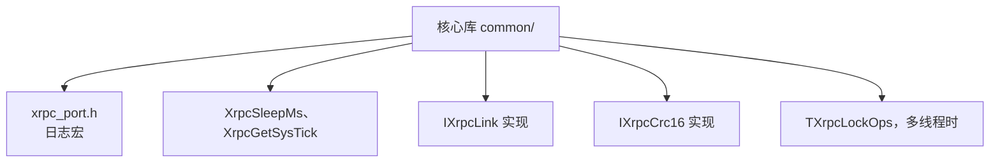

# port/ — 平台适配

核心库（`common/`）不依赖任何私有基础库，只要求部署方提供下面这些。用 `tools/xrpc_port_gen.py` 可以生成框架，只填虚接口。



| 要提供的 | 说明 |
| --- | --- |
| `xrpc_port.h` | 定义 `XRPC_LOG_T`、`XRPC_LOG_W`、`XRPC_LOG_E`，参数同 `printf`，可以定义成空。所在目录用 `-DXRPC_PORT_DIR=<目录>` 指定 |
| `XrpcSleepMs` | 休眠指定毫秒，声明在 `xrpc.h` |
| `XrpcGetSysTick` | 毫秒计数，允许 32 位回绕 |
| `IXrpcLink` | 链路收发，见 `xrpc_link.h`。总线上一个节点下线不能让整条链路报告断开 |
| `IXrpcCrc16` | 用 `TXrpcNodeSetCrc16` 注入，两端算法必须相同 |
| `TXrpcLockOps` | 调用线程和 `RunOnce` 线程不同时必须注入，三类锁是不同对象 |

基础类型来自 `common/include/xrpc/xrpc_types.h`。类型宽度不符的平台编译会失败。

最小的 `xrpc_port.h`：

```c
#ifndef XRPC_PORT_H
#define XRPC_PORT_H

#define XRPC_LOG_T(...) ((void)0)
#define XRPC_LOG_W(...) ((void)0)
#define XRPC_LOG_E(...) ((void)0)

#endif
```

`tools/xrpc_port_gen.py` 生成的 `port_include/xrpc_port.h` 就是一个实际例子。

## 接入 CAN、LIN 这类短帧总线

XRPC 的帧头有 28 字节，经典 CAN 单帧只有 8 字节，所以要在 `IXrpcLink` 里做分段。核心库看到的仍是完整的字节流。


| 要点 | 做法 |
| --- | --- |
| 分段 | 用 ISO-TP 这类成熟协议，不要自己发明 |
| 多节点同时发 | 接收端按发送方分别重组，交给核心库前不能把不同节点的字节混在一起 |
| 拓扑 | 链路配成 `topology: bus`，单播由寻址信封处理 |
| 帧长 | 按分段协议的上限配置 `max_frame` |
| 一个节点下线 | 不能让整条链路报告断开 |

CAN 总线上一次 `OnSend_` 要发很多短帧，这段时间会占住轮询线程。发送放进链路自己的队列，再由中断或任务逐帧发出。
