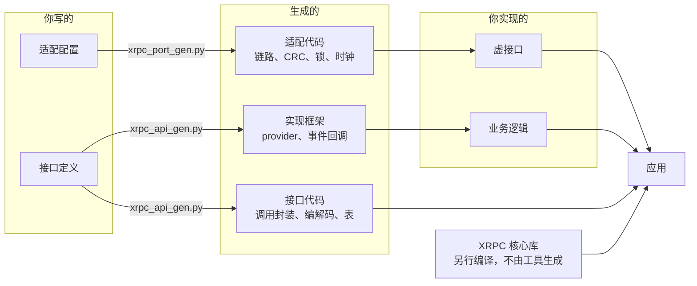
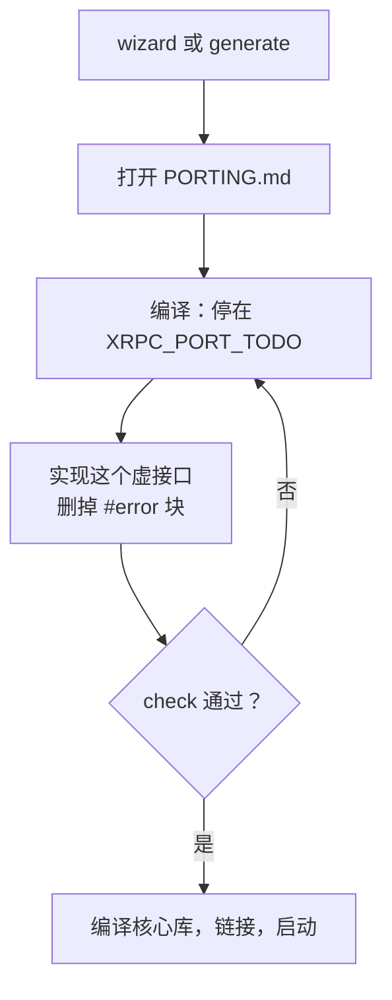
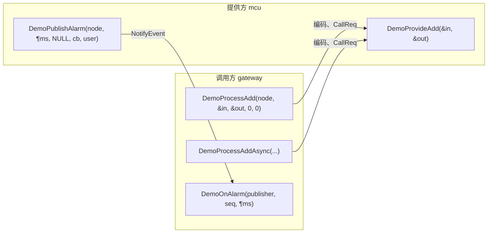
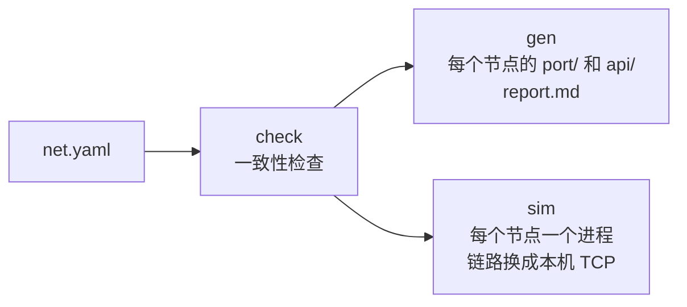
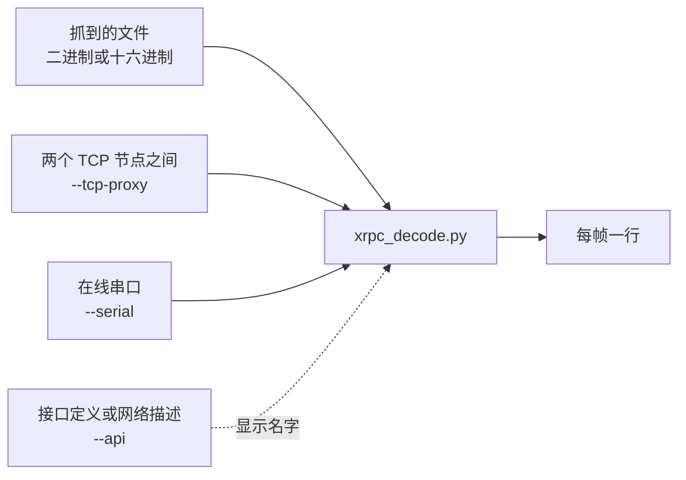

# tools/ — 代码生成和诊断工具

只依赖 Python 3 标准库，不用安装任何包。

```bash
python tools/xrpc_tool_gui.py
```

| 工具 | 解决什么 | 输入 | 输出 |
| --- | --- | --- | --- |
| `xrpc_tool_gui.py` | 图形界面，整合下面的工具 | 表单和编辑框 | 同下 |
| `xrpc_port_gen.py` | 把组件部署到一个节点 | 问答或 `xrpc_port.yaml` | 适配代码 + 接入说明 |
| `xrpc_api_gen.py` | 定义远程调用和发布订阅 | 接口定义 YAML | 类型化接口 + 实现框架 |
| `xrpc_net_gen.py` | 一份描述生成全网所有节点 | 网络描述 YAML | 每个节点的上面两份代码 + 网络报告 + PC 仿真 |
| `xrpc_decode.py` | 看懂线上字节 | 抓到的数据或在线链路 | 每帧一行的解码结果 |
| `xrpc_cli.py` | 不写 C 就能调用设备 | 接口定义 + 链路 | 调用结果、事件 |

节点多于一个时用 `xrpc_net_gen.py`，它把网络描述翻译给另外两个工具，单节点用法不变。

## 图形界面

单节点按前三页的顺序用，多节点直接用第 4 页。错误显示在底部的输出区，不会弹窗打断。


| 页 | 能做什么 |
| --- | --- |
| 适配代码 | 填节点配置，增删链路，打开或保存 `xrpc_port.yaml`，生成适配代码 |
| 虚接口检查 | 列出未实现的虚接口和位置，双击打开文件。生成后自动刷新 |
| 接口代码 | 打开、编辑、保存接口定义，校验后看过程、通知和 key，选节点生成 |
| 全网生成 | 打开、编辑、保存网络描述，检查后看节点、中继和帧缓冲，生成全部节点或 PC 仿真。不画拓扑图，拓扑图在 `report.md` |

界面只是外壳，生成逻辑和命令行是同一份代码，同样的配置输出完全相同。命令行适合放进 CI。



## 1. 适配代码生成：xrpc_port_gen.py

### 用法

```bash
python tools/xrpc_port_gen.py wizard --out my_port
```

```bash
python tools/xrpc_port_gen.py generate tools/examples/port_custom.yaml --out my_port
```

```bash
python tools/xrpc_port_gen.py check my_port
```

`wizard` 一问一答，并把答案存成 `xrpc_port.yaml`。`generate` 按配置文件生成。`check` 列出还没实现的虚接口，全部完成时退出码为 0，可以放进 CI。

### 引导流程



没实现的虚接口**编译不过**，错误信息写明要做什么，不会等到运行时才发现。想先把工程编过，定义 `XRPC_PORT_ALLOW_TODO`，但这时运行不起来。

### 生成什么

| 文件 | 内容 |
| --- | --- |
| `xrpc_port_node.h/.c` | 节点装配：`XrpcPortInit`、`XrpcPortNode`、`XrpcPortPoll`，所有缓冲静态分配 |
| `xrpc_port_link_<名字>.c` | 每条链路一个 `IXrpcLink` |
| `xrpc_port_crc16.c` | `IXrpcCrc16` |
| `xrpc_port_platform.c` | 睡眠、tick、日志、锁 |
| `port_include/xrpc_port.h` | 核心库包含的日志接口 |
| `xrpc_port.cmake` | 适配源码和头文件路径 |
| `PORTING.md` | 这个节点的待办清单和接入步骤 |

**不生成核心库的编译**：`xrpc_port.cmake` 里没有 `add_library`，也不引用 `common/*.c`。核心库由你编译：

```bash
cmake -S framework/xrpc -B build-xrpc -DXRPC_PORT_DIR=my_port/port_include
cmake --build build-xrpc
```

已存在的文件默认不覆盖，因为里面可能已经有你的实现。确实要重新生成时加 `--force`。

### 配置项

| 项 | 取值 | 说明 |
| --- | --- | --- |
| `node_id` | 必填 | 网络内唯一，不能是 0 或 0xFFFFFFFF |
| `protocol_version` | 默认 0x0200 | 必须与对端一致 |
| `platform` | `win32` `posix` `custom` | 前两个自动实现睡眠、tick、锁、轮询线程 |
| `threads` | `multi` `single` | 同步调用要有独立轮询线程，选 `multi` |
| `crc16` | `custom` `ccitt_false` `fixed` | 见下 |
| `call_slots` | 默认 4 | 0 表示不启用，也就不能用异步调用 |
| `frame_size` | 默认 2600 | 拼帧和发送缓存，决定最大帧长 |
| `recv_size` | 默认 1024 | 单次读取链路的缓冲 |
| `links[].name` | 必填 | 小写，用于函数名和文件名 |
| `links[].type` | `custom` `win_pipe` `tcp` `serial` | `win_pipe` 还要写 `pipe`、`server`；`tcp` 要写 `port`、`server`，可选 `host`；`serial` 要写 `device`，可选 `baud`（默认 115200） |
| `links[].topology` | `p2p` `bus` | 总线还可以写 `remote_capacity` |
| `links[].peer_node_id` | 默认 0 | 0 表示靠握手学习 |
| `links[].max_frame` | 默认 0 | 本链路单帧上限，0 表示不限 |
| `links[].advertise_max_recv` | 默认 false | Hello 是否通告接收上限 |

`crc16` 的选择：

| 取值 | 什么时候用 |
| --- | --- |
| `custom` | 要和已有设备互通，转调现有实现 |
| `ccitt_false` | 新项目两端都用它 |
| `fixed` | 只用于本机联调，等于关闭 CRC 校验 |

## 2. 接口代码生成：xrpc_api_gen.py

### 用法

```bash
python tools/xrpc_api_gen.py tools/examples/api_demo.yaml --list
```

```bash
python tools/xrpc_api_gen.py tools/examples/api_demo.yaml --node mcu --out gen/mcu
```

两端用**同一份**定义文件，按节点分别生成。

### 定义文件

完整示例见 [examples/api_demo.yaml](examples/api_demo.yaml)。

```yaml
module: demo

processes:
  - name: Add
    id: 0x00001001
    timeout_ms: 1000
    input:
      - {id: 1, name: a, type: i32}
      - {id: 2, name: b, type: i32}
    output:
      - {id: 1, name: sum, type: i32}

notifies:
  - name: Alarm
    id: 0x00002002
    need_ack: true
    params:
      - {id: 1, name: code, type: u32}

nodes:
  - name: mcu
    provides: [Add]
    publishes:
      - {notify: Alarm, links: [0], ack_nodes: [0x0A]}
  - name: gateway
    subscribes:
      - {notify: Alarm, publisher: 0x0B}
```

| 项 | 说明 |
| --- | --- |
| 参数 `type` | `u8` `i8` `u16` `i16` `u32` `i32` `u64` `i64`，`bytes` 和 `string` 还要写 `max_len` |
| 过程 `timeout_ms` | 调用时传 0 用这个值，都没写用组件默认的 5 秒 |
| 调用的 `retry` 参数 | 生成的同步、异步函数最后一个参数，超时后重发的次数。组件不判断幂等，不是幂等的函数填 0。要求节点配置了调用槽 |
| 过程 `key` | 可选，写死 key，见下 |
| 通知 `need_ack`、`timeout_ms`、`retry` | 发布时 `opt` 传 NULL 用这些默认值 |
| 节点 `provides` | 本节点实现的过程 |
| 节点 `calls` | 本节点调用的过程；不写时，不提供的过程都算远端 |
| 节点 `publishes` | `links` 发布到哪些链路，`ack_nodes` 必须应答的节点 |
| 节点 `subscribes` | `publisher` 期望的发布方，0 表示任意；`send_ack: false` 是观察者 |
| 节点 `bindings` | `{process, link, provider}`，把过程绑到链路和节点 |
| 节点 `relay` | `{routes, calls, knock_timeout_ms, call_timeout_ms}`，开启服务中继，见使用说明第 7 节；前两项默认 8，后两项 0 表示用组件默认值 |

### 生成什么

| 文件 | 内容 | 重新生成时 |
| --- | --- | --- |
| `demo_xrpc.h` | ID、key、参数结构、接口声明 | 覆盖 |
| `demo_xrpc.c` | 编解码、调用封装、过程表、通知表 | 覆盖 |
| `demo_xrpc_impl.c` | provider 和事件回调的框架 | **不覆盖**，只追加新函数的骨架 |

定义改动后，新增的函数会追加到 `_impl.c` 末尾，定义里已经删掉的函数会提示，但不会替你删。



| 生成的接口 | 用途 | 在哪个线程 |
| --- | --- | --- |
| `<模块>Process<名字>` | 同步调用 | 业务线程，不能在轮询线程 |
| `<模块>Process<名字>Async` | 异步调用，要启用调用槽 | 任意 |
| `<模块>Publish<名字>` | 发布事件 | 任意 |
| `<模块>Provide<名字>` | **你实现**：过程 | 轮询线程，不能阻塞 |
| `<模块>On<名字>` | **你实现**：收到事件 | 轮询线程，不能阻塞 |
| `<模块>XrpcRegister` | 注册过程表和通知表 | 启动时 |

### 启动

```c
XrpcPortInit();
DemoXrpcRegister(XrpcPortNode(), seq_seed);     /* seq_seed 取与启动相关的值 */
XrpcPortStartPollThread();

TDemoAddIn in = {40, 2};
TDemoAddOut out;
Int32 result = DemoProcessAdd(XrpcPortNode(), &in, &out, 0U, 0U);
```

### process_key

key 用来确认两端接口定义一致。工具对下面的规范文本做 CRC32：

```text
process|0x<ID>|in=<id>:<类型码>:<长度>,...|out=...
notify|0x<ID>|params=<id>:<类型码>:<长度>,...
```

改参数的 ID、类型、长度会换 key，改参数名不会。

> **与其他工具生成的设备互通时，key 要写死。** 别的工具算出来的值不保证相同。把现有的值写进定义的 `key:`，并保持 `id` 与参数编号一致。

## 3. 全网生成：xrpc_net_gen.py



### 用法

```bash
python tools/xrpc_net_gen.py check net.yaml
```

```bash
python tools/xrpc_net_gen.py gen net.yaml --out gen
```

```bash
python tools/xrpc_net_gen.py sim net.yaml --out sim
```

格式和完整示例见 代码框架设计，能跑的例子见 [examples/net_demo.yaml](examples/net_demo.yaml)。

只写节点、链路、过程、事件。中继开关、转发表、应答列表、链路序号、帧长和表项容量由工具算出，结果写在 `report.md`。`override` 可以覆盖容量，比算出来的小时报警告。

### 仿真

`sim` 不改网络描述，把所有链路换成 TCP，端口从 `--base-port`（默认 47000）开始，每条链路一个，先列出的节点当服务端。

```bash
cmake -S sim -B sim/build -G Ninja
```

```bash
cmake --build sim/build
```

每个节点得到一个可执行文件，在 `sim/build` 下，各开一个进程运行，启动顺序不限。业务写在 `<节点>/xrpc_sim_app.c` 和 `<节点>/api/*_impl.c`，重新生成不会覆盖。

## 4. 协议解码：xrpc_decode.py

联调时最先用到：把抓到的字节翻译成人能读的内容。



```bash
python tools/xrpc_decode.py capture.bin --api net.yaml
```

```text
#12 a(0x0A) -> CallReq Add(x=40, y=2) seq=41 ttl=255
#13 b(0x0B) -> CallRsp req_seq=41 Add ok sum=42 seq=90 ttl=255
#14 ?    -> CRC 错误，跳过 31 字节
```

| 选项 | 说明 |
| --- | --- |
| `--hex` | 输入是十六进制文本，`58 52`、`5852`、`0x58, 0x52` 都可以 |
| `--api` | 接口定义或网络描述，用来显示过程名、参数名和节点名 |
| `--crc` | `ccitt_false`（默认）、`none` 不校验、`fixed:0x5AA5` |
| `--tcp-proxy 47100:127.0.0.1:47000` | 监听 47100，转发到目标，只转发不修改。`[>]` 是连上来的一方发的，`[<]` 是目标发的 |
| `--serial COM3:115200` | 在线读串口，要先 `pip install pyserial`。串口被节点占用时打不开，这时用串口监听软件存下数据再解码 |

## 5. PC 调试节点：xrpc_cli.py

PC 作为普通节点接入网络。隔着中继的节点由相邻节点转发，不用改设备。

```bash
python tools/xrpc_cli.py --api net.yaml --tcp 127.0.0.1:47000 --node-id a call Add x=40 y=2
```

```bash
python tools/xrpc_cli.py --api net.yaml --serial COM3:115200 --node-id gateway listen
```

| 选项或命令 | 说明 |
| --- | --- |
| `--tcp 主机:端口` | 连到节点 |
| `--listen 端口` | 等节点连过来 |
| `--serial 设备:波特率` | 串口，要先 `pip install pyserial` |
| `--node-id` | 本节点的 ID，或网络描述里的节点名。要收事件应答时，填发布方 `ack_nodes` 里的节点 |
| `--crc` | `ccitt_false`（默认）或 `fixed:<值>`，要和网络一致 |
| `call 过程 名字=值 ...` | 调用。整数可以写十六进制，`bytes` 写十六进制文本 |
| `discover 过程` | 询问过程是否存在 |
| `listen [--seconds N]` | 接收事件并应答 |

退出码：0 成功，1 过程返回错误，2 配置或连接有问题。

这是调试工具，不是产品接口，不承诺兼容。只连一条点对点链路，不做中继，不提供过程。别的节点调用它时回 `-8`。

## 局限

- 链路模板只有 `custom`、`win_pipe`、`tcp` 和 `serial`，CAN、LIN 要自己实现 `IXrpcLink`，见[适配说明](../port/README.md)。`tcp` 只支持点对点，服务端一次接受一个连接。
- `serial` 用于 Windows 和 Linux 上的串口和 USB 虚拟串口，固定 8N1，不做流控，只支持点对点。MCU 上用 `custom`。POSIX 分支用伪终端测试，Windows 分支只编译过，都没有接过真实串口。
- 仿真不支持总线链路。
- 没有单向调用。不要结果时用生成的 Async 函数，见决策记录。
- 仿真的调用延迟取决于轮询周期：Windows 上 `Sleep(1)` 实际约 15ms，三跳调用约 100ms。
- `posix` 平台在 MinGW 上编译过，没有在 Linux 上运行过，`tcp` 模板的 POSIX 分支也一样。
- 生成的 `<模块>XrpcRegister` 用静态运行时数据，一个进程只能注册一个节点。
- 自带的 YAML 解析器只支持配置用到的子集：没有锚点、多文档和多行字符串。也可以直接写 JSON。
- 图形界面用 tkinter，部分 Linux 发行版要单独安装 `python3-tk`；只在 Windows 上试过。
